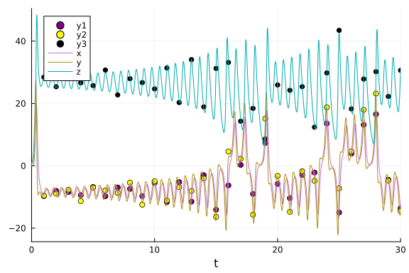
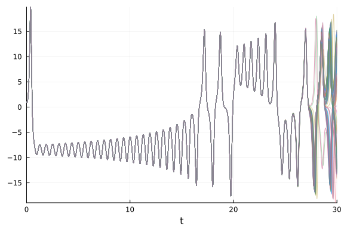
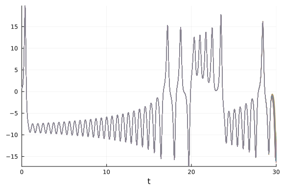
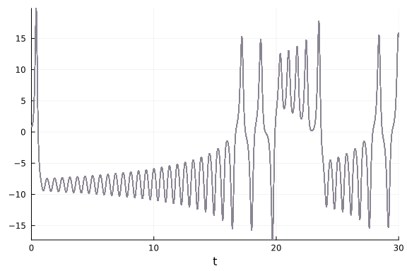

## Parameter estimation of Lorenz Equation using DiffEqBayes.jl

```julia
using DiffEqBayes
using DiffEqCallbacks, StaticArrays
using Distributions, StanSample, DynamicHMC, Turing
using OrdinaryDiffEq, RecursiveArrayTools, ParameterizedFunctions, DiffEqCallbacks
using Plots, LinearAlgebra
```


```julia
"""Print elapsed sampling time, allocated bytes, and the Turing chain."""
function display_ess_per_sec(chain, timed)
    println("Elapsed time: $(round(timed.time; digits=2)) seconds")
    println("Allocated: $(round(timed.bytes / 2^30; digits=3)) GiB ($(timed.bytes) bytes)")
    display(chain)
end

# Distributions requires a vector mean; sol[:, i] can be a scalar after ODE 7.
_mvn(u, σ) = MvNormal(
    let n = length(σ)
        μ = u isa AbstractVector ? collect(float.(u)) : [float(u)]
        length(μ) == n ? μ : fill(μ[1], n)
    end,
    Diagonal(σ .^ 2),
)

"""Extract and display Stan's internal timing from its CSV output files."""
function display_stan_timing(stan_result)
    sample_files = stan_result.model.sample_file
    for (chain_idx, f) in enumerate(sample_files)
        isfile(f) || continue
        lines = readlines(f)
        println("Chain $chain_idx timing (from Stan CSV):")
        for line in lines
            if startswith(line, "#") && occursin("Elapsed Time", line)
                println("  ", strip(line[2:end]))
            elseif startswith(line, "#") && occursin("seconds", line)
                println("  ", strip(line[2:end]))
            end
        end
    end
end
```

```
Main.var"##WeaveSandBox#277".display_stan_timing
```


```julia
gr(fmt = :png)
```

```
Plots.GRBackend()
```


#### Initializing the problem

```julia
g1 = @ode_def LorenzExample begin
    dx = σ*(y-x)
    dy = x*(ρ-z) - y
    dz = x*y - β*z
end σ ρ β
```

```
Main.var"##WeaveSandBox#277".LorenzExample{Main.var"##WeaveSandBox#277".var
"###ParameterizedDiffEqFunction#279", Main.var"##WeaveSandBox#277".var"###P
arameterizedTGradFunction#280", Main.var"##WeaveSandBox#277".var"###Paramet
erizedJacobianFunction#281", Nothing, Nothing, ModelingToolkitBase.System}(
Main.var"##WeaveSandBox#277".var"##ParameterizedDiffEqFunction#279", Linear
Algebra.UniformScaling{Bool}(true), nothing, Main.var"##WeaveSandBox#277".v
ar"##ParameterizedTGradFunction#280", Main.var"##WeaveSandBox#277".var"##Pa
rameterizedJacobianFunction#281", nothing, nothing, nothing, nothing, nothi
ng, nothing, nothing, [:x, :y, :z], :t, nothing, Model ##Parameterized#278:
Equations (3):
  3 standard: see equations(##Parameterized#278)
Unknowns (3): see unknowns(##Parameterized#278)
  x(t)
  y(t)
  z(t)
Parameters (3): see parameters(##Parameterized#278)
  σ
  ρ
  β, nothing, nothing)
```


```julia
r0 = [1.0; 0.0; 0.0]
tspan = (0.0, 30.0)
p = [10.0, 28.0, 2.66]
```

```
3-element Vector{Float64}:
 10.0
 28.0
  2.66
```


```julia
prob = ODEProblem(g1, r0, tspan, p)
sol = solve(prob, Tsit5())
```

```
retcode: Success
Interpolation: specialized 4th order "free" interpolation
t: 355-element Vector{Float64}:
  0.0
  3.5678604836301404e-5
  0.0012320942519312387
  0.00556932465348067
  0.012366524722957406
  0.021160814850103675
  0.033296251971569796
  0.04900115478366526
  0.06936892249678134
  0.09517047537763844
  ⋮
 29.383016799571845
 29.460494075076628
 29.540306930513268
 29.625471076888655
 29.723135438241798
 29.805484193360808
 29.910086909807717
 29.99928302640111
 30.0
u: 355-element Vector{Vector{Float64}}:
 [1.0, 0.0, 0.0]
 [0.9996434557625105, 0.0009988049817849054, 1.7814349300524496e-8]
 [0.9879653604576064, 0.03426824324278913, 2.0964175442932688e-5]
 [0.9500089426818266, 0.1514709435028955, 0.00040920017142123774]
 [0.9033877560315204, 0.32596836188271083, 0.001892216392693151]
 [0.8639680997970994, 0.5392700815038988, 0.005168731067070007]
 [0.8433235120785849, 0.8199540219704273, 0.0119181078390778]
 [0.8665761894886946, 1.178060982280894, 0.024523932292864075]
 [0.9699424017971061, 1.6684270372332624, 0.04902023715188545]
 [1.2120261198364632, 2.3949595105940595, 0.10071541720535906]
 ⋮
 [-11.953731623976742, -8.724911172152208, 34.75350663343156]
 [-8.414218124478245, -3.3997394618081014, 32.42494675534079]
 [-5.095020000229003, -2.072653537110552, 27.39746410268826]
 [-3.578767653386599, -2.916342234602008, 22.594599695010295]
 [-3.9132937007923942, -5.183232333060949, 18.662230583885023]
 [-5.62219113490472, -8.549611643866369, 17.379536103765123]
 [-9.796979599919887, -14.53093015590858, 21.494882238678578]
 [-13.15432518607142, -14.732570431860434, 31.42586687218547]
 [-13.165446107264613, -14.689326774867084, 31.504660801755886]
```


```julia
sr0 = SA[1.0; 0.0; 0.0]
tspan = (0.0, 30.0)
sp = SA[10.0, 28.0, 2.66]
sprob = ODEProblem{false, SciMLBase.FullSpecialize}(g1, sr0, tspan, sp)
sol = solve(sprob, Tsit5())
```

```
retcode: Success
Interpolation: specialized 4th order "free" interpolation
t: 355-element Vector{Float64}:
  0.0
  3.5678604836301404e-5
  0.0012320942519312387
  0.00556932465348067
  0.012366524722957406
  0.021160814850103675
  0.033296251971569796
  0.04900115478366526
  0.06936892249678134
  0.09517047537763844
  ⋮
 29.383016896164897
 29.460494173696
 29.540307024777988
 29.62547117109964
 29.72313561053084
 29.805484348246978
 29.91008712510907
 29.99928320804487
 30.0
u: 355-element Vector{StaticArraysCore.SVector{3, Float64}}:
 [1.0, 0.0, 0.0]
 [0.9996434557625105, 0.0009988049817849054, 1.7814349300524496e-8]
 [0.9879653604576064, 0.03426824324278913, 2.0964175442932688e-5]
 [0.9500089426818266, 0.1514709435028955, 0.00040920017142123774]
 [0.9033877560315204, 0.32596836188271083, 0.001892216392693151]
 [0.8639680997970994, 0.5392700815038988, 0.005168731067070007]
 [0.8433235120785849, 0.8199540219704273, 0.0119181078390778]
 [0.8665761894886946, 1.178060982280894, 0.024523932292864075]
 [0.9699424017971061, 1.6684270372332624, 0.04902023715188545]
 [1.2120261198364632, 2.3949595105940595, 0.10071541720535906]
 ⋮
 [-11.953728707099234, -8.724903559414773, 34.75350730511037]
 [-8.414213772728967, -3.399736204270524, 32.42494152319427]
 [-5.0950176680667125, -2.0726539133804285, 27.39745893707636]
 [-3.5787673480301443, -2.9163438983419585, 22.594595712232938]
 [-3.9132960668681473, -5.183237769500962, 18.66222616103544]
 [-5.622195731286272, -8.549619474241986, 17.379536947095986]
 [-9.796989656834683, -14.530940358320164, 21.4949007487875]
 [-13.154327787595237, -14.732559461298061, 31.42588636022459]
 [-13.165445843155602, -14.689326671922553, 31.50466026912453]
```


#### Generating data for bayesian estimation of parameters from the obtained solutions using the `Tsit5` algorithm by adding random noise to it.

```julia
t = collect(range(1, stop = 30, length = 30))
sig = 0.49
data = convert(Array, VectorOfArray([(sol(t[i]) + sig*randn(3)) for i in 1:length(t)]))
```

```
3×30 Matrix{Float64}:
 -9.69271  -8.02846  -8.40063   -9.39594  …  16.5353  -4.45959  -13.5884
 -9.58049  -8.91238  -7.65649  -11.2989      23.1859  -4.72553  -14.5461
 28.4096   25.3779   28.2925    26.6266      30.1962  22.253     30.6405
```


#### Plots of the generated data and the actual data.

```julia
Plots.scatter(t, data[1, :], markersize = 4, color = :purple)
Plots.scatter!(t, data[2, :], markersize = 4, color = :yellow)
Plots.scatter!(t, data[3, :], markersize = 4, color = :black)
plot!(sol)
```




#### Uncertainty Quantification plot is used to decide the tolerance for the differential equation.

```julia
cb = AdaptiveProbIntsUncertainty(5)
monte_prob = EnsembleProblem(prob)
sim = solve(
    monte_prob, Tsit5(), trajectories = 100, callback = cb, reltol = 1e-5, abstol = 1e-5)
plot(sim, vars = (0, 1), linealpha = 0.4)
```



```julia
cb = AdaptiveProbIntsUncertainty(5)
monte_prob = EnsembleProblem(prob)
sim = solve(
    monte_prob, Tsit5(), trajectories = 100, callback = cb, reltol = 1e-6, abstol = 1e-6)
plot(sim, vars = (0, 1), linealpha = 0.4)
```



```julia
cb = AdaptiveProbIntsUncertainty(5)
monte_prob = EnsembleProblem(prob)
sim = solve(
    monte_prob, Tsit5(), trajectories = 100, callback = cb, reltol = 1e-8, abstol = 1e-8)
plot(sim, vars = (0, 1), linealpha = 0.4)
```



```julia
priors = [truncated(Normal(10, 2), 1, 15), truncated(Normal(30, 5), 1, 45),
    truncated(Normal(2.5, 0.5), 1, 4)]
```

```
3-element Vector{Distributions.Truncated{Distributions.Normal{Float64}, Dis
tributions.Continuous, Float64, Float64, Float64}}:
 Truncated(Distributions.Normal{Float64}(μ=10.0, σ=2.0); lower=1.0, upper=1
5.0)
 Truncated(Distributions.Normal{Float64}(μ=30.0, σ=5.0); lower=1.0, upper=4
5.0)
 Truncated(Distributions.Normal{Float64}(μ=2.5, σ=0.5); lower=1.0, upper=4.
0)
```


## Using Stan.jl backend

Lorenz equation is a chaotic system hence requires very low tolerance to be estimated in a reasonable way, we use 1e-8 obtained from the uncertainty plots. Use of truncated priors is necessary to prevent Stan from stepping into negative and other improbable areas.

We use `adapt_delta = 0.85` (slightly above Stan's default of 0.8) consistently across the Stan and Turing backends for a fair comparison.
Stan infers a separate noise parameter per data dimension (3 for the 3D Lorenz system).

```julia
@time bayesian_result_stan = stan_inference(
    prob, :rk45, t, data, priors;
    solve_kwargs = Dict(:reltol => 1e-8, :abstol => 1e-8),
    sample_kwargs = Dict(:delta => 0.85),
    vars = (DiffEqBayes.StanODEData(), InverseGamma(2, 3)))
```

```
14359.102935 seconds (4.89 M allocations: 239.199 MiB, 0.00% gc time, 0.03%
 compilation time)
14388.879378 seconds (33.98 M allocations: 1.663 GiB, 0.00% gc time, 0.11% 
compilation time: 2% of which was recompilation)
1000×6 DataFrame
  Row │ sigma1.1  sigma1.2  sigma1.3  theta_1  theta_2  theta_3
      │ Float64   Float64   Float64   Float64  Float64  Float64
──────┼─────────────────────────────────────────────────────────
    1 │  6.22845   11.3498   7.93824  7.62997  23.6666  2.03611
    2 │  6.14876   11.1648   8.01161  7.61103  23.7056  2.03618
    3 │  6.22808   11.8151   8.1129   7.70348  23.6005  2.03676
    4 │  6.37299   11.428    8.07464  7.74501  23.6322  2.0398
    5 │  6.21385   12.0494   8.09854  7.70777  23.582   2.036
    6 │  6.47193   12.3461   7.87264  7.71413  23.664   2.04083
    7 │  6.57056   12.2662   8.01327  7.67235  23.6508  2.03829
    8 │  6.73797   12.468    8.2567   7.73241  23.6403  2.04027
  ⋮   │    ⋮         ⋮         ⋮         ⋮        ⋮        ⋮
  994 │  6.15482   11.0841   8.16703  7.12751  24.7464  1.9131
  995 │  6.08791   11.2688   8.11591  7.17329  24.6934  1.90428
  996 │  6.22838   11.2009   7.80523  7.17969  24.6423  1.89836
  997 │  6.12579   11.4956   7.64484  7.24835  24.5844  1.89578
  998 │  5.80987   11.9855   7.58341  7.3127   24.5185  1.89522
  999 │  5.73001   11.7633   7.67404  7.33637  24.5018  1.89603
 1000 │  5.76831   11.3105   7.62109  7.30038  24.5155  1.89393
                                                985 rows omitted
```


Stan's internal timing (excluding data serialization and CSV parsing):

```julia
display_stan_timing(bayesian_result_stan)
```

```
Chain 1 timing (from Stan CSV):
  Elapsed Time: 4308.66 seconds (Warm-up)
  10046.7 seconds (Sampling)
  14355.3 seconds (Total)
```


### Direct Turing.jl

We use per-dimension noise parameters (matching Stan) with `InverseGamma(2, 3)` priors on each `σ`.
The model solves the same static-array problem `sprob` with `Vern9` at `reltol = abstol = 1e-8` that the
DiffEqBayes Turing backend below is given, so the two runs differ only in how the Turing model is written.

```julia
@model function fitlorenz(data, prob)
    # Prior distributions.
    σ ~ filldist(InverseGamma(2, 3), 3)
    σ_param ~ truncated(Normal(10, 2), 1, 15)
    ρ ~ truncated(Normal(30, 5), 1, 45)
    β ~ truncated(Normal(2.5, 0.5), 1, 4)

    # Simulate Lorenz model.
    p = SA[σ_param, ρ, β]
    _prob = remake(prob, p = p)
    predicted = solve(_prob, Vern9(); saveat = t, reltol = 1e-8, abstol = 1e-8)

    # Observations.
    for i in axes(data, 2)
        data[:, i] ~ _mvn(predicted(t[i]), σ)
    end

    return nothing
end

model = fitlorenz(data, sprob)

# Warmup run to compile all code paths before timing
sample(model, Turing.NUTS(0.85), 10; progress = false)

timed_turing_direct = @timed chain = sample(model, Turing.NUTS(0.85), 10_000; progress = false)
chain
```

```
╭─FlexiChain (10000 iterations, 1 chain) ──────────────────────────────────
────╮
│ ↓ iter  = 1001:11000                                                     
    │
│ → chain = 1:1                                                            
    │
│                                                                          
    │
│ Parameters (4) ── AbstractPPL.VarName                                    
    │
│  Vector{Float64}  σ (3,)                                                 
    │
│  Float64          σ_param, ρ, β                                          
    │
│                                                                          
    │
│ Extras (14)                                                              
    │
│  Int64    n_steps, tree_depth                                            
    │
│  Bool     is_accept, numerical_error                                     
    │
│  Float64  acceptance_rate, log_density, hamiltonian_energy,              
    │
│           hamiltonian_energy_error, max_hamiltonian_energy_error, step_si
ze, │
│           nom_step_size, logprior, loglikelihood, logjoint               
    │
╰──────────────────────────────────────────────────────────────────────────
────╯
```


```julia
display_ess_per_sec(chain, timed_turing_direct)
```

```
Elapsed time: 3069.24 seconds
Allocated: 421.822 GiB (452927759664 bytes)
╭─FlexiChain (10000 iterations, 1 chain) ──────────────────────────────────
────╮
│ ↓ iter  = 1001:11000                                                     
    │
│ → chain = 1:1                                                            
    │
│                                                                          
    │
│ Parameters (4) ── AbstractPPL.VarName                                    
    │
│  Vector{Float64}  σ (3,)                                                 
    │
│  Float64          σ_param, ρ, β                                          
    │
│                                                                          
    │
│ Extras (14)                                                              
    │
│  Int64    n_steps, tree_depth                                            
    │
│  Bool     is_accept, numerical_error                                     
    │
│  Float64  acceptance_rate, log_density, hamiltonian_energy,              
    │
│           hamiltonian_energy_error, max_hamiltonian_energy_error, step_si
ze, │
│           nom_step_size, logprior, loglikelihood, logjoint               
    │
╰──────────────────────────────────────────────────────────────────────────
────╯
```


### Using Turing.jl backend

```julia
# DiffEqBayes captures `likelihood` inside its Turing model, so both calls below
# must pass the same callable for the warmup to compile the timed specialization.
lorenz_likelihood(u, p, t, σ) = _mvn(u, σ)

# Warmup run to compile all code paths before timing, matching the direct model above
turing_inference(
    sprob, Vern9(), t, data, priors;
    sample_args = (sampler = Turing.NUTS(0.85), num_samples = 10),
    solve_kwargs = Dict(:reltol => 1e-8, :abstol => 1e-8),
    likelihood = lorenz_likelihood,
    likelihood_dist_priors = [InverseGamma(2, 3), InverseGamma(2, 3), InverseGamma(2, 3)])

timed_turing_backend = @timed bayesian_result_turing = turing_inference(
    sprob, Vern9(), t, data, priors;
    sample_args = (sampler = Turing.NUTS(0.85), num_samples = 10_000),
    solve_kwargs = Dict(:reltol => 1e-8, :abstol => 1e-8),
    likelihood = lorenz_likelihood,
    likelihood_dist_priors = [InverseGamma(2, 3), InverseGamma(2, 3), InverseGamma(2, 3)])
bayesian_result_turing
```

```
╭─FlexiChain (10000 iterations, 1 chain) ──────────────────────────────────
────╮
│ ↓ iter  = 1001:11000                                                     
    │
│ → chain = 1:1                                                            
    │
│                                                                          
    │
│ Parameters (4) ── AbstractPPL.VarName                                    
    │
│  Float64          theta[1], theta[2], theta[3]                           
    │
│  Vector{Float64}  σ (3,)                                                 
    │
│                                                                          
    │
│ Extras (14)                                                              
    │
│  Int64    n_steps, tree_depth                                            
    │
│  Bool     is_accept, numerical_error                                     
    │
│  Float64  acceptance_rate, log_density, hamiltonian_energy,              
    │
│           hamiltonian_energy_error, max_hamiltonian_energy_error, step_si
ze, │
│           nom_step_size, logprior, loglikelihood, logjoint               
    │
╰──────────────────────────────────────────────────────────────────────────
────╯
```


The direct model above and this backend solve the same problem with the same sampler settings, and each
timed run follows a 10-draw warmup that compiles its sampling path. The divergent-transition counts printed
below show whether the two samplers took similar paths through the posterior; on this chaotic problem the
counts can differ by orders of magnitude, in which case the wall times are not like-for-like measurements
of the same trajectory:

```julia
println("Direct Turing model: $(round(timed_turing_direct.time; digits=2)) s, ",
    "$(round(timed_turing_direct.bytes / 2^30; digits=3)) GiB allocated, ",
    sum(chain[:numerical_error]), " divergent transitions")
println("DiffEqBayes backend: $(round(timed_turing_backend.time; digits=2)) s, ",
    "$(round(timed_turing_backend.bytes / 2^30; digits=3)) GiB allocated, ",
    sum(bayesian_result_turing[:numerical_error]), " divergent transitions")
println("Backend / direct: $(round(timed_turing_backend.time / timed_turing_direct.time; sigdigits=2))x time, ",
    "$(round(timed_turing_backend.bytes / timed_turing_direct.bytes; sigdigits=2))x allocated")
```

```
Direct Turing model: 3069.24 s, 421.822 GiB allocated, 857 divergent transi
tions
DiffEqBayes backend: 8074.22 s, 1162.961 GiB allocated, 11 divergent transi
tions
Backend / direct: 2.6x time, 2.8x allocated
```


### Using DynamicHMC.jl backend

```julia
@time bayesian_result_dynamichmc = dynamichmc_inference(
    prob, Tsit5(), t, data, priors; solve_kwargs = (reltol = 1e-8, abstol = 1e-8))
```

```
552.760865 seconds (192.04 M allocations: 18.854 GiB, 2.71% gc time, 1.97% 
compilation time)
(posterior = [(parameters = [4.697752598649291, 21.965158185371006, 1.66854
5496743354], σ = [7.38342337831187, 7.279218639528952, 7.49043016730585]), 
(parameters = [4.8447217940002, 21.851684269236817, 1.677614674986058], σ =
 [7.515119161835431, 7.666763868641636, 7.235578776691011]), (parameters = 
[4.72844711597368, 22.053166846467914, 1.6844596774003886], σ = [6.69153896
8484936, 8.50920271469932, 7.4019417612551415]), (parameters = [4.610673872
6984915, 21.980426578719815, 1.6616745831549438], σ = [6.741548287598121, 8
.082835562510041, 7.477372144722086]), (parameters = [4.641712498550828, 22
.059198236208545, 1.6698259274183866], σ = [6.77946654910855, 8.25430418789
069, 7.517424979054671]), (parameters = [4.591387004759307, 22.249994628645
176, 1.679098084064125], σ = [6.900853318784801, 8.427929976493846, 7.84045
5141984519]), (parameters = [4.588523224915479, 22.228312023175818, 1.68067
68538429633], σ = [6.893433931215722, 8.403488968344663, 7.888710187858041]
), (parameters = [4.595355824016725, 22.225184440023494, 1.6797182621140858
], σ = [7.3484658606253825, 8.120965914693516, 7.544803977165014]), (parame
ters = [4.569380963431411, 22.268867046232373, 1.6789094793840016], σ = [7.
658753199201719, 8.790551128001965, 6.767066768762526]), (parameters = [4.5
20059073011995, 22.26273733771215, 1.6654758328504073], σ = [7.640641475205
707, 8.716136564355931, 6.641912643824628])  …  (parameters = [7.0343373785
40341, 24.678074566822954, 1.9266968352946447], σ = [6.138547976416683, 10.
013303060268338, 7.7116240557213676]), (parameters = [7.034337378540341, 24
.678074566822954, 1.9266968352946447], σ = [6.138547976416683, 10.013303060
268338, 7.7116240557213676]), (parameters = [7.034337378540341, 24.67807456
6822954, 1.9266968352946447], σ = [6.138547976416683, 10.013303060268338, 7
.7116240557213676]), (parameters = [7.034337378540341, 24.678074566822954, 
1.9266968352946447], σ = [6.138547976416683, 10.013303060268338, 7.71162405
57213676]), (parameters = [7.034337378540341, 24.678074566822954, 1.9266968
352946447], σ = [6.138547976416683, 10.013303060268338, 7.7116240557213676]
), (parameters = [7.034337378540341, 24.678074566822954, 1.9266968352946447
], σ = [6.138547976416683, 10.013303060268338, 7.7116240557213676]), (param
eters = [7.034337378540341, 24.678074566822954, 1.9266968352946447], σ = [6
.138547976416683, 10.013303060268338, 7.7116240557213676]), (parameters = [
7.034337378540341, 24.678074566822954, 1.9266968352946447], σ = [6.13854797
6416683, 10.013303060268338, 7.7116240557213676]), (parameters = [7.0343373
78540341, 24.678074566822954, 1.9266968352946447], σ = [6.138547976416683, 
10.013303060268338, 7.7116240557213676]), (parameters = [7.034337378540341,
 24.678074566822954, 1.9266968352946447], σ = [6.138547976416683, 10.013303
060268338, 7.7116240557213676])], posterior_matrix = [1.5470842238558913 1.
5778898224350772 … 1.9508034968680537 1.9508034968680537; 3.089457479103199
7 3.0842780018311036 … 3.2059151800627874 3.2059151800627874; … ; 1.9850235
267133123 2.0368946056991426 … 2.3039145149477886 2.3039145149477886; 2.013
626228097031 1.979010353662177 … 2.042728808158583 2.042728808158583], tree
_statistics = DynamicHMC.TreeStatisticsNUTS[DynamicHMC.TreeStatisticsNUTS(-
331.4606859960974, 8, turning at positions -29:226, 0.5641280623838211, 255
, DynamicHMC.Directions(0x92a8a9e2)), DynamicHMC.TreeStatisticsNUTS(-332.69
184820577, 7, turning at positions -109:18, 0.23081770983679023, 127, Dynam
icHMC.Directions(0x2799a112)), DynamicHMC.TreeStatisticsNUTS(-334.188516985
37367, 8, turning at positions -219:36, 0.23865014167908932, 255, DynamicHM
C.Directions(0xfff96c24)), DynamicHMC.TreeStatisticsNUTS(-331.5473127600112
, 5, turning at positions 11:26, 0.4735696149187773, 47, DynamicHMC.Directi
ons(0x509710aa)), DynamicHMC.TreeStatisticsNUTS(-331.41884477347503, 4, tur
ning at positions -16:-19, 0.9001467977374731, 27, DynamicHMC.Directions(0x
e4fb7ee8)), DynamicHMC.TreeStatisticsNUTS(-328.8472797151834, 7, turning at
 positions -65:62, 0.8273723615433192, 127, DynamicHMC.Directions(0x9157bbb
e)), DynamicHMC.TreeStatisticsNUTS(-329.6475831664968, 6, turning at positi
ons 52:59, 0.06871672573780037, 119, DynamicHMC.Directions(0x8c1394c3)), Dy
namicHMC.TreeStatisticsNUTS(-331.4501137898888, 5, turning at positions -5:
-12, 0.8348336469361366, 39, DynamicHMC.Directions(0xaeae589b)), DynamicHMC
.TreeStatisticsNUTS(-332.790278943632, 6, turning at positions 99:114, 0.21
671540769815023, 127, DynamicHMC.Directions(0x81db13f2)), DynamicHMC.TreeSt
atisticsNUTS(-333.2970478949459, 5, turning at positions -24:-31, 0.5649023
47787276, 55, DynamicHMC.Directions(0x67b83b98))  …  DynamicHMC.TreeStatist
icsNUTS(-320.5541735981091, 0, divergence at position 1, 0.0, 1, DynamicHMC
.Directions(0x6bcaa175)), DynamicHMC.TreeStatisticsNUTS(-321.7296532679743,
 5, divergence at position 11, 2.539905238151943e-7, 33, DynamicHMC.Directi
ons(0x58641b69)), DynamicHMC.TreeStatisticsNUTS(-321.00408050630847, 5, tur
ning at positions 48:55, 1.5491165359956021e-9, 55, DynamicHMC.Directions(0
x5610ca7f)), DynamicHMC.TreeStatisticsNUTS(-320.67572271574824, 3, turning 
at positions -3:4, 8.006592193007575e-9, 7, DynamicHMC.Directions(0x5bb6a91
4)), DynamicHMC.TreeStatisticsNUTS(-321.88608786821953, 1, divergence at po
sition -3, 3.553314745651557e-6, 3, DynamicHMC.Directions(0x7f4b6b34)), Dyn
amicHMC.TreeStatisticsNUTS(-322.48512912013155, 1, divergence at position 2
, 4.650629786703409e-225, 2, DynamicHMC.Directions(0x0eaf8e53)), DynamicHMC
.TreeStatisticsNUTS(-324.78246829459687, 5, divergence at position 8, 3.505
232012671796e-5, 36, DynamicHMC.Directions(0xa2699fa3)), DynamicHMC.TreeSta
tisticsNUTS(-321.9651183930931, 2, divergence at position 6, 4.963652115343
212e-5, 7, DynamicHMC.Directions(0x6657813e)), DynamicHMC.TreeStatisticsNUT
S(-322.46140374468706, 1, divergence at position 2, 4.935109771049365e-86, 
2, DynamicHMC.Directions(0xb2a4700f)), DynamicHMC.TreeStatisticsNUTS(-325.9
797784737861, 3, divergence at position 12, 3.994328022746235e-8, 13, Dynam
icHMC.Directions(0x297cdf3e))], logdensities = [-328.2592029536249, -331.06
65774417257, -329.0949050284289, -330.5291256867349, -327.49121407317045, -
326.7123645127912, -328.2432218449867, -327.5508405484817, -327.94604513881
796, -329.37635112122155  …  -319.7056650444975, -319.7056650444975, -319.7
056650444975, -319.7056650444975, -319.7056650444975, -319.7056650444975, -
319.7056650444975, -319.7056650444975, -319.7056650444975, -319.70566504449
75], κ = Gaussian kinetic energy (Diagonal), √diag(M⁻¹): [0.100977083630159
27, 0.03960323315132634, 0.03765180770706258, 0.12298383144547288, 0.150805
44558210104, 0.12709635400384847], ϵ = 0.016337880637118996)
```


## Conclusion

Due to the chaotic nature of Lorenz Equation, it is a very hard problem to estimate as it has the property of exponentially increasing errors.
Its uncertainty plot demonstrates chaotic behavior and exhibits instability for different tolerance values. We use 1e-8 as the tolerance as it makes its uncertainty small enough to be trusted in the `(0,30)` time span.


## Appendix

These benchmarks are a part of the SciMLBenchmarks.jl repository, found at: [https://github.com/SciML/SciMLBenchmarks.jl](https://github.com/SciML/SciMLBenchmarks.jl). For more information on high-performance scientific machine learning, check out the SciML Open Source Software Organization [https://sciml.ai](https://sciml.ai).

To locally run this benchmark, do the following commands:
```
using SciMLBenchmarks
SciMLBenchmarks.weave_file("benchmarks/BayesianInference","DiffEqBayesLorenz.jmd")
```

Computer Information:

```
Julia Version 1.12.7
Commit 6d172b025e4 (2026-08-15 08:05 UTC)
Build Info:
  Official https://julialang.org release
Platform Info:
  OS: Linux (x86_64-linux-gnu)
  CPU: 128 × AMD EPYC 7502 32-Core Processor
  WORD_SIZE: 64
  LLVM: libLLVM-18.1.7 (ORCJIT, znver2)
  GC: Built with stock GC
Threads: 128 default, 1 interactive, 128 GC (on 128 virtual cores)
Environment:
  JULIA_NUM_THREADS = auto

```

Package Information:

```
Status `/julia/github-runners/amdci1-1/_work/SciMLBenchmarks.jl/SciMLBenchmarks.jl/benchmarks/BayesianInference/Project.toml`
  [6e4b80f9] BenchmarkTools v1.8.0
  [ebbdde9d] DiffEqBayes v3.16.2
⌃ [459566f4] DiffEqCallbacks v4.19.4
  [31c24e10] Distributions v0.25.131
  [bbc10e6e] DynamicHMC v3.6.1
  [1dea7af3] OrdinaryDiffEq v7.8.1
  [65888b18] ParameterizedFunctions v5.27.0
  [91a5bcdd] Plots v1.41.7
⌃ [731186ca] RecursiveArrayTools v4.5.1
  [31c91b34] SciMLBenchmarks v0.2.1 [loaded: `/julia/github-runners/amdci1-1/_work/SciMLBenchmarks.jl/SciMLBenchmarks.jl/src/SciMLBenchmarks.jl` (v0.2.1) expected `/home/crackauc/.julia/packages/SciMLBenchmarks/ceJyd/src/SciMLBenchmarks.jl` (v0.2.1)]
  [c1514b29] StanSample v7.10.3
⌃ [90137ffa] StaticArrays v1.9.20
⌃ [fce5fe82] Turing v0.46.1
  [37e2e46d] LinearAlgebra v1.12.0
Info Packages marked with ⌃ have new versions available and may be upgradable.
```

And the full manifest:

```
Status `/julia/github-runners/amdci1-1/_work/SciMLBenchmarks.jl/SciMLBenchmarks.jl/benchmarks/BayesianInference/Manifest.toml`
  [47edcb42] ADTypes v1.24.0
  [14f7f29c] AMD v0.5.4
  [621f4979] AbstractFFTs v1.5.0
⌃ [80f14c24] AbstractMCMC v5.16.0
⌃ [7a57a42e] AbstractPPL v0.15.5
  [6e696c72] AbstractPlutoDingetjes v1.4.1
  [1520ce14] AbstractTrees v0.4.5
  [7d9f7c33] Accessors v0.1.45
⌃ [79e6a3ab] Adapt v4.7.0
  [0bf59076] AdvancedHMC v0.8.7
  [5b7e9947] AdvancedMH v0.8.10
⌅ [576499cb] AdvancedPS v0.7.2
  [b5ca4192] AdvancedVI v0.7.0
  [66dad0bd] AliasTables v1.1.3
  [dce04be8] ArgCheck v2.5.0
  [ec485272] ArnoldiMethod v0.4.0
  [4fba245c] ArrayInterface v7.30.2
⌃ [4c555306] ArrayLayouts v1.12.2
⌃ [aae01518] BandedMatrices v1.12.0
  [198e06fe] BangBang v0.4.9
  [6e4b80f9] BenchmarkTools v1.8.0
  [e2ed5e7c] Bijections v0.2.2
  [76274a88] Bijectors v0.16.3
  [b2a6c25c] BinaryHeaps v1.1.0
  [caf10ac8] BipartiteGraphs v0.1.14
⌃ [8e7c35d0] BlockArrays v1.10.0
⌃ [70df07ce] BracketingNonlinearSolve v1.12.7
⌅ [336ed68f] CSV v0.10.17
⌃ [d360d2e6] ChainRulesCore v1.26.1
  [0ca39b1e] Chairmarks v1.3.1
  [9e997f8a] ChangesOfVariables v0.1.11
  [944b1d66] CodecZlib v0.7.9
  [35d6a980] ColorSchemes v3.31.0
⌃ [3da002f7] ColorTypes v0.12.1
  [c3611d14] ColorVectorSpace v0.11.0
⌃ [5ae59095] Colors v0.13.1
⌅ [861a8166] Combinatorics v1.0.2
  [38540f10] CommonSolve v0.2.14
  [bbf7d656] CommonSubexpressions v0.3.1
  [f70d9fcc] CommonWorldInvalidations v1.2.2
  [34da2185] Compat v4.18.1
  [5224ae11] CompatHelperLocal v0.1.29
  [b152e2b5] CompositeTypes v0.1.4
  [a33af91c] CompositionsBase v0.1.2
  [2569d6c7] ConcreteStructs v0.2.8
  [88cd18e8] ConsoleProgressMonitor v0.1.2
  [187b0558] ConstructionBase v1.6.0
  [d38c429a] Contour v0.6.3
  [a8cc5b0e] Crayons v4.2.0
  [9a962f9c] DataAPI v1.16.0
  [a93c6f00] DataFrames v1.8.2
  [864edb3b] DataStructures v0.19.6
  [e2d170a0] DataValueInterfaces v1.0.0
  [8bb1440f] DelimitedFiles v1.9.1
  [b429d917] DensityInterface v0.4.0
⌃ [2b5f629d] DiffEqBase v7.21.1
  [ebbdde9d] DiffEqBayes v3.16.2
⌃ [459566f4] DiffEqCallbacks v4.19.4
  [163ba53b] DiffResults v1.1.0
  [b552c78f] DiffRules v1.16.0
  [a0c0ee7d] DifferentiationInterface v0.7.21
  [0703355e] DimensionalData v0.30.2
  [b4f34e82] Distances v0.10.12
  [31c24e10] Distributions v0.25.131
⌅ [ffbed154] DocStringExtensions v0.9.5
⌃ [5b8099bc] DomainSets v0.8.1
  [bbc10e6e] DynamicHMC v3.6.1
⌃ [366bfd00] DynamicPPL v0.42.13
  [7c1d4256] DynamicPolynomials v0.6.8
  [cad2338a] EllipticalSliceSampling v2.0.0
  [4e289a0a] EnumX v1.0.7
⌃ [f151be2c] EnzymeCore v0.8.21
  [e2ba6199] ExprTools v0.1.11
  [55351af7] ExproniconLite v0.10.14
  [411431e0] Extents v0.1.6
⌃ [c87230d0] FFMPEG v0.4.5
  [7034ab61] FastBroadcast v1.4.0
  [9aa1b823] FastClosures v0.3.2
  [a4df4552] FastPower v1.5.0
  [48062228] FilePathsBase v0.9.24
⌃ [1a297f60] FillArrays v1.17.0
⌃ [64ca27bc] FindFirstFunctions v3.2.1
  [6a86dc24] FiniteDiff v2.33.0
⌅ [53c48c17] FixedPointNumbers v0.8.6
⌃ [4a37a8b9] FlexiChains v0.6.39
  [1fa38f19] Format v1.3.7
  [f6369f11] ForwardDiff v1.4.6
  [a85aefff] FunctionMaps v0.1.2
  [069b7b12] FunctionWrappers v1.1.3
  [77dc65aa] FunctionWrappersWrappers v1.13.0
⌃ [d9f16b24] Functors v0.5.3
⌃ [46192b85] GPUArraysCore v0.2.0
  [28b8d3ca] GR v0.73.27
⌃ [a0844989] Gamma v1.1.0
  [86223c79] Graphs v1.15.0
⌅ [eafb193a] Highlights v0.5.3
  [34004b35] HypergeometricFunctions v0.3.30
  [3263718b] ImplicitDiscreteSolve v2.3.0
  [d25df0c9] Inflate v0.1.5
  [22cec73e] InitialValues v0.3.1
⌅ [842dd82b] InlineStrings v1.4.6
  [18e54dd8] IntegerMathUtils v0.1.4
  [85a1e053] Interfaces v0.3.2
⌃ [8197267c] IntervalSets v0.7.14
  [3587e190] InverseFunctions v0.1.17
  [41ab1584] InvertedIndices v1.3.1
  [92d709cd] IrrationalConstants v0.2.6
  [82899510] IteratorInterfaceExtensions v1.0.0
  [1019f520] JLFzf v0.1.11
  [692b3bcd] JLLWrappers v1.8.0
⌅ [682c06a0] JSON v0.21.4
  [ae98c720] Jieko v0.2.1
⌅ [ccbc3e58] JumpProcesses v9.32.3
⌃ [ba0b0d4f] Krylov v0.10.10
  [2faa5264] LHLFactorization v2.2.2
  [b964fa9f] LaTeXStrings v1.4.1
  [23fbe1c1] Latexify v0.16.12
  [1fad7336] LazyStack v0.1.3
  [1d6d02ad] LeftChildRightSiblingTrees v0.3.0
  [6f1fad26] Libtask v0.9.19
⌃ [87fe0de2] LineSearch v0.1.18
⌃ [d3d80556] LineSearches v7.8.1
⌃ [7ed4a6bd] LinearSolve v5.17.3
  [6fdf6af0] LogDensityProblems v2.2.0
  [996a588d] LogDensityProblemsAD v1.13.1
⌅ [2ab3a3ac] LogExpFunctions v0.3.29
  [e6f89c97] LoggingExtras v1.2.0
  [be115224] MCMCDiagnosticTools v0.3.19
  [e80e1ace] MLJModelInterface v1.12.1
  [1914dd2f] MacroTools v0.5.16
  [dbb5928d] MappedArrays v0.4.3
  [bb5d69b7] MaybeInplace v0.1.8
  [442fdcdd] Measures v0.3.3
  [e1d29d7a] Missings v1.2.0
  [dbe65cb8] MistyClosures v2.1.0
⌃ [961ee093] ModelingToolkit v11.43.1
⌃ [7771a370] ModelingToolkitBase v1.71.2
⌃ [6bb917b9] ModelingToolkitTearing v1.20.6
⌅ [2e0e35c7] Moshi v0.3.9
  [46d2c3a1] MuladdMacro v0.2.7
⌃ [102ac46a] MultivariatePolynomials v0.5.19
⌃ [ffc61752] Mustache v1.0.21 [loaded: v1.1.0]
⌃ [d8a4904e] MutableArithmetics v1.8.0
  [d41bc354] NLSolversBase v8.0.1
  [77ba4419] NaNMath v1.1.4
  [d9ec5142] NamedTupleTools v0.14.3
⌃ [8913a72c] NonlinearSolve v4.30.0
⌃ [be0214bd] NonlinearSolveBase v2.49.5
⌃ [5959db7a] NonlinearSolveFirstOrder v2.6.1
  [9a2c21bd] NonlinearSolveQuasiNewton v1.15.3
  [26075421] NonlinearSolveSpectralMethods v1.8.3
  [6fe1bfb0] OffsetArrays v1.17.0
⌃ [429524aa] Optim v2.3.1
  [3bd65402] Optimisers v0.4.9
  [7f7a1694] Optimization v5.9.1
⌃ [bca83a33] OptimizationBase v5.6.1
  [36348300] OptimizationOptimJL v0.4.21
⌅ [bac558e1] OrderedCollections v1.8.2 [loaded: v2.0.3]
  [1dea7af3] OrdinaryDiffEq v7.8.1
⌃ [6ad6398a] OrdinaryDiffEqBDF v2.4.9
⌃ [bbf590c4] OrdinaryDiffEqCore v4.17.2
  [50262376] OrdinaryDiffEqDefault v2.6.2
⌃ [4302a76b] OrdinaryDiffEqDifferentiation v3.12.0
⌃ [127b3ac7] OrdinaryDiffEqNonlinearSolve v2.9.8
⌃ [43230ef6] OrdinaryDiffEqRosenbrock v2.7.3
  [b4bd8bb3] OrdinaryDiffEqRosenbrockTableaus v2.4.2
⌃ [2d112036] OrdinaryDiffEqSDIRK v2.9.4
⌃ [b1df2697] OrdinaryDiffEqTsit5 v2.1.4
⌃ [79d7bb75] OrdinaryDiffEqVerner v2.4.1
  [90014a1f] PDMats v0.11.41
  [65888b18] ParameterizedFunctions v5.27.0
⌅ [d96e819e] Parameters v0.12.3
⌅ [69de0a69] Parsers v2.8.8
⌃ [569bd051] PartitionedDistributions v0.1.0
  [ccf2f8ad] PlotThemes v3.3.0
⌃ [995b91a9] PlotUtils v1.4.4
  [91a5bcdd] Plots v1.41.7
  [e409e4f3] PoissonRandom v0.4.13
  [2dfb63ee] PooledArrays v1.4.3
  [85a6dd25] PositiveFactorizations v0.2.4
  [d236fae5] PreallocationTools v1.7.1
  [aea7be01] PrecompileTools v1.3.4
  [21216c6a] Preferences v1.6.0
⌃ [08abe8d2] PrettyTables v3.4.8
  [27ebfcd6] Primes v0.5.7
  [33c8b6b6] ProgressLogging v0.1.6
  [92933f4c] ProgressMeter v1.11.0
  [43287f4e] PtrArrays v1.4.0
⌃ [0c0d3e7f] PureKLU v1.5.0
  [1fd47b50] QuadGK v2.11.3
  [74087812] Random123 v1.7.1
  [e6cf234a] RandomNumbers v1.6.0
  [988b38a3] ReadOnlyArrays v0.2.0
  [795d4caa] ReadOnlyDicts v1.0.1
⌃ [3cdcf5f2] RecipesBase v1.3.4
  [01d81517] RecipesPipeline v0.6.12
⌃ [731186ca] RecursiveArrayTools v4.5.1
  [189a3867] Reexport v1.2.2
  [05181044] RelocatableFolders v1.0.1
  [ae029012] Requires v1.3.1
  [9fe22ead] RespecializeParams v1.3.0
  [79098fc4] Rmath v0.9.0
⌃ [f2b01f46] Roots v3.0.8
⌃ [7e49a35a] RuntimeGeneratedFunctions v0.5.26
⌃ [9dfe8606] SCCNonlinearSolve v1.15.3
⌅ [26aad666] SSMProblems v0.6.1
⌃ [0bca4576] SciMLBase v3.54.0
  [31c91b34] SciMLBenchmarks v0.2.1 [loaded: `/julia/github-runners/amdci1-1/_work/SciMLBenchmarks.jl/SciMLBenchmarks.jl/src/SciMLBenchmarks.jl` (v0.2.1) expected `/home/crackauc/.julia/packages/SciMLBenchmarks/ceJyd/src/SciMLBenchmarks.jl` (v0.2.1)]
⌃ [19f34311] SciMLJacobianOperators v0.1.19
  [a6db7da4] SciMLLogging v2.1.0
⌃ [c0aeaf25] SciMLOperators v1.30.0
  [431bcebd] SciMLPublic v1.3.0
⌃ [53ae85a6] SciMLStructures v1.10.5
  [30f210dd] ScientificTypesBase v3.1.0
  [6c6a2e73] Scratch v1.3.0
  [91c51154] SentinelArrays v1.4.10
  [efcf1570] Setfield v1.1.2
  [992d4aef] Showoff v1.1.1
⌃ [727e6d20] SimpleNonlinearSolve v2.14.5
  [699a6c99] SimpleTraits v0.9.6
  [a2af1166] SortingAlgorithms v1.2.3
  [a57abbd0] SparseColumnPivotedQR v2.1.8
⌃ [9f842d2f] SparseConnectivityTracer v1.2.3
⌃ [0a514795] SparseMatrixColorings v0.4.28
  [276daf66] SpecialFunctions v2.9.0
⌃ [860ef19b] StableRNGs v1.0.4
  [d0ee94f6] StanBase v4.12.4
  [c1514b29] StanSample v7.10.3
  [0c0c59c1] StarAlgebras v0.3.0
  [64909d44] StateSelection v1.11.1
⌃ [90137ffa] StaticArrays v1.9.20
  [1e83bf80] StaticArraysCore v1.4.4
⌃ [64bff920] StatisticalTraits v3.5.0
  [10745b16] Statistics v1.11.5
  [82ae8749] StatsAPI v1.8.0
  [2913bbd2] StatsBase v0.34.13
⌅ [4c63d2b9] StatsFuns v1.5.3
⌃ [5e0ebb24] Strided v2.6.4
⌃ [4db3bf67] StridedViews v0.5.2
  [69024149] StringEncodings v0.3.7
⌅ [892a3eda] StringManipulation v0.5.0
  [2efcf032] SymbolicIndexingInterface v0.3.55
⌃ [19f23fe9] SymbolicLimits v1.2.1
⌃ [d1185830] SymbolicUtils v4.46.6
⌃ [0c5d862f] Symbolics v7.39.2
  [ab02a1b2] TableOperations v1.2.0
  [3783bdb8] TableTraits v1.0.1
  [bd369af6] Tables v1.14.0
  [ed4db957] TaskLocalValues v0.1.3
  [02d47bb6] TensorCast v0.4.9
  [62fd8b95] TensorCore v0.1.1
  [8ea1fca8] TermInterface v2.0.0
  [5d786b92] TerminalLoggers v0.1.8
⌃ [a759f4b9] TimerOutputs v1.2.1
  [3bb67fe8] TranscodingStreams v0.11.3
  [84d833dd] TransformVariables v0.8.26
  [f9bc47f6] TransformedLogDensities v1.1.1
  [24ddb15e] TransmuteDims v0.1.17
  [781d530d] TruncatedStacktraces v1.4.0
⌃ [9d95972d] TupleTools v1.6.0
⌃ [fce5fe82] Turing v0.46.1
  [3a884ed6] UnPack v1.0.2
  [1cfade01] UnicodeFun v0.4.1
  [41fe7b60] Unzip v0.2.0
  [d30d5f5c] WeakCacheSets v0.1.0
⌅ [ea10d353] WeakRefStrings v1.4.3
  [44d3d7a6] Weave v0.10.12
  [76eceee3] WorkerUtilities v1.6.1
⌃ [ddb6d928] YAML v0.4.16 [loaded: v0.4.17]
  [6e34b625] Bzip2_jll v1.0.9+0
⌃ [83423d85] Cairo_jll v1.18.7+0
  [ee1fde0b] Dbus_jll v1.16.2+0
  [2702e6a9] EpollShim_jll v0.0.20230411+1
  [2e619515] Expat_jll v2.8.4+0
⌅ [b22a6f82] FFMPEG_jll v8.1.2+0
  [a3f928ae] Fontconfig_jll v2.17.1+0
  [d7e528f0] FreeType2_jll v2.14.3+1
  [559328eb] FriBidi_jll v1.0.17+0
  [0656b61e] GLFW_jll v3.5.1+0
  [d2c73de3] GR_jll v0.73.27+0
⌅ [b0724c58] GettextRuntime_jll v0.22.4+0
  [61579ee1] Ghostscript_jll v9.55.1+0
  [7746bdde] Glib_jll v2.88.3+0
  [3b182d85] Graphite2_jll v1.3.16+0
  [2e76f6c2] HarfBuzz_jll v100.14004.0+0
  [1d5cc7b8] IntelOpenMP_jll v2025.2.0+0
  [aacddb02] JpegTurbo_jll v3.2.0+1
  [c1c5ebd0] LAME_jll v3.100.3+0
  [88015f11] LERC_jll v4.2.0+0
  [1d63c593] LLVMOpenMP_jll v23.1.1+0
⌅ [e9f186c6] Libffi_jll v3.4.7+0
  [7e76a0d4] Libglvnd_jll v1.7.1+1
  [94ce4f54] Libiconv_jll v1.18.0+0
⌃ [4b2f31a3] Libmount_jll v2.42.0+0
  [89763e89] Libtiff_jll v4.7.3+0
  [38a345b3] Libuuid_jll v2.42.0+0
  [856f044c] MKL_jll v2025.2.0+0
  [e7412a2a] Ogg_jll v1.3.6+0
  [efe28fd5] OpenSpecFun_jll v0.5.6+0
  [91d4177d] Opus_jll v1.6.1+0
  [36c8627f] Pango_jll v1.58.2+0
  [30392449] Pixman_jll v0.46.4+0
  [c0090381] Qt6Base_jll v6.10.2+2
  [629bc702] Qt6Declarative_jll v6.10.2+2
  [ce943373] Qt6ShaderTools_jll v6.10.2+1
  [6de9746b] Qt6Svg_jll v6.10.2+0
  [e99dba38] Qt6Wayland_jll v6.10.2+1
  [f50d1b31] Rmath_jll v0.5.2+0
  [a44049a8] Vulkan_Loader_jll v1.3.243+0
  [a2964d1f] Wayland_jll v1.24.0+0
  [ffd25f8a] XZ_jll v5.8.4+0
  [f67eecfb] Xorg_libICE_jll v1.1.2+0
  [c834827a] Xorg_libSM_jll v1.2.6+0
  [4f6342f7] Xorg_libX11_jll v1.8.13+0
  [0c0b7dd1] Xorg_libXau_jll v1.0.13+0
  [935fb764] Xorg_libXcursor_jll v1.2.4+0
  [a3789734] Xorg_libXdmcp_jll v1.1.6+0
  [1082639a] Xorg_libXext_jll v1.3.8+0
  [d091e8ba] Xorg_libXfixes_jll v6.0.2+0
  [a51aa0fd] Xorg_libXi_jll v1.8.4+0
  [d1454406] Xorg_libXinerama_jll v1.1.7+0
  [ec84b674] Xorg_libXrandr_jll v1.5.6+0
  [ea2f1a96] Xorg_libXrender_jll v0.9.12+0
  [a65dc6b1] Xorg_libpciaccess_jll v0.19.0+0
  [c7cfdc94] Xorg_libxcb_jll v1.17.1+0
  [cc61e674] Xorg_libxkbfile_jll v1.2.0+0
  [e920d4aa] Xorg_xcb_util_cursor_jll v0.1.6+0
  [12413925] Xorg_xcb_util_image_jll v0.4.1+0
  [2def613f] Xorg_xcb_util_jll v0.4.1+0
  [975044d2] Xorg_xcb_util_keysyms_jll v0.4.1+0
  [0d47668e] Xorg_xcb_util_renderutil_jll v0.3.10+0
  [c22f9ab0] Xorg_xcb_util_wm_jll v0.4.2+0
⌃ [35661453] Xorg_xkbcomp_jll v1.4.7+0
⌃ [33bec58e] Xorg_xkeyboard_config_jll v2.47.0+2
  [c5fb5394] Xorg_xtrans_jll v1.6.0+0
  [3161d3a3] Zstd_jll v1.5.7+1
  [35ca27e7] eudev_jll v3.2.14+0
⌅ [214eeab7] fzf_jll v0.61.1+0
⌃ [a4ae2306] libaom_jll v3.14.1+0
  [0ac62f75] libass_jll v0.17.5+0
  [1183f4f0] libdecor_jll v0.2.2+0
  [8e53e030] libdrm_jll v2.4.134+0
  [2db6ffa8] libevdev_jll v1.13.4+0
  [f638f0a6] libfdk_aac_jll v2.0.4+0
  [36db933b] libinput_jll v1.28.1+0
⌃ [b53b4c65] libpng_jll v1.6.58+0
  [9a156e7d] libva_jll v2.23.0+0
  [f27f6e37] libvorbis_jll v1.3.8+0
  [009596ad] mtdev_jll v1.1.7+0
⌃ [1317d2d5] oneTBB_jll v2022.3.0+0
⌅ [1270edf5] x264_jll v10164.0.1+0
  [dfaa095f] x265_jll v4.1.0+0
  [d8fb68d0] xkbcommon_jll v1.13.0+0
  [0dad84c5] ArgTools v1.1.2
  [56f22d72] Artifacts v1.11.0
  [2a0f44e3] Base64 v1.11.0
  [ade2ca70] Dates v1.11.0
  [8ba89e20] Distributed v1.11.0
  [f43a241f] Downloads v1.7.0
  [7b1f6079] FileWatching v1.11.0
  [9fa8497b] Future v1.11.0
  [b77e0a4c] InteractiveUtils v1.11.0
  [ac6e5ff7] JuliaSyntaxHighlighting v1.12.0
  [4af54fe1] LazyArtifacts v1.11.0
  [b27032c2] LibCURL v0.6.4
  [76f85450] LibGit2 v1.11.0
  [8f399da3] Libdl v1.11.0
  [37e2e46d] LinearAlgebra v1.12.0
  [56ddb016] Logging v1.11.0
  [d6f4376e] Markdown v1.11.0
  [a63ad114] Mmap v1.11.0
  [ca575930] NetworkOptions v1.3.0
  [44cfe95a] Pkg v1.12.1
  [de0858da] Printf v1.11.0
  [9abbd945] Profile v1.11.0
  [3fa0cd96] REPL v1.11.0
  [9a3f8284] Random v1.11.0
  [ea8e919c] SHA v0.7.0
  [9e88b42a] Serialization v1.11.0
  [6462fe0b] Sockets v1.11.0
  [2f01184e] SparseArrays v1.12.0
  [f489334b] StyledStrings v1.11.0
  [4607b0f0] SuiteSparse
  [fa267f1f] TOML v1.0.3
  [a4e569a6] Tar v1.10.0
  [8dfed614] Test v1.11.0
  [cf7118a7] UUIDs v1.11.0
  [4ec0a83e] Unicode v1.11.0
  [e66e0078] CompilerSupportLibraries_jll v1.3.1+2
  [deac9b47] LibCURL_jll v8.15.0+0
  [e37daf67] LibGit2_jll v1.9.0+0
  [29816b5a] LibSSH2_jll v1.11.3+1
  [14a3606d] MozillaCACerts_jll v2025.11.4
  [4536629a] OpenBLAS_jll v0.3.29+0
  [05823500] OpenLibm_jll v0.8.7+0
  [458c3c95] OpenSSL_jll v3.5.6+0
  [efcefdf7] PCRE2_jll v10.44.0+1
  [bea87d4a] SuiteSparse_jll v7.8.3+2
  [83775a58] Zlib_jll v1.3.1+2
  [8e850b90] libblastrampoline_jll v5.15.0+0
  [8e850ede] nghttp2_jll v1.64.0+1
  [3f19e933] p7zip_jll v17.7.0+0
Info Packages marked with ⌃ and ⌅ have new versions available. Those with ⌃ may be upgradable, but those with ⌅ are restricted by compatibility constraints from upgrading. To see why use `status --outdated -m`
```

