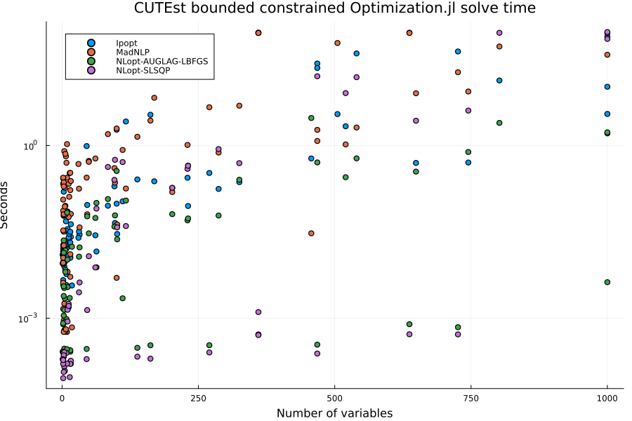
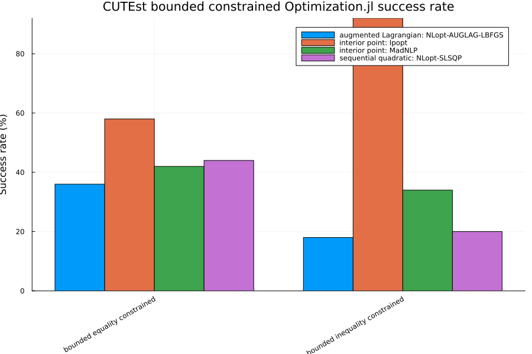
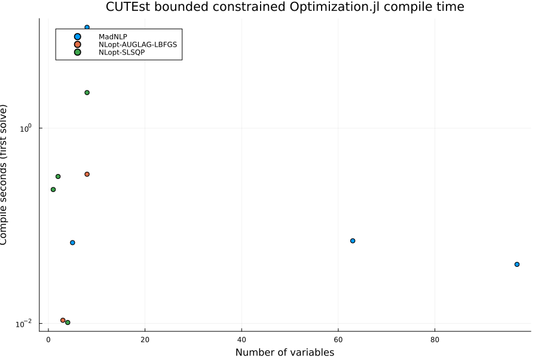
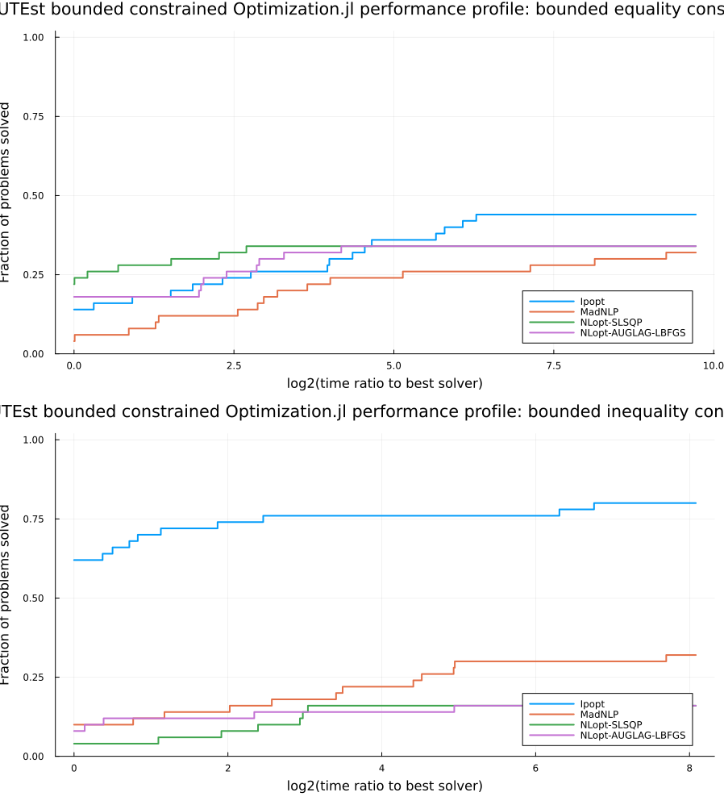
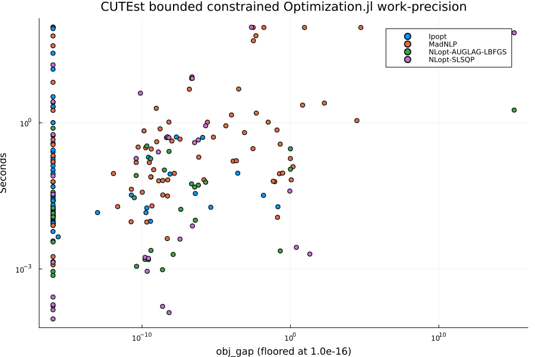

# CUTEst Bounded Constrained Optimization.jl Benchmarks

This benchmark runs constrained problems from the
[CUTEst](https://github.com/JuliaSmoothOptimizers/CUTEst.jl) test set through the
Optimization.jl interface using `OptimizationNLPModels`. Two candidate pools are used:

  - equality constrained: `CUTEst.select_sif_problems(min_con = 1, only_equ_con = true)`
  - inequality constrained: `CUTEst.select_sif_problems(min_con = 1, only_ineq_con = true)`

`min_con = 1` requires at least one general (linear or nonlinear) constraint,
`only_equ_con` keeps problems whose constraints are all equalities, and `only_ineq_con` keeps
problems with no equality constraints. The bounded page includes every problem with at least
one variable bound, including problems that also have free variables. The companion
`CUTEst_unbounded` page contains problems whose variables are all free. These categories are
disjoint and cover the eligible equality and inequality pools.

All four CUTEst pages in this folder share the harness in `cutest_benchmark_utils.jl`,
which defines the selection constants, the solver constructors, the run loop, and the
summary and plotting helpers. The prose below describes the harness as it stands;
refinements to the solver sets, solution-quality metrics, performance profiles, problem
selection, and timing methodology are tracked in #1857.

## Setup

```julia
ENV["GKSwstype"] = "100"

using CUTEst
using DataFrames
using Plots
using StatsPlots
using StatsBase: countmap
using Statistics
using Printf

include(joinpath(isdefined(Main, :WEAVE_ARGS) ? WEAVE_ARGS[:folder] : @__DIR__,
    "cutest_benchmark_utils.jl"))
```

```
plot_work_precision (generic function with 1 method)
```


## Problem selection

`select_safe_problems` sorts candidate names, filters the measured skip map and size limits,
then selects up to `MAX_PROBLEMS_PER_CATEGORY` across the 1–10, 11–100, and 101–`MAX_NVAR`
variable buckets. It samples each name-sorted bucket evenly, redistributing quotas when a
bucket has fewer candidates. Size strata come from CUTEst's public selection filters. The
selected and eligible counts are printed per bucket.

```julia
println("MAX_PROBLEMS_PER_CATEGORY = ", MAX_PROBLEMS_PER_CATEGORY)
println("MAX_NVAR = ", MAX_NVAR)
println("MAX_NCON = ", MAX_NCON)
println("SOLVE_MAXITERS = ", SOLVE_MAXITERS)
println("SOLVE_TIMEOUT_SECONDS = ", SOLVE_TIMEOUT_SECONDS)
println("KNOWN_BAD_PROBLEMS = ", join(sort(collect(keys(KNOWN_BAD_PROBLEMS))), ", "))

all_equality_candidates = collect(CUTEst.select_sif_problems(min_con = 1,
    only_equ_con = true, max_var = MAX_NVAR, max_con = MAX_NCON))
bounded_equality_candidates = collect(CUTEst.select_sif_problems(min_con = 1,
    only_equ_con = true, max_var = MAX_NVAR, max_con = MAX_NCON,
    custom_filter = p -> p["variables"]["free"] < p["variables"]["number"]))
free_equality_candidates = collect(CUTEst.select_sif_problems(min_con = 1,
    only_equ_con = true, only_free_var = true, max_var = MAX_NVAR, max_con = MAX_NCON))
assert_bounded_pool_coverage(all_equality_candidates, bounded_equality_candidates,
    free_equality_candidates, "Equality")

all_inequality_candidates = collect(CUTEst.select_sif_problems(min_con = 1,
    only_ineq_con = true, max_var = MAX_NVAR, max_con = MAX_NCON))
bounded_inequality_candidates = collect(CUTEst.select_sif_problems(min_con = 1,
    only_ineq_con = true, max_var = MAX_NVAR, max_con = MAX_NCON,
    custom_filter = p -> p["variables"]["free"] < p["variables"]["number"]))
free_inequality_candidates = collect(CUTEst.select_sif_problems(min_con = 1,
    only_ineq_con = true, only_free_var = true, max_var = MAX_NVAR, max_con = MAX_NCON))
assert_bounded_pool_coverage(all_inequality_candidates, bounded_inequality_candidates,
    free_inequality_candidates, "Inequality")

bounded_equality_problems = select_safe_problems(bounded_equality_candidates)
bounded_inequality_problems = select_safe_problems(bounded_inequality_candidates)

println("Selected bounded equality-constrained problems: ", length(bounded_equality_problems))
println(join(bounded_equality_problems, ", "))
println("Selected bounded inequality-constrained problems: ", length(bounded_inequality_problems))
println(join(bounded_inequality_problems, ", "))
```

```
MAX_PROBLEMS_PER_CATEGORY = 50
MAX_NVAR = 1000
MAX_NCON = 1000
SOLVE_MAXITERS = 1000
SOLVE_TIMEOUT_SECONDS = 90.0
KNOWN_BAD_PROBLEMS = 
Equality eligible candidates: all=350, bounded=156, free=194
Inequality eligible candidates: all=166, bounded=103, free=63
Selected 50 of 156 eligible problems (selected/eligible per bucket): 1-10 v
ars: 17/74, 11-100 vars: 17/44, 101-1000 vars: 16/38
Selected 50 of 103 eligible problems (selected/eligible per bucket): 1-10 v
ars: 30/83, 11-100 vars: 8/8, 101-1000 vars: 12/12
Selected bounded equality-constrained problems: 50
AIRCRFTA, HATFLDANE, HS111, HS41, HS60, HS80, KOEBHELBNE, LEVYMONE8, ODFITS
, PALMER1NE, PALMER3ANE, PALMER4ANE, PALMER5BNE, PALMER7ANE, PFIT2, SUPERSI
M, WEEDSNE, AVION2, CONCON, DALLASS, DECONVNE, DNIEPER, DUAL2, GOULDQP1, HI
MMELBJ, HS119, LEVYMONE, MCONCON, NYSTROM5C, PORTFL1, PORTFL4, ROBOT, SPANH
YD, WATER, ALJAZZAF, CHAIN, DIXCHLNV, DUAL3, EIGMAXC, EIGMINB, HIE1372D, KT
MODEL, QR3DBD, SMBANK, STEENBRB, STEENBRD, STEENBRG, TARGUS, ZAMB2-11, ZAMB
2-9
Selected bounded inequality-constrained problems: 50
AVGASA, BURKEHAN, CRESC4, EQC, HIMMELP3, HIMMELP6, HS103, HS106, HS15, HS17
, HS20, HS23, HS31, HS35, HS36, HS44, HS59, HS66, HS72, HS83, HS86, HS95, H
S98, LSQFIT, QC, S365, SIMPLLPA, STANCMIN, ZECEVIC2, ZY2, AIRPORT, DEMBO7, 
HIMMELBI, HS116, HS117, HS118, KISSING2, OPTPRLOC, CLEUVEN7, HYDROELM, HYDR
OELS, LEUVEN7, PRIMAL1, PRIMAL2, PRIMAL3, PRIMALC1, PRIMALC2, PRIMALC5, PRI
MALC8, SINROSNB
```


## Solvers

`CONSTRAINED_SOLVERS` currently contains only `Ipopt`, run through `OptimizationMOI`.
It is the only optimizer wired into the harness that accepts general equality and
inequality constraints via Optimization.jl; the Optim.jl algorithms on the unconstrained
page do not. Ipopt is configured with `max_iter = SOLVE_MAXITERS`,
`max_wall_time = SOLVE_TIMEOUT_SECONDS`, `tol = 1.0e-6`, `print_level = 0`, and
`hessian_approximation = "limited-memory"`. The limited-memory setting is used because
`OptimizationNLPModels` supplies the objective gradient and Hessian and the constraint
values and Jacobian from the CUTEst model, but not the constraint Hessians needed for an
exact Hessian of the Lagrangian. The same
iteration and time limits are also passed to `solve` as `maxiters` and `maxtime`. Adding
further constrained backends and an exact-Hessian Ipopt variant is item 1 of #1857.

## Run

Each (problem, solver) pair is solved once by `run_single_solve`. A row records the return
code as reported by Optimization.jl and a `status` of `OK` when `solve` returned,
`FAILED` when it threw, or `LOAD_FAILED` when the CUTEst problem could not be
constructed. The reported time is `sol.stats.time` when the solver provides a finite,
non-negative value, and otherwise the wall-clock time measured around problem construction
and `solve` together. `run_benchmarks` errors if a category yields no `OK` rows, so a
broken environment fails the build instead of producing an empty page.

```julia
bounded_results = vcat(
    run_benchmarks("bounded equality constrained", bounded_equality_problems,
        CONSTRAINED_SOLVERS),
    run_benchmarks("bounded inequality constrained", bounded_inequality_problems,
        CONSTRAINED_SOLVERS),
)

display(bounded_results)
```

```
Warming up solvers (JIT), results are not benchmarked:
  Ipopt              HS35                    
***************************************************************************
***
This program contains Ipopt, a library for large-scale nonlinear optimizati
on.
 Ipopt is released as open source code under the Eclipse Public License (EP
L).
         For more information visit https://github.com/coin-or/Ipopt
***************************************************************************
***

 OK Success first 19.905s compile 19.884s clean 0.011s (total 22.877s)
  MadNLP             HS35                     OK Success first 18.533s comp
ile 18.464s clean 0.064s (total 18.969s)
  NLopt-SLSQP        HS35                    CUTEst solve skipped for HS35 
with NLopt-SLSQP: constraint bounds are not of the cons(x) <= 0 / cons(x) =
= 0 form that OptimizationNLopt passes to NLopt
 SKIPPED SKIPPED first 0.000s compile 0.000s clean 0.000s (total 0.262s)
  NLopt-AUGLAG-LBFGS HS35                    CUTEst solve skipped for HS35 
with NLopt-AUGLAG-LBFGS: constraint bounds are not of the cons(x) <= 0 / co
ns(x) == 0 form that OptimizationNLopt passes to NLopt
 SKIPPED SKIPPED first 0.000s compile 0.000s clean 0.000s (total 0.270s)

Running bounded equality constrained benchmarks
Problems: 50
Solvers: Ipopt, MadNLP, NLopt-SLSQP, NLopt-AUGLAG-LBFGS
Per-solve time cap: 90.0 s
  Ipopt              AIRCRFTA                 OK Success 0.006s (first 0.00
8s, compile 0.000s, decode 0.274s)
  MadNLP             AIRCRFTA                 OK Success 0.001s (first 10.7
63s, compile 10.761s, decode 0.266s)
  NLopt-SLSQP        AIRCRFTA                 OK Success 0.000s (first 2.33
5s, compile 2.310s, decode 0.273s)
  NLopt-AUGLAG-LBFGS AIRCRFTA                 OK Success 0.001s (first 0.33
9s, compile 0.337s, decode 0.266s)
  Ipopt              HATFLDANE                OK Success 0.008s (first 0.01
0s, compile 0.000s, decode 0.265s)
  MadNLP             HATFLDANE                OK Success 0.002s (first 0.00
3s, compile 0.000s, decode 0.268s)
  NLopt-SLSQP        HATFLDANE                OK Success 0.000s (first 0.00
0s, compile 0.000s, decode 0.265s)
  NLopt-AUGLAG-LBFGS HATFLDANE                OK Success 0.001s (first 0.00
2s, compile 0.000s, decode 0.257s)
  Ipopt              HS111                    OK Success 0.035s (first 0.05
3s, compile 0.000s, decode 0.324s)
  MadNLP             HS111                    OK MaxIters 0.071s (first 0.0
97s, compile 0.000s, decode 0.323s)
  NLopt-SLSQP        HS111                    OK Success 0.001s (first 0.00
2s, compile 0.000s, decode 0.325s)
  NLopt-AUGLAG-LBFGS HS111                    OK Success 0.010s (first 0.01
1s, compile 0.000s, decode 0.322s)
  Ipopt              HS41                     OK Success 0.020s (first 0.01
6s, compile 0.000s, decode 0.262s)
  MadNLP             HS41                     OK Success 0.020s (first 0.02
1s, compile 0.000s, decode 0.259s)
  NLopt-SLSQP        HS41                     OK Failure 0.000s (first 0.01
1s, compile 0.010s, decode 0.260s)
  NLopt-AUGLAG-LBFGS HS41                     OK Failure 0.000s (first 0.00
0s, compile 0.000s, decode 0.255s)
  Ipopt              HS60                     OK Success 0.014s (first 0.01
6s, compile 0.000s, decode 0.275s)
  MadNLP             HS60                     OK Success 0.060s (first 0.06
1s, compile 0.000s, decode 0.279s)
  NLopt-SLSQP        HS60                     OK Success 0.000s (first 0.00
0s, compile 0.000s, decode 0.293s)
  NLopt-AUGLAG-LBFGS HS60                     OK Success 0.001s (first 0.00
1s, compile 0.000s, decode 0.286s)
  Ipopt              HS80                     OK Success 0.009s (first 0.01
1s, compile 0.000s, decode 0.301s)
  MadNLP             HS80                     OK Success 0.074s (first 0.14
9s, compile 0.067s, decode 0.290s)
  NLopt-SLSQP        HS80                     OK Success 0.000s (first 0.00
0s, compile 0.000s, decode 0.298s)
  NLopt-AUGLAG-LBFGS HS80                     OK Success 0.002s (first 0.00
2s, compile 0.000s, decode 0.291s)
  Ipopt              KOEBHELBNE               OK Failure 0.004s (first 0.00
5s, compile 0.000s, decode 0.278s)
  MadNLP             KOEBHELBNE               OK Infeasible 0.001s (first 0
.001s, compile 0.000s, decode 0.272s)
  NLopt-SLSQP        KOEBHELBNE              CUTEst solve skipped for KOEBH
ELBNE with NLopt-SLSQP: SLSQP supports at most nvar equality constraints
 SKIPPED SKIPPED 0.000s (first 0.000s, compile 0.000s, decode 0.280s)
  NLopt-AUGLAG-LBFGS KOEBHELBNE               OK Failure 0.022s (first 0.10
2s, compile 0.011s, decode 0.277s)
  Ipopt              LEVYMONE8                OK Failure 0.004s (first 0.00
5s, compile 0.000s, decode 0.276s)
  MadNLP             LEVYMONE8                OK Infeasible 0.001s (first 0
.001s, compile 0.000s, decode 0.279s)
  NLopt-SLSQP        LEVYMONE8               CUTEst solve skipped for LEVYM
ONE8 with NLopt-SLSQP: SLSQP supports at most nvar equality constraints
 SKIPPED SKIPPED 0.000s (first 0.000s, compile 0.000s, decode 0.274s)
  NLopt-AUGLAG-LBFGS LEVYMONE8                OK Failure 0.001s (first 0.00
1s, compile 0.000s, decode 0.275s)
  Ipopt              ODFITS                   OK Success 0.018s (first 0.01
9s, compile 0.000s, decode 0.275s)
  MadNLP             ODFITS                   OK Success 0.006s (first 0.00
7s, compile 0.000s, decode 0.279s)
  NLopt-SLSQP        ODFITS                   OK Success 0.001s (first 0.00
1s, compile 0.000s, decode 0.268s)
  NLopt-AUGLAG-LBFGS ODFITS                   OK Success 0.003s (first 0.00
4s, compile 0.000s, decode 0.270s)
  Ipopt              PALMER1NE                OK Failure 0.004s (first 0.00
5s, compile 0.000s, decode 0.257s)
  MadNLP             PALMER1NE                OK Infeasible 0.001s (first 0
.001s, compile 0.000s, decode 0.263s)
  NLopt-SLSQP        PALMER1NE               CUTEst solve skipped for PALME
R1NE with NLopt-SLSQP: SLSQP supports at most nvar equality constraints
 SKIPPED SKIPPED 0.000s (first 0.000s, compile 0.000s, decode 0.264s)
  NLopt-AUGLAG-LBFGS PALMER1NE                OK Failure 0.003s (first 0.00
4s, compile 0.000s, decode 0.261s)
  Ipopt              PALMER3ANE               OK Failure 0.004s (first 0.00
5s, compile 0.000s, decode 0.263s)
  MadNLP             PALMER3ANE               OK Infeasible 0.001s (first 0
.001s, compile 0.000s, decode 0.259s)
  NLopt-SLSQP        PALMER3ANE              CUTEst solve skipped for PALME
R3ANE with NLopt-SLSQP: SLSQP supports at most nvar equality constraints
 SKIPPED SKIPPED 0.000s (first 0.000s, compile 0.000s, decode 0.281s)
  NLopt-AUGLAG-LBFGS PALMER3ANE               OK Failure 0.007s (first 0.00
7s, compile 0.000s, decode 0.277s)
  Ipopt              PALMER4ANE               OK Failure 0.004s (first 0.00
5s, compile 0.000s, decode 0.271s)
  MadNLP             PALMER4ANE               OK Infeasible 0.001s (first 0
.001s, compile 0.000s, decode 0.266s)
  NLopt-SLSQP        PALMER4ANE              CUTEst solve skipped for PALME
R4ANE with NLopt-SLSQP: SLSQP supports at most nvar equality constraints
 SKIPPED SKIPPED 0.000s (first 0.000s, compile 0.000s, decode 0.260s)
  NLopt-AUGLAG-LBFGS PALMER4ANE               OK Failure 0.006s (first 0.00
7s, compile 0.000s, decode 0.269s)
  Ipopt              PALMER5BNE               OK Failure 0.004s (first 0.00
5s, compile 0.000s, decode 0.266s)
  MadNLP             PALMER5BNE               OK Infeasible 0.001s (first 0
.001s, compile 0.000s, decode 0.276s)
  NLopt-SLSQP        PALMER5BNE              CUTEst solve skipped for PALME
R5BNE with NLopt-SLSQP: SLSQP supports at most nvar equality constraints
 SKIPPED SKIPPED 0.000s (first 0.000s, compile 0.000s, decode 0.265s)
  NLopt-AUGLAG-LBFGS PALMER5BNE               OK MaxIters 0.068s (first 0.0
18s, compile 0.000s, decode 0.265s)
  Ipopt              PALMER7ANE               OK Failure 0.004s (first 0.00
5s, compile 0.000s, decode 0.274s)
  MadNLP             PALMER7ANE               OK Infeasible 0.001s (first 0
.001s, compile 0.000s, decode 0.271s)
  NLopt-SLSQP        PALMER7ANE              CUTEst solve skipped for PALME
R7ANE with NLopt-SLSQP: SLSQP supports at most nvar equality constraints
 SKIPPED SKIPPED 0.000s (first 0.000s, compile 0.000s, decode 0.275s)
  NLopt-AUGLAG-LBFGS PALMER7ANE               OK MaxIters 0.015s (first 0.0
16s, compile 0.000s, decode 0.272s)
  Ipopt              PFIT2                    OK Infeasible 0.158s (first 0
.187s, compile 0.000s, decode 0.316s)
  MadNLP             PFIT2                    OK MaxIters 0.069s (first 0.0
95s, compile 0.000s, decode 0.319s)
  NLopt-SLSQP        PFIT2                    OK Failure 0.000s (first 0.00
1s, compile 0.000s, decode 0.318s)
  NLopt-AUGLAG-LBFGS PFIT2                    OK Success 0.014s (first 0.01
4s, compile 0.000s, decode 0.323s)
  Ipopt              SUPERSIM                 OK Success 0.005s (first 0.00
6s, compile 0.000s, decode 0.247s)
  MadNLP             SUPERSIM                 OK Success 0.001s (first 0.00
2s, compile 0.000s, decode 0.237s)
  NLopt-SLSQP        SUPERSIM                 OK Success 0.000s (first 0.00
0s, compile 0.000s, decode 0.244s)
  NLopt-AUGLAG-LBFGS SUPERSIM                 OK Failure 0.001s (first 0.00
1s, compile 0.000s, decode 0.245s)
  Ipopt              WEEDSNE                  OK Failure 0.004s (first 0.00
4s, compile 0.000s, decode 0.273s)
  MadNLP             WEEDSNE                  OK Infeasible 0.001s (first 0
.001s, compile 0.000s, decode 0.272s)
  NLopt-SLSQP        WEEDSNE                 CUTEst solve skipped for WEEDS
NE with NLopt-SLSQP: SLSQP supports at most nvar equality constraints
 SKIPPED SKIPPED 0.000s (first 0.000s, compile 0.000s, decode 0.270s)
  NLopt-AUGLAG-LBFGS WEEDSNE                  OK Failure 0.002s (first 0.00
3s, compile 0.000s, decode 0.272s)
  Ipopt              AVION2                   OK Failure 0.541s (first 0.57
3s, compile 0.000s, decode 0.367s)
  MadNLP             AVION2                   OK MaxIters 0.520s (first 0.4
94s, compile 0.000s, decode 0.365s)
  NLopt-SLSQP        AVION2                   OK Success 0.012s (first 0.01
3s, compile 0.000s, decode 0.370s)
  NLopt-AUGLAG-LBFGS AVION2                   OK MaxIters 0.030s (first 0.0
32s, compile 0.000s, decode 0.379s)
  Ipopt              CONCON                   OK Success 0.011s (first 0.01
8s, compile 0.000s, decode 0.277s)
  MadNLP             CONCON                   OK Success 0.005s (first 0.00
7s, compile 0.000s, decode 0.277s)
  NLopt-SLSQP        CONCON                   OK Failure 0.000s (first 0.00
0s, compile 0.000s, decode 0.276s)
  NLopt-AUGLAG-LBFGS CONCON                   OK Failure 0.000s (first 0.00
0s, compile 0.000s, decode 0.274s)
  Ipopt              DALLASS                  OK Success 0.093s (first 0.10
6s, compile 0.000s, decode 0.275s)
  MadNLP             DALLASS                  OK Success 0.064s (first 0.07
2s, compile 0.000s, decode 0.281s)
  NLopt-SLSQP        DALLASS                  OK Success 0.001s (first 0.00
2s, compile 0.000s, decode 0.281s)
  NLopt-AUGLAG-LBFGS DALLASS                  OK Success 0.059s (first 0.08
0s, compile 0.000s, decode 0.278s)
  Ipopt              DECONVNE                 OK Success 0.014s (first 0.01
6s, compile 0.000s, decode 0.284s)
  MadNLP             DECONVNE                 OK Success 0.008s (first 0.08
1s, compile 0.070s, decode 0.278s)
  NLopt-SLSQP        DECONVNE                 OK MaxIters 0.080s (first 0.1
75s, compile 0.000s, decode 0.273s)
  NLopt-AUGLAG-LBFGS DECONVNE                 OK MaxIters 0.101s (first 0.1
50s, compile 0.000s, decode 0.288s)
  Ipopt              DNIEPER                  OK Success 0.028s (first 0.05
8s, compile 0.000s, decode 0.297s)
  MadNLP             DNIEPER                  OK MaxIters 0.595s (first 0.6
23s, compile 0.000s, decode 0.292s)
  NLopt-SLSQP        DNIEPER                  OK Success 0.008s (first 0.00
8s, compile 0.000s, decode 0.295s)
  NLopt-AUGLAG-LBFGS DNIEPER                  OK Success 0.055s (first 0.03
9s, compile 0.000s, decode 0.293s)
  Ipopt              DUAL2                    OK Success 0.195s (first 0.22
0s, compile 0.000s, decode 0.344s)
  MadNLP             DUAL2                    OK Infeasible 0.405s (first 0
.442s, compile 0.000s, decode 0.343s)
  NLopt-SLSQP        DUAL2                    OK Success 0.253s (first 0.27
2s, compile 0.000s, decode 0.343s)
  NLopt-AUGLAG-LBFGS DUAL2                    OK Success 0.039s (first 0.05
5s, compile 0.000s, decode 0.348s)
  Ipopt              GOULDQP1                 OK Success 0.028s (first 0.03
7s, compile 0.000s, decode 0.267s)
  MadNLP             GOULDQP1                 OK Success 0.038s (first 0.05
6s, compile 0.000s, decode 0.268s)
  NLopt-SLSQP        GOULDQP1                 OK Success 0.004s (first 0.03
5s, compile 0.000s, decode 0.264s)
  NLopt-AUGLAG-LBFGS GOULDQP1                 OK Success 0.017s (first 0.01
9s, compile 0.000s, decode 0.268s)
  Ipopt              HIMMELBJ                 OK Failure 0.977s (first 1.03
2s, compile 0.000s, decode 0.344s)
  MadNLP             HIMMELBJ                 OK MaxIters 0.277s (first 0.3
05s, compile 0.000s, decode 0.335s)
  NLopt-SLSQP        HIMMELBJ                 OK Failure 0.000s (first 0.00
1s, compile 0.000s, decode 0.337s)
  NLopt-AUGLAG-LBFGS HIMMELBJ                 OK Failure 0.000s (first 0.00
0s, compile 0.000s, decode 0.343s)
  Ipopt              HS119                    OK Success 0.026s (first 0.03
2s, compile 0.000s, decode 0.260s)
  MadNLP             HS119                    OK Success 0.065s (first 0.09
2s, compile 0.000s, decode 0.274s)
  NLopt-SLSQP        HS119                    OK Failure 0.000s (first 0.00
0s, compile 0.000s, decode 0.279s)
  NLopt-AUGLAG-LBFGS HS119                    OK Failure 0.000s (first 0.00
0s, compile 0.000s, decode 0.281s)
  Ipopt              LEVYMONE                 OK Failure 0.039s (first 0.04
1s, compile 0.000s, decode 0.275s)
  MadNLP             LEVYMONE                 OK Infeasible 0.005s (first 0
.005s, compile 0.000s, decode 0.284s)
  NLopt-SLSQP        LEVYMONE                CUTEst solve skipped for LEVYM
ONE with NLopt-SLSQP: SLSQP supports at most nvar equality constraints
 SKIPPED SKIPPED 0.000s (first 0.000s, compile 0.000s, decode 0.282s)
  NLopt-AUGLAG-LBFGS LEVYMONE                 OK Failure 0.361s (first 0.02
2s, compile 0.000s, decode 0.287s)
  Ipopt              MCONCON                  OK Success 0.011s (first 0.01
3s, compile 0.000s, decode 0.282s)
  MadNLP             MCONCON                  OK Success 0.013s (first 0.01
4s, compile 0.000s, decode 0.279s)
  NLopt-SLSQP        MCONCON                  OK Failure 0.000s (first 0.00
0s, compile 0.000s, decode 0.274s)
  NLopt-AUGLAG-LBFGS MCONCON                  OK Failure 0.000s (first 0.00
0s, compile 0.000s, decode 0.278s)
  Ipopt              NYSTROM5C                OK Failure 0.004s (first 0.00
5s, compile 0.000s, decode 0.359s)
  MadNLP             NYSTROM5C                OK Infeasible 0.001s (first 0
.001s, compile 0.000s, decode 0.371s)
  NLopt-SLSQP        NYSTROM5C               CUTEst solve skipped for NYSTR
OM5C with NLopt-SLSQP: SLSQP supports at most nvar equality constraints
 SKIPPED SKIPPED 0.000s (first 0.000s, compile 0.000s, decode 0.360s)
  NLopt-AUGLAG-LBFGS NYSTROM5C                OK Success 0.017s (first 0.01
8s, compile 0.000s, decode 0.360s)
  Ipopt              PORTFL1                  OK Success 0.024s (first 0.02
6s, compile 0.000s, decode 0.263s)
  MadNLP             PORTFL1                  OK Success 0.216s (first 0.09
4s, compile 0.000s, decode 0.265s)
  NLopt-SLSQP        PORTFL1                  OK Success 0.002s (first 0.00
2s, compile 0.000s, decode 0.254s)
  NLopt-AUGLAG-LBFGS PORTFL1                  OK Success 0.002s (first 0.00
2s, compile 0.000s, decode 0.262s)
  Ipopt              PORTFL4                  OK Success 0.025s (first 0.02
8s, compile 0.000s, decode 0.261s)
  MadNLP             PORTFL4                  OK Success 0.057s (first 0.08
1s, compile 0.000s, decode 0.260s)
  NLopt-SLSQP        PORTFL4                  OK Success 0.002s (first 0.00
2s, compile 0.000s, decode 0.257s)
  NLopt-AUGLAG-LBFGS PORTFL4                  OK Success 0.002s (first 0.00
2s, compile 0.000s, decode 0.256s)
  Ipopt              ROBOT                    OK Success 0.030s (first 0.03
9s, compile 0.000s, decode 0.275s)
  MadNLP             ROBOT                    OK MaxIters 0.332s (first 0.3
55s, compile 0.000s, decode 0.270s)
  NLopt-SLSQP        ROBOT                    OK Success 0.000s (first 0.00
0s, compile 0.000s, decode 0.275s)
  NLopt-AUGLAG-LBFGS ROBOT                    OK Success 0.002s (first 0.00
3s, compile 0.000s, decode 0.277s)
  Ipopt              SPANHYD                  OK Success 0.045s (first 0.06
8s, compile 0.000s, decode 0.464s)
  MadNLP             SPANHYD                  OK Infeasible 0.226s (first 0
.245s, compile 0.040s, decode 0.474s)
  NLopt-SLSQP        SPANHYD                  OK Success 0.564s (first 0.56
4s, compile 0.000s, decode 0.483s)
  NLopt-AUGLAG-LBFGS SPANHYD                  OK MaxIters 0.061s (first 0.1
00s, compile 0.000s, decode 0.476s)
  Ipopt              WATER                    OK Success 0.032s (first 0.04
8s, compile 0.000s, decode 0.261s)
  MadNLP             WATER                    OK Infeasible 0.178s (first 0
.201s, compile 0.000s, decode 0.259s)
  NLopt-SLSQP        WATER                    OK Success 0.003s (first 0.00
3s, compile 0.000s, decode 0.264s)
  NLopt-AUGLAG-LBFGS WATER                    OK Success 0.012s (first 0.01
2s, compile 0.000s, decode 0.273s)
  Ipopt              ALJAZZAF                 OK MaxIters 3.535s (first 3.6
15s, compile 0.000s, decode 0.298s)
  MadNLP             ALJAZZAF                 OK MaxIters 1.623s (first 1.6
97s, compile 0.000s, decode 0.296s)
  NLopt-SLSQP        ALJAZZAF                 [rerun skipped: first run end
ed with MaxTime] OK MaxTime 93.533s (first 93.533s, compile 0.000s, decode 
0.305s)
  NLopt-AUGLAG-LBFGS ALJAZZAF                 OK Failure 0.004s (first 0.01
4s, compile 0.000s, decode 0.306s)
  Ipopt              CHAIN                    OK Success 13.483s (first 14.
056s, compile 0.000s, decode 0.294s)
  MadNLP             CHAIN                    OK MaxIters 52.475s (first 53
.823s, compile 0.000s, decode 0.286s)
  NLopt-SLSQP        CHAIN                    [rerun skipped: first run end
ed with MaxTime] OK MaxTime 90.760s (first 90.760s, compile 0.000s, decode 
0.293s)
  NLopt-AUGLAG-LBFGS CHAIN                    OK MaxIters 2.471s (first 2.8
82s, compile 0.000s, decode 0.304s)
  Ipopt              DIXCHLNV                 OK Success 10.485s (first 10.
735s, compile 0.000s, decode 1.767s)
  MadNLP             DIXCHLNV                 OK Success 37.730s (first 38.
019s, compile 0.000s, decode 1.718s)
  NLopt-SLSQP        DIXCHLNV                 OK Failure 71.010s (first 71.
014s, compile 0.000s, decode 1.766s)
  NLopt-AUGLAG-LBFGS DIXCHLNV                 OK Failure 1.696s (first 2.75
4s, compile 0.000s, decode 1.790s)
  Ipopt              DUAL3                    OK Success 0.107s (first 0.12
6s, compile 0.000s, decode 0.366s)
  MadNLP             DUAL3                    OK Success 0.837s (first 0.49
6s, compile 0.000s, decode 0.362s)
  NLopt-SLSQP        DUAL3                    OK Success 0.516s (first 0.54
2s, compile 0.000s, decode 0.363s)
  NLopt-AUGLAG-LBFGS DUAL3                    OK Failure 0.002s (first 0.00
3s, compile 0.000s, decode 0.358s)
  Ipopt              EIGMAXC                  OK Success 0.183s (first 0.14
2s, compile 0.000s, decode 0.546s)
  MadNLP             EIGMAXC                  OK Success 0.155s (first 0.17
3s, compile 0.000s, decode 0.555s)
  NLopt-SLSQP        EIGMAXC                  OK Success 0.184s (first 0.20
9s, compile 0.000s, decode 0.548s)
  NLopt-AUGLAG-LBFGS EIGMAXC                  OK Success 0.064s (first 0.23
7s, compile 0.000s, decode 0.547s)
  Ipopt              EIGMINB                  OK Success 0.029s (first 0.03
4s, compile 0.000s, decode 0.341s)
  MadNLP             EIGMINB                  OK Success 0.042s (first 0.06
0s, compile 0.000s, decode 0.341s)
  NLopt-SLSQP        EIGMINB                  OK Success 0.038s (first 0.05
6s, compile 0.000s, decode 0.342s)
  NLopt-AUGLAG-LBFGS EIGMINB                  OK Success 0.023s (first 0.06
4s, compile 0.000s, decode 0.333s)
  Ipopt              HIE1372D                 [rerun skipped: first run end
ed with MaxTime] OK MaxTime 91.229s (first 91.229s, compile 0.000s, decode 
0.299s)
  MadNLP             HIE1372D                 [rerun skipped: first run end
ed with MaxTime] OK MaxTime 90.014s (first 90.014s, compile 0.000s, decode 
0.301s)
  NLopt-SLSQP        HIE1372D                 OK Failure 0.001s (first 0.00
1s, compile 0.000s, decode 0.294s)
  NLopt-AUGLAG-LBFGS HIE1372D                 OK Failure 0.001s (first 0.02
6s, compile 0.000s, decode 0.288s)
  Ipopt              KTMODEL                  OK Failure 42.981s (first 43.
185s, compile 0.000s, decode 0.350s)
  MadNLP             KTMODEL                  OK Infeasible 18.734s (first 
20.249s, compile 0.000s, decode 0.338s)
  NLopt-SLSQP        KTMODEL                  OK Failure 0.001s (first 0.00
1s, compile 0.000s, decode 0.342s)
  NLopt-AUGLAG-LBFGS KTMODEL                  OK Failure 0.001s (first 0.00
1s, compile 0.000s, decode 0.345s)
  Ipopt              QR3DBD                   OK Failure 0.595s (first 0.95
1s, compile 0.000s, decode 0.383s)
  MadNLP             QR3DBD                   OK Infeasible 0.030s (first 0
.031s, compile 0.000s, decode 0.376s)
  NLopt-SLSQP        QR3DBD                  CUTEst solve skipped for QR3DB
D with NLopt-SLSQP: SLSQP supports at most nvar equality constraints
 SKIPPED SKIPPED 0.000s (first 0.000s, compile 0.000s, decode 0.383s)
  NLopt-AUGLAG-LBFGS QR3DBD                   OK MaxIters 3.003s (first 3.2
07s, compile 0.000s, decode 0.382s)
  Ipopt              SMBANK                   OK Failure 2.612s (first 2.56
2s, compile 0.000s, decode 0.271s)
  MadNLP             SMBANK                   OK Success 0.179s (first 0.20
5s, compile 0.000s, decode 0.284s)
  NLopt-SLSQP        SMBANK                   OK Success 0.040s (first 0.05
8s, compile 0.000s, decode 0.282s)
  NLopt-AUGLAG-LBFGS SMBANK                   OK MaxIters 0.111s (first 0.1
18s, compile 0.000s, decode 0.278s)
  Ipopt              STEENBRB                 OK MaxIters 26.561s (first 26
.567s, compile 0.000s, decode 0.298s)
  MadNLP             STEENBRB                 OK Success 1.198s (first 1.22
7s, compile 0.000s, decode 0.301s)
  NLopt-SLSQP        STEENBRB                 OK Failure 15.952s (first 15.
969s, compile 0.000s, decode 0.296s)
  NLopt-AUGLAG-LBFGS STEENBRB                 OK MaxIters 0.508s (first 0.6
73s, compile 0.000s, decode 0.304s)
  Ipopt              STEENBRD                 OK Success 22.250s (first 22.
134s, compile 0.000s, decode 0.306s)
  MadNLP             STEENBRD                 OK Infeasible 1.867s (first 2
.009s, compile 0.000s, decode 0.308s)
  NLopt-SLSQP        STEENBRD                 OK Failure 0.000s (first 0.00
1s, compile 0.000s, decode 0.306s)
  NLopt-AUGLAG-LBFGS STEENBRD                 OK Failure 0.000s (first 0.00
0s, compile 0.000s, decode 0.297s)
  Ipopt              STEENBRG                 OK MaxIters 39.712s (first 39
.719s, compile 0.000s, decode 0.302s)
  MadNLP             STEENBRG                 OK Infeasible 2.054s (first 1
.890s, compile 0.000s, decode 0.311s)
  NLopt-SLSQP        STEENBRG                 OK Success 15.370s (first 15.
397s, compile 0.000s, decode 0.300s)
  NLopt-AUGLAG-LBFGS STEENBRG                 OK MaxIters 0.598s (first 0.7
10s, compile 0.000s, decode 0.307s)
  Ipopt              TARGUS                   OK MaxIters 3.421s (first 3.4
54s, compile 0.000s, decode 0.278s)
  MadNLP             TARGUS                   OK MaxIters 2.705s (first 2.6
02s, compile 0.000s, decode 0.272s)
  NLopt-SLSQP        TARGUS                   OK Failure 0.000s (first 0.00
0s, compile 0.000s, decode 0.268s)
  NLopt-AUGLAG-LBFGS TARGUS                   OK Failure 0.000s (first 0.00
0s, compile 0.000s, decode 0.268s)
  Ipopt              ZAMB2-11                 OK Success 0.333s (first 0.39
1s, compile 0.000s, decode 0.300s)
  MadNLP             ZAMB2-11                 OK MaxIters 4.621s (first 4.8
34s, compile 0.000s, decode 0.298s)
  NLopt-SLSQP        ZAMB2-11                 OK Failure 0.000s (first 0.00
1s, compile 0.000s, decode 0.309s)
  NLopt-AUGLAG-LBFGS ZAMB2-11                 OK Failure 0.000s (first 0.00
1s, compile 0.000s, decode 0.302s)
  Ipopt              ZAMB2-9                  OK Success 0.257s (first 0.33
6s, compile 0.000s, decode 0.300s)
  MadNLP             ZAMB2-9                  OK MaxIters 1.418s (first 1.4
45s, compile 0.000s, decode 0.306s)
  NLopt-SLSQP        ZAMB2-9                  OK Failure 0.000s (first 0.00
0s, compile 0.000s, decode 0.305s)
  NLopt-AUGLAG-LBFGS ZAMB2-9                  OK Failure 0.000s (first 0.00
0s, compile 0.000s, decode 0.291s)
  bounded equality constrained: 189/189 attempted rows completed (100.0%); 
11 skipped; status: OK=189, SKIPPED=11

Warming up solvers (JIT), results are not benchmarked:
  Ipopt              HS35                     OK Success first 0.018s compi
le 0.000s clean 0.015s (total 0.300s)
  MadNLP             HS35                     OK Success first 0.088s compi
le 0.000s clean 0.064s (total 0.419s)
  NLopt-SLSQP        HS35                    CUTEst solve skipped for HS35 
with NLopt-SLSQP: constraint bounds are not of the cons(x) <= 0 / cons(x) =
= 0 form that OptimizationNLopt passes to NLopt
 SKIPPED SKIPPED first 0.000s compile 0.000s clean 0.000s (total 0.276s)
  NLopt-AUGLAG-LBFGS HS35                    CUTEst solve skipped for HS35 
with NLopt-AUGLAG-LBFGS: constraint bounds are not of the cons(x) <= 0 / co
ns(x) == 0 form that OptimizationNLopt passes to NLopt
 SKIPPED SKIPPED first 0.000s compile 0.000s clean 0.000s (total 0.266s)

Running bounded inequality constrained benchmarks
Problems: 50
Solvers: Ipopt, MadNLP, NLopt-SLSQP, NLopt-AUGLAG-LBFGS
Per-solve time cap: 90.0 s
  Ipopt              AVGASA                   OK Success 0.016s (first 0.01
8s, compile 0.000s, decode 0.267s)
  MadNLP             AVGASA                   OK Success 0.501s (first 0.45
0s, compile 0.000s, decode 0.264s)
  NLopt-SLSQP        AVGASA                  CUTEst solve skipped for AVGAS
A with NLopt-SLSQP: constraint bounds are not of the cons(x) <= 0 / cons(x)
 == 0 form that OptimizationNLopt passes to NLopt
 SKIPPED SKIPPED 0.000s (first 0.000s, compile 0.000s, decode 0.279s)
  NLopt-AUGLAG-LBFGS AVGASA                  CUTEst solve skipped for AVGAS
A with NLopt-AUGLAG-LBFGS: constraint bounds are not of the cons(x) <= 0 / 
cons(x) == 0 form that OptimizationNLopt passes to NLopt
 SKIPPED SKIPPED 0.000s (first 0.000s, compile 0.000s, decode 0.276s)
  Ipopt              BURKEHAN                 OK Infeasible 0.013s (first 0
.015s, compile 0.000s, decode 0.255s)
  MadNLP             BURKEHAN                 OK Infeasible 0.009s (first 0
.010s, compile 0.000s, decode 0.259s)
  NLopt-SLSQP        BURKEHAN                 OK Failure 0.000s (first 0.23
6s, compile 0.235s, decode 0.265s)
  NLopt-AUGLAG-LBFGS BURKEHAN                 OK Failure 0.000s (first 0.00
0s, compile 0.000s, decode 0.259s)
  Ipopt              CRESC4                   OK Success 0.062s (first 0.08
8s, compile 0.000s, decode 0.408s)
  MadNLP             CRESC4                   OK MaxIters 0.090s (first 0.1
16s, compile 0.000s, decode 0.411s)
  NLopt-SLSQP        CRESC4                  CUTEst solve skipped for CRESC
4 with NLopt-SLSQP: constraint bounds are not of the cons(x) <= 0 / cons(x)
 == 0 form that OptimizationNLopt passes to NLopt
 SKIPPED SKIPPED 0.000s (first 0.000s, compile 0.000s, decode 0.399s)
  NLopt-AUGLAG-LBFGS CRESC4                  CUTEst solve skipped for CRESC
4 with NLopt-AUGLAG-LBFGS: constraint bounds are not of the cons(x) <= 0 / 
cons(x) == 0 form that OptimizationNLopt passes to NLopt
 SKIPPED SKIPPED 0.000s (first 0.000s, compile 0.000s, decode 0.412s)
  Ipopt              EQC                      OK Success 0.020s (first 0.02
1s, compile 0.000s, decode 0.313s)
  MadNLP             EQC                      OK Infeasible 0.276s (first 0
.317s, compile 0.000s, decode 0.310s)
  NLopt-SLSQP        EQC                      OK Failure 0.000s (first 0.00
0s, compile 0.000s, decode 0.312s)
  NLopt-AUGLAG-LBFGS EQC                      OK Failure 0.000s (first 0.00
0s, compile 0.000s, decode 0.301s)
  Ipopt              HIMMELP3                 OK Success 0.014s (first 0.01
6s, compile 0.000s, decode 0.301s)
  MadNLP             HIMMELP3                 OK Success 0.004s (first 0.00
4s, compile 0.000s, decode 0.301s)
  NLopt-SLSQP        HIMMELP3                CUTEst solve skipped for HIMME
LP3 with NLopt-SLSQP: constraint bounds are not of the cons(x) <= 0 / cons(
x) == 0 form that OptimizationNLopt passes to NLopt
 SKIPPED SKIPPED 0.000s (first 0.000s, compile 0.000s, decode 0.307s)
  NLopt-AUGLAG-LBFGS HIMMELP3                CUTEst solve skipped for HIMME
LP3 with NLopt-AUGLAG-LBFGS: constraint bounds are not of the cons(x) <= 0 
/ cons(x) == 0 form that OptimizationNLopt passes to NLopt
 SKIPPED SKIPPED 0.000s (first 0.000s, compile 0.000s, decode 0.296s)
  Ipopt              HIMMELP6                 OK Success 0.016s (first 0.01
8s, compile 0.000s, decode 0.296s)
  MadNLP             HIMMELP6                 OK Success 0.009s (first 0.01
0s, compile 0.000s, decode 0.306s)
  NLopt-SLSQP        HIMMELP6                CUTEst solve skipped for HIMME
LP6 with NLopt-SLSQP: constraint bounds are not of the cons(x) <= 0 / cons(
x) == 0 form that OptimizationNLopt passes to NLopt
 SKIPPED SKIPPED 0.000s (first 0.000s, compile 0.000s, decode 0.293s)
  NLopt-AUGLAG-LBFGS HIMMELP6                CUTEst solve skipped for HIMME
LP6 with NLopt-AUGLAG-LBFGS: constraint bounds are not of the cons(x) <= 0 
/ cons(x) == 0 form that OptimizationNLopt passes to NLopt
 SKIPPED SKIPPED 0.000s (first 0.000s, compile 0.000s, decode 0.294s)
  Ipopt              HS103                    OK Success 0.048s (first 0.07
0s, compile 0.000s, decode 0.341s)
  MadNLP             HS103                    OK MaxIters 0.650s (first 0.7
01s, compile 0.000s, decode 0.337s)
  NLopt-SLSQP        HS103                   CUTEst solve skipped for HS103
 with NLopt-SLSQP: constraint bounds are not of the cons(x) <= 0 / cons(x) 
== 0 form that OptimizationNLopt passes to NLopt
 SKIPPED SKIPPED 0.000s (first 0.000s, compile 0.000s, decode 0.338s)
  NLopt-AUGLAG-LBFGS HS103                   CUTEst solve skipped for HS103
 with NLopt-AUGLAG-LBFGS: constraint bounds are not of the cons(x) <= 0 / c
ons(x) == 0 form that OptimizationNLopt passes to NLopt
 SKIPPED SKIPPED 0.000s (first 0.000s, compile 0.000s, decode 0.326s)
  Ipopt              HS106                    OK Success 0.033s (first 0.04
7s, compile 0.000s, decode 0.262s)
  MadNLP             HS106                    OK MaxIters 0.072s (first 0.0
99s, compile 0.000s, decode 0.278s)
  NLopt-SLSQP        HS106                   CUTEst solve skipped for HS106
 with NLopt-SLSQP: constraint bounds are not of the cons(x) <= 0 / cons(x) 
== 0 form that OptimizationNLopt passes to NLopt
 SKIPPED SKIPPED 0.000s (first 0.000s, compile 0.000s, decode 0.270s)
  NLopt-AUGLAG-LBFGS HS106                   CUTEst solve skipped for HS106
 with NLopt-AUGLAG-LBFGS: constraint bounds are not of the cons(x) <= 0 / c
ons(x) == 0 form that OptimizationNLopt passes to NLopt
 SKIPPED SKIPPED 0.000s (first 0.000s, compile 0.000s, decode 0.267s)
  Ipopt              HS15                     OK Success 0.012s (first 0.01
4s, compile 0.000s, decode 0.272s)
  MadNLP             HS15                     OK Success 0.074s (first 0.10
0s, compile 0.000s, decode 0.276s)
  NLopt-SLSQP        HS15                    CUTEst solve skipped for HS15 
with NLopt-SLSQP: constraint bounds are not of the cons(x) <= 0 / cons(x) =
= 0 form that OptimizationNLopt passes to NLopt
 SKIPPED SKIPPED 0.000s (first 0.000s, compile 0.000s, decode 0.279s)
  NLopt-AUGLAG-LBFGS HS15                    CUTEst solve skipped for HS15 
with NLopt-AUGLAG-LBFGS: constraint bounds are not of the cons(x) <= 0 / co
ns(x) == 0 form that OptimizationNLopt passes to NLopt
 SKIPPED SKIPPED 0.000s (first 0.000s, compile 0.000s, decode 0.274s)
  Ipopt              HS17                     OK Success 0.019s (first 0.02
0s, compile 0.000s, decode 0.269s)
  MadNLP             HS17                     OK Success 0.216s (first 0.18
5s, compile 0.000s, decode 0.275s)
  NLopt-SLSQP        HS17                    CUTEst solve skipped for HS17 
with NLopt-SLSQP: constraint bounds are not of the cons(x) <= 0 / cons(x) =
= 0 form that OptimizationNLopt passes to NLopt
 SKIPPED SKIPPED 0.000s (first 0.000s, compile 0.000s, decode 0.279s)
  NLopt-AUGLAG-LBFGS HS17                    CUTEst solve skipped for HS17 
with NLopt-AUGLAG-LBFGS: constraint bounds are not of the cons(x) <= 0 / co
ns(x) == 0 form that OptimizationNLopt passes to NLopt
 SKIPPED SKIPPED 0.000s (first 0.000s, compile 0.000s, decode 0.271s)
  Ipopt              HS20                     OK Success 0.009s (first 0.01
1s, compile 0.000s, decode 0.263s)
  MadNLP             HS20                     OK Success 0.268s (first 0.29
8s, compile 0.000s, decode 0.283s)
  NLopt-SLSQP        HS20                    CUTEst solve skipped for HS20 
with NLopt-SLSQP: constraint bounds are not of the cons(x) <= 0 / cons(x) =
= 0 form that OptimizationNLopt passes to NLopt
 SKIPPED SKIPPED 0.000s (first 0.000s, compile 0.000s, decode 0.272s)
  NLopt-AUGLAG-LBFGS HS20                    CUTEst solve skipped for HS20 
with NLopt-AUGLAG-LBFGS: constraint bounds are not of the cons(x) <= 0 / co
ns(x) == 0 form that OptimizationNLopt passes to NLopt
 SKIPPED SKIPPED 0.000s (first 0.000s, compile 0.000s, decode 0.272s)
  Ipopt              HS23                     OK Success 0.009s (first 0.01
1s, compile 0.000s, decode 0.277s)
  MadNLP             HS23                     OK MaxIters 0.276s (first 0.3
05s, compile 0.000s, decode 0.265s)
  NLopt-SLSQP        HS23                    CUTEst solve skipped for HS23 
with NLopt-SLSQP: constraint bounds are not of the cons(x) <= 0 / cons(x) =
= 0 form that OptimizationNLopt passes to NLopt
 SKIPPED SKIPPED 0.000s (first 0.000s, compile 0.000s, decode 0.262s)
  NLopt-AUGLAG-LBFGS HS23                    CUTEst solve skipped for HS23 
with NLopt-AUGLAG-LBFGS: constraint bounds are not of the cons(x) <= 0 / co
ns(x) == 0 form that OptimizationNLopt passes to NLopt
 SKIPPED SKIPPED 0.000s (first 0.000s, compile 0.000s, decode 0.261s)
  Ipopt              HS31                     OK Success 0.014s (first 0.01
6s, compile 0.000s, decode 0.269s)
  MadNLP             HS31                     OK MaxIters 0.229s (first 0.2
89s, compile 0.000s, decode 0.266s)
  NLopt-SLSQP        HS31                    CUTEst solve skipped for HS31 
with NLopt-SLSQP: constraint bounds are not of the cons(x) <= 0 / cons(x) =
= 0 form that OptimizationNLopt passes to NLopt
 SKIPPED SKIPPED 0.000s (first 0.000s, compile 0.000s, decode 0.277s)
  NLopt-AUGLAG-LBFGS HS31                    CUTEst solve skipped for HS31 
with NLopt-AUGLAG-LBFGS: constraint bounds are not of the cons(x) <= 0 / co
ns(x) == 0 form that OptimizationNLopt passes to NLopt
 SKIPPED SKIPPED 0.000s (first 0.000s, compile 0.000s, decode 0.266s)
  Ipopt              HS35                     OK Success 0.015s (first 0.01
7s, compile 0.000s, decode 0.270s)
  MadNLP             HS35                     OK Success 0.061s (first 0.08
8s, compile 0.000s, decode 0.273s)
  NLopt-SLSQP        HS35                    CUTEst solve skipped for HS35 
with NLopt-SLSQP: constraint bounds are not of the cons(x) <= 0 / cons(x) =
= 0 form that OptimizationNLopt passes to NLopt
 SKIPPED SKIPPED 0.000s (first 0.000s, compile 0.000s, decode 0.266s)
  NLopt-AUGLAG-LBFGS HS35                    CUTEst solve skipped for HS35 
with NLopt-AUGLAG-LBFGS: constraint bounds are not of the cons(x) <= 0 / co
ns(x) == 0 form that OptimizationNLopt passes to NLopt
 SKIPPED SKIPPED 0.000s (first 0.000s, compile 0.000s, decode 0.276s)
  Ipopt              HS36                     OK Success 0.011s (first 0.01
2s, compile 0.000s, decode 0.262s)
  MadNLP             HS36                     OK Success 0.018s (first 0.01
9s, compile 0.000s, decode 0.260s)
  NLopt-SLSQP        HS36                    CUTEst solve skipped for HS36 
with NLopt-SLSQP: constraint bounds are not of the cons(x) <= 0 / cons(x) =
= 0 form that OptimizationNLopt passes to NLopt
 SKIPPED SKIPPED 0.000s (first 0.000s, compile 0.000s, decode 0.266s)
  NLopt-AUGLAG-LBFGS HS36                    CUTEst solve skipped for HS36 
with NLopt-AUGLAG-LBFGS: constraint bounds are not of the cons(x) <= 0 / co
ns(x) == 0 form that OptimizationNLopt passes to NLopt
 SKIPPED SKIPPED 0.000s (first 0.000s, compile 0.000s, decode 0.257s)
  Ipopt              HS44                     OK Success 0.017s (first 0.01
8s, compile 0.000s, decode 0.269s)
  MadNLP             HS44                     OK MaxIters 0.799s (first 0.8
34s, compile 0.000s, decode 0.266s)
  NLopt-SLSQP        HS44                    CUTEst solve skipped for HS44 
with NLopt-SLSQP: constraint bounds are not of the cons(x) <= 0 / cons(x) =
= 0 form that OptimizationNLopt passes to NLopt
 SKIPPED SKIPPED 0.000s (first 0.000s, compile 0.000s, decode 0.268s)
  NLopt-AUGLAG-LBFGS HS44                    CUTEst solve skipped for HS44 
with NLopt-AUGLAG-LBFGS: constraint bounds are not of the cons(x) <= 0 / co
ns(x) == 0 form that OptimizationNLopt passes to NLopt
 SKIPPED SKIPPED 0.000s (first 0.000s, compile 0.000s, decode 0.268s)
  Ipopt              HS59                     OK Success 0.014s (first 0.01
6s, compile 0.000s, decode 0.295s)
  MadNLP             HS59                     OK Success 0.011s (first 0.01
2s, compile 0.000s, decode 0.297s)
  NLopt-SLSQP        HS59                    CUTEst solve skipped for HS59 
with NLopt-SLSQP: constraint bounds are not of the cons(x) <= 0 / cons(x) =
= 0 form that OptimizationNLopt passes to NLopt
 SKIPPED SKIPPED 0.000s (first 0.000s, compile 0.000s, decode 0.293s)
  NLopt-AUGLAG-LBFGS HS59                    CUTEst solve skipped for HS59 
with NLopt-AUGLAG-LBFGS: constraint bounds are not of the cons(x) <= 0 / co
ns(x) == 0 form that OptimizationNLopt passes to NLopt
 SKIPPED SKIPPED 0.000s (first 0.000s, compile 0.000s, decode 0.292s)
  Ipopt              HS66                     OK Success 0.014s (first 0.01
5s, compile 0.000s, decode 0.274s)
  MadNLP             HS66                     OK Success 0.032s (first 0.04
1s, compile 0.000s, decode 0.276s)
  NLopt-SLSQP        HS66                    CUTEst solve skipped for HS66 
with NLopt-SLSQP: constraint bounds are not of the cons(x) <= 0 / cons(x) =
= 0 form that OptimizationNLopt passes to NLopt
 SKIPPED SKIPPED 0.000s (first 0.000s, compile 0.000s, decode 0.266s)
  NLopt-AUGLAG-LBFGS HS66                    CUTEst solve skipped for HS66 
with NLopt-AUGLAG-LBFGS: constraint bounds are not of the cons(x) <= 0 / co
ns(x) == 0 form that OptimizationNLopt passes to NLopt
 SKIPPED SKIPPED 0.000s (first 0.000s, compile 0.000s, decode 0.275s)
  Ipopt              HS72                     OK Success 0.018s (first 0.01
9s, compile 0.000s, decode 0.264s)
  MadNLP             HS72                     OK MaxIters 0.063s (first 0.0
89s, compile 0.000s, decode 0.270s)
  NLopt-SLSQP        HS72                    CUTEst solve skipped for HS72 
with NLopt-SLSQP: constraint bounds are not of the cons(x) <= 0 / cons(x) =
= 0 form that OptimizationNLopt passes to NLopt
 SKIPPED SKIPPED 0.000s (first 0.000s, compile 0.000s, decode 0.257s)
  NLopt-AUGLAG-LBFGS HS72                    CUTEst solve skipped for HS72 
with NLopt-AUGLAG-LBFGS: constraint bounds are not of the cons(x) <= 0 / co
ns(x) == 0 form that OptimizationNLopt passes to NLopt
 SKIPPED SKIPPED 0.000s (first 0.000s, compile 0.000s, decode 0.262s)
  Ipopt              HS83                     OK Success 0.012s (first 0.01
3s, compile 0.000s, decode 0.251s)
  MadNLP             HS83                     OK MaxIters 0.087s (first 0.1
14s, compile 0.000s, decode 0.272s)
  NLopt-SLSQP        HS83                    CUTEst solve skipped for HS83 
with NLopt-SLSQP: constraint bounds are not of the cons(x) <= 0 / cons(x) =
= 0 form that OptimizationNLopt passes to NLopt
 SKIPPED SKIPPED 0.000s (first 0.000s, compile 0.000s, decode 0.262s)
  NLopt-AUGLAG-LBFGS HS83                    CUTEst solve skipped for HS83 
with NLopt-AUGLAG-LBFGS: constraint bounds are not of the cons(x) <= 0 / co
ns(x) == 0 form that OptimizationNLopt passes to NLopt
 SKIPPED SKIPPED 0.000s (first 0.000s, compile 0.000s, decode 0.260s)
  Ipopt              HS86                     OK Success 0.017s (first 0.01
8s, compile 0.000s, decode 0.263s)
  MadNLP             HS86                     OK Success 0.184s (first 0.17
4s, compile 0.000s, decode 0.273s)
  NLopt-SLSQP        HS86                    CUTEst solve skipped for HS86 
with NLopt-SLSQP: constraint bounds are not of the cons(x) <= 0 / cons(x) =
= 0 form that OptimizationNLopt passes to NLopt
 SKIPPED SKIPPED 0.000s (first 0.000s, compile 0.000s, decode 0.272s)
  NLopt-AUGLAG-LBFGS HS86                    CUTEst solve skipped for HS86 
with NLopt-AUGLAG-LBFGS: constraint bounds are not of the cons(x) <= 0 / co
ns(x) == 0 form that OptimizationNLopt passes to NLopt
 SKIPPED SKIPPED 0.000s (first 0.000s, compile 0.000s, decode 0.268s)
  Ipopt              HS95                     OK Success 0.012s (first 0.01
3s, compile 0.000s, decode 0.253s)
  MadNLP             HS95                     OK MaxIters 0.716s (first 0.7
41s, compile 0.000s, decode 0.271s)
  NLopt-SLSQP        HS95                    CUTEst solve skipped for HS95 
with NLopt-SLSQP: constraint bounds are not of the cons(x) <= 0 / cons(x) =
= 0 form that OptimizationNLopt passes to NLopt
 SKIPPED SKIPPED 0.000s (first 0.000s, compile 0.000s, decode 0.270s)
  NLopt-AUGLAG-LBFGS HS95                    CUTEst solve skipped for HS95 
with NLopt-AUGLAG-LBFGS: constraint bounds are not of the cons(x) <= 0 / co
ns(x) == 0 form that OptimizationNLopt passes to NLopt
 SKIPPED SKIPPED 0.000s (first 0.000s, compile 0.000s, decode 0.270s)
  Ipopt              HS98                     OK Success 0.019s (first 0.02
1s, compile 0.000s, decode 0.266s)
  MadNLP             HS98                     OK Success 0.063s (first 0.08
9s, compile 0.000s, decode 0.271s)
  NLopt-SLSQP        HS98                    CUTEst solve skipped for HS98 
with NLopt-SLSQP: constraint bounds are not of the cons(x) <= 0 / cons(x) =
= 0 form that OptimizationNLopt passes to NLopt
 SKIPPED SKIPPED 0.000s (first 0.000s, compile 0.000s, decode 0.267s)
  NLopt-AUGLAG-LBFGS HS98                    CUTEst solve skipped for HS98 
with NLopt-AUGLAG-LBFGS: constraint bounds are not of the cons(x) <= 0 / co
ns(x) == 0 form that OptimizationNLopt passes to NLopt
 SKIPPED SKIPPED 0.000s (first 0.000s, compile 0.000s, decode 0.266s)
  Ipopt              LSQFIT                   OK Success 0.013s (first 0.01
4s, compile 0.000s, decode 0.259s)
  MadNLP             LSQFIT                   OK Success 0.033s (first 0.04
4s, compile 0.000s, decode 0.257s)
  NLopt-SLSQP        LSQFIT                   OK Success 0.000s (first 0.33
3s, compile 0.320s, decode 0.258s)
  NLopt-AUGLAG-LBFGS LSQFIT                   OK Success 0.001s (first 0.00
1s, compile 0.000s, decode 0.258s)
  Ipopt              QC                       OK Success 0.012s (first 0.01
4s, compile 0.000s, decode 0.307s)
  MadNLP             QC                       OK MaxIters 1.057s (first 1.0
70s, compile 0.000s, decode 0.312s)
  NLopt-SLSQP        QC                      CUTEst solve skipped for QC wi
th NLopt-SLSQP: constraint bounds are not of the cons(x) <= 0 / cons(x) == 
0 form that OptimizationNLopt passes to NLopt
 SKIPPED SKIPPED 0.000s (first 0.000s, compile 0.000s, decode 0.318s)
  NLopt-AUGLAG-LBFGS QC                      CUTEst solve skipped for QC wi
th NLopt-AUGLAG-LBFGS: constraint bounds are not of the cons(x) <= 0 / cons
(x) == 0 form that OptimizationNLopt passes to NLopt
 SKIPPED SKIPPED 0.000s (first 0.000s, compile 0.000s, decode 0.308s)
  Ipopt              S365                     OK Failure 0.004s (first 0.00
5s, compile 0.000s, decode 0.280s)
  MadNLP             S365                     OK Failure 0.001s (first 0.00
1s, compile 0.000s, decode 0.283s)
  NLopt-SLSQP        S365                    CUTEst solve skipped for S365 
with NLopt-SLSQP: constraint bounds are not of the cons(x) <= 0 / cons(x) =
= 0 form that OptimizationNLopt passes to NLopt
 SKIPPED SKIPPED 0.000s (first 0.000s, compile 0.000s, decode 0.276s)
  NLopt-AUGLAG-LBFGS S365                    CUTEst solve skipped for S365 
with NLopt-AUGLAG-LBFGS: constraint bounds are not of the cons(x) <= 0 / co
ns(x) == 0 form that OptimizationNLopt passes to NLopt
 SKIPPED SKIPPED 0.000s (first 0.000s, compile 0.000s, decode 0.282s)
  Ipopt              SIMPLLPA                 OK Success 0.009s (first 0.01
0s, compile 0.000s, decode 0.246s)
  MadNLP             SIMPLLPA                 OK Success 0.004s (first 0.00
5s, compile 0.000s, decode 0.246s)
  NLopt-SLSQP        SIMPLLPA                CUTEst solve skipped for SIMPL
LPA with NLopt-SLSQP: constraint bounds are not of the cons(x) <= 0 / cons(
x) == 0 form that OptimizationNLopt passes to NLopt
 SKIPPED SKIPPED 0.000s (first 0.000s, compile 0.000s, decode 0.250s)
  NLopt-AUGLAG-LBFGS SIMPLLPA                CUTEst solve skipped for SIMPL
LPA with NLopt-AUGLAG-LBFGS: constraint bounds are not of the cons(x) <= 0 
/ cons(x) == 0 form that OptimizationNLopt passes to NLopt
 SKIPPED SKIPPED 0.000s (first 0.000s, compile 0.000s, decode 0.246s)
  Ipopt              STANCMIN                 OK Success 0.013s (first 0.01
7s, compile 0.000s, decode 0.267s)
  MadNLP             STANCMIN                 OK MaxIters 0.064s (first 0.0
89s, compile 0.000s, decode 0.269s)
  NLopt-SLSQP        STANCMIN                 OK Success 0.000s (first 0.00
0s, compile 0.000s, decode 0.267s)
  NLopt-AUGLAG-LBFGS STANCMIN                 OK Success 0.004s (first 0.00
3s, compile 0.000s, decode 0.262s)
  Ipopt              ZECEVIC2                 OK Success 0.011s (first 0.01
3s, compile 0.000s, decode 0.264s)
  MadNLP             ZECEVIC2                 OK MaxIters 0.115s (first 0.1
41s, compile 0.000s, decode 0.266s)
  NLopt-SLSQP        ZECEVIC2                 OK Failure 0.000s (first 0.00
0s, compile 0.000s, decode 0.273s)
  NLopt-AUGLAG-LBFGS ZECEVIC2                 OK Failure 0.000s (first 0.00
0s, compile 0.000s, decode 0.265s)
  Ipopt              ZY2                      OK Success 0.009s (first 0.01
0s, compile 0.000s, decode 0.261s)
  MadNLP             ZY2                      OK MaxIters 0.194s (first 0.1
84s, compile 0.000s, decode 0.271s)
  NLopt-SLSQP        ZY2                     CUTEst solve skipped for ZY2 w
ith NLopt-SLSQP: constraint bounds are not of the cons(x) <= 0 / cons(x) ==
 0 form that OptimizationNLopt passes to NLopt
 SKIPPED SKIPPED 0.000s (first 0.000s, compile 0.000s, decode 0.279s)
  NLopt-AUGLAG-LBFGS ZY2                     CUTEst solve skipped for ZY2 w
ith NLopt-AUGLAG-LBFGS: constraint bounds are not of the cons(x) <= 0 / con
s(x) == 0 form that OptimizationNLopt passes to NLopt
 SKIPPED SKIPPED 0.000s (first 0.000s, compile 0.000s, decode 0.270s)
  Ipopt              AIRPORT                  OK Success 0.090s (first 0.11
3s, compile 0.000s, decode 0.316s)
  MadNLP             AIRPORT                  OK MaxIters 1.577s (first 1.5
73s, compile 0.000s, decode 0.313s)
  NLopt-SLSQP        AIRPORT                  OK Success 0.424s (first 0.44
5s, compile 0.000s, decode 0.309s)
  NLopt-AUGLAG-LBFGS AIRPORT                  OK Success 0.117s (first 0.13
0s, compile 0.000s, decode 0.313s)
  Ipopt              DEMBO7                   OK Success 0.043s (first 0.06
5s, compile 0.000s, decode 0.308s)
  MadNLP             DEMBO7                   OK MaxIters 0.242s (first 0.2
41s, compile 0.000s, decode 0.307s)
  NLopt-SLSQP        DEMBO7                  CUTEst solve skipped for DEMBO
7 with NLopt-SLSQP: constraint bounds are not of the cons(x) <= 0 / cons(x)
 == 0 form that OptimizationNLopt passes to NLopt
 SKIPPED SKIPPED 0.000s (first 0.000s, compile 0.000s, decode 0.318s)
  NLopt-AUGLAG-LBFGS DEMBO7                  CUTEst solve skipped for DEMBO
7 with NLopt-AUGLAG-LBFGS: constraint bounds are not of the cons(x) <= 0 / 
cons(x) == 0 form that OptimizationNLopt passes to NLopt
 SKIPPED SKIPPED 0.000s (first 0.000s, compile 0.000s, decode 0.310s)
  Ipopt              HIMMELBI                 OK Success 0.098s (first 0.12
6s, compile 0.000s, decode 0.277s)
  MadNLP             HIMMELBI                 OK Infeasible 1.976s (first 1
.996s, compile 0.000s, decode 0.296s)
  NLopt-SLSQP        HIMMELBI                CUTEst solve skipped for HIMME
LBI with NLopt-SLSQP: constraint bounds are not of the cons(x) <= 0 / cons(
x) == 0 form that OptimizationNLopt passes to NLopt
 SKIPPED SKIPPED 0.000s (first 0.000s, compile 0.000s, decode 0.288s)
  NLopt-AUGLAG-LBFGS HIMMELBI                CUTEst solve skipped for HIMME
LBI with NLopt-AUGLAG-LBFGS: constraint bounds are not of the cons(x) <= 0 
/ cons(x) == 0 form that OptimizationNLopt passes to NLopt
 SKIPPED SKIPPED 0.000s (first 0.000s, compile 0.000s, decode 0.279s)
  Ipopt              HS116                    OK Success 0.029s (first 0.04
0s, compile 0.000s, decode 0.266s)
  MadNLP             HS116                    OK MaxIters 0.128s (first 0.1
83s, compile 0.000s, decode 0.270s)
  NLopt-SLSQP        HS116                   CUTEst solve skipped for HS116
 with NLopt-SLSQP: constraint bounds are not of the cons(x) <= 0 / cons(x) 
== 0 form that OptimizationNLopt passes to NLopt
 SKIPPED SKIPPED 0.000s (first 0.000s, compile 0.000s, decode 0.278s)
  NLopt-AUGLAG-LBFGS HS116                   CUTEst solve skipped for HS116
 with NLopt-AUGLAG-LBFGS: constraint bounds are not of the cons(x) <= 0 / c
ons(x) == 0 form that OptimizationNLopt passes to NLopt
 SKIPPED SKIPPED 0.000s (first 0.000s, compile 0.000s, decode 0.279s)
  Ipopt              HS117                    OK Success 0.032s (first 0.04
6s, compile 0.000s, decode 0.271s)
  MadNLP             HS117                    OK MaxIters 0.168s (first 0.1
93s, compile 0.000s, decode 0.268s)
  NLopt-SLSQP        HS117                   CUTEst solve skipped for HS117
 with NLopt-SLSQP: constraint bounds are not of the cons(x) <= 0 / cons(x) 
== 0 form that OptimizationNLopt passes to NLopt
 SKIPPED SKIPPED 0.000s (first 0.000s, compile 0.000s, decode 0.265s)
  NLopt-AUGLAG-LBFGS HS117                   CUTEst solve skipped for HS117
 with NLopt-AUGLAG-LBFGS: constraint bounds are not of the cons(x) <= 0 / c
ons(x) == 0 form that OptimizationNLopt passes to NLopt
 SKIPPED SKIPPED 0.000s (first 0.000s, compile 0.000s, decode 0.269s)
  Ipopt              HS118                    OK Success 0.021s (first 0.02
2s, compile 0.000s, decode 0.262s)
  MadNLP             HS118                    OK Infeasible 0.336s (first 0
.310s, compile 0.000s, decode 0.268s)
  NLopt-SLSQP        HS118                   CUTEst solve skipped for HS118
 with NLopt-SLSQP: constraint bounds are not of the cons(x) <= 0 / cons(x) 
== 0 form that OptimizationNLopt passes to NLopt
 SKIPPED SKIPPED 0.000s (first 0.000s, compile 0.000s, decode 0.268s)
  NLopt-AUGLAG-LBFGS HS118                   CUTEst solve skipped for HS118
 with NLopt-AUGLAG-LBFGS: constraint bounds are not of the cons(x) <= 0 / c
ons(x) == 0 form that OptimizationNLopt passes to NLopt
 SKIPPED SKIPPED 0.000s (first 0.000s, compile 0.000s, decode 0.267s)
  Ipopt              KISSING2                 OK Success 1.878s (first 1.92
3s, compile 0.000s, decode 0.339s)
  MadNLP             KISSING2                 OK MaxIters 48.268s (first 48
.470s, compile 0.000s, decode 0.339s)
  NLopt-SLSQP        KISSING2                CUTEst solve skipped for KISSI
NG2 with NLopt-SLSQP: constraint bounds are not of the cons(x) <= 0 / cons(
x) == 0 form that OptimizationNLopt passes to NLopt
 SKIPPED SKIPPED 0.000s (first 0.000s, compile 0.000s, decode 0.346s)
  NLopt-AUGLAG-LBFGS KISSING2                CUTEst solve skipped for KISSI
NG2 with NLopt-AUGLAG-LBFGS: constraint bounds are not of the cons(x) <= 0 
/ cons(x) == 0 form that OptimizationNLopt passes to NLopt
 SKIPPED SKIPPED 0.000s (first 0.000s, compile 0.000s, decode 0.339s)
  Ipopt              OPTPRLOC                 OK Success 0.025s (first 0.02
9s, compile 0.000s, decode 0.273s)
  MadNLP             OPTPRLOC                 OK Infeasible 0.478s (first 0
.523s, compile 0.000s, decode 0.266s)
  NLopt-SLSQP        OPTPRLOC                CUTEst solve skipped for OPTPR
LOC with NLopt-SLSQP: constraint bounds are not of the cons(x) <= 0 / cons(
x) == 0 form that OptimizationNLopt passes to NLopt
 SKIPPED SKIPPED 0.000s (first 0.000s, compile 0.000s, decode 0.270s)
  NLopt-AUGLAG-LBFGS OPTPRLOC                CUTEst solve skipped for OPTPR
LOC with NLopt-AUGLAG-LBFGS: constraint bounds are not of the cons(x) <= 0 
/ cons(x) == 0 form that OptimizationNLopt passes to NLopt
 SKIPPED SKIPPED 0.000s (first 0.000s, compile 0.000s, decode 0.265s)
  Ipopt              CLEUVEN7                 [rerun skipped: first run end
ed with MaxTime] OK MaxTime 91.382s (first 91.382s, compile 0.000s, decode 
0.495s)
  MadNLP             CLEUVEN7                 [rerun skipped: first run end
ed with MaxTime] OK MaxTime 90.039s (first 90.039s, compile 0.000s, decode 
0.499s)
  NLopt-SLSQP        CLEUVEN7                 OK Failure 0.001s (first 0.04
8s, compile 0.000s, decode 0.497s)
  NLopt-AUGLAG-LBFGS CLEUVEN7                 OK Failure 0.001s (first 0.00
1s, compile 0.000s, decode 0.501s)
  Ipopt              HYDROELM                 OK Success 3.512s (first 3.64
1s, compile 0.000s, decode 0.300s)
  MadNLP             HYDROELM                 OK MaxIters 60.314s (first 60
.813s, compile 0.000s, decode 0.294s)
  NLopt-SLSQP        HYDROELM                CUTEst solve skipped for HYDRO
ELM with NLopt-SLSQP: constraint bounds are not of the cons(x) <= 0 / cons(
x) == 0 form that OptimizationNLopt passes to NLopt
 SKIPPED SKIPPED 0.000s (first 0.000s, compile 0.000s, decode 0.306s)
  NLopt-AUGLAG-LBFGS HYDROELM                CUTEst solve skipped for HYDRO
ELM with NLopt-AUGLAG-LBFGS: constraint bounds are not of the cons(x) <= 0 
/ cons(x) == 0 form that OptimizationNLopt passes to NLopt
 SKIPPED SKIPPED 0.000s (first 0.000s, compile 0.000s, decode 0.297s)
  Ipopt              HYDROELS                 OK Success 0.239s (first 0.24
3s, compile 0.000s, decode 0.280s)
  MadNLP             HYDROELS                 OK MaxIters 6.746s (first 6.9
65s, compile 0.000s, decode 0.284s)
  NLopt-SLSQP        HYDROELS                CUTEst solve skipped for HYDRO
ELS with NLopt-SLSQP: constraint bounds are not of the cons(x) <= 0 / cons(
x) == 0 form that OptimizationNLopt passes to NLopt
 SKIPPED SKIPPED 0.000s (first 0.000s, compile 0.000s, decode 0.282s)
  NLopt-AUGLAG-LBFGS HYDROELS                CUTEst solve skipped for HYDRO
ELS with NLopt-AUGLAG-LBFGS: constraint bounds are not of the cons(x) <= 0 
/ cons(x) == 0 form that OptimizationNLopt passes to NLopt
 SKIPPED SKIPPED 0.000s (first 0.000s, compile 0.000s, decode 0.278s)
  Ipopt              LEUVEN7                  [rerun skipped: first run end
ed with MaxTime] OK MaxTime 90.557s (first 90.557s, compile 0.000s, decode 
0.559s)
  MadNLP             LEUVEN7                  [rerun skipped: first run end
ed with MaxTime] OK MaxTime 90.124s (first 90.124s, compile 0.000s, decode 
0.528s)
  NLopt-SLSQP        LEUVEN7                  OK Failure 0.001s (first 0.01
9s, compile 0.000s, decode 0.555s)
  NLopt-AUGLAG-LBFGS LEUVEN7                  OK Failure 0.001s (first 0.00
1s, compile 0.000s, decode 0.555s)
  Ipopt              PRIMAL1                  OK Success 0.231s (first 0.15
8s, compile 0.000s, decode 0.296s)
  MadNLP             PRIMAL1                  OK Success 4.911s (first 5.27
6s, compile 0.000s, decode 0.298s)
  NLopt-SLSQP        PRIMAL1                  OK Success 0.494s (first 0.51
8s, compile 0.000s, decode 0.295s)
  NLopt-AUGLAG-LBFGS PRIMAL1                  OK Success 0.254s (first 0.30
1s, compile 0.000s, decode 0.295s)
  Ipopt              PRIMAL2                  OK Success 0.498s (first 0.43
8s, compile 0.000s, decode 0.307s)
  MadNLP             PRIMAL2                  OK Success 8.076s (first 8.50
3s, compile 0.000s, decode 0.313s)
  NLopt-SLSQP        PRIMAL2                  OK Success 2.694s (first 2.71
8s, compile 0.000s, decode 0.311s)
  NLopt-AUGLAG-LBFGS PRIMAL2                  OK Success 0.352s (first 0.38
2s, compile 0.000s, decode 0.309s)
  Ipopt              PRIMAL3                  OK Success 0.507s (first 0.61
1s, compile 0.000s, decode 0.368s)
  MadNLP             PRIMAL3                  OK Success 8.665s (first 9.01
7s, compile 0.000s, decode 0.356s)
  NLopt-SLSQP        PRIMAL3                  OK Success 4.043s (first 4.04
9s, compile 0.000s, decode 0.345s)
  NLopt-AUGLAG-LBFGS PRIMAL3                  OK Success 0.770s (first 0.85
9s, compile 0.000s, decode 0.359s)
  Ipopt              PRIMALC1                 OK Success 0.275s (first 0.30
3s, compile 0.000s, decode 0.278s)
  MadNLP             PRIMALC1                 OK MaxIters 1.022s (first 1.0
87s, compile 0.000s, decode 0.274s)
  NLopt-SLSQP        PRIMALC1                 OK Success 0.393s (first 0.41
9s, compile 0.000s, decode 0.285s)
  NLopt-AUGLAG-LBFGS PRIMALC1                 OK Success 0.050s (first 0.07
0s, compile 0.000s, decode 0.278s)
  Ipopt              PRIMALC2                 OK Success 0.089s (first 0.11
5s, compile 0.000s, decode 0.280s)
  MadNLP             PRIMALC2                 OK MaxIters 0.448s (first 0.4
75s, compile 0.000s, decode 0.271s)
  NLopt-SLSQP        PRIMALC2                 OK Success 0.444s (first 0.47
0s, compile 0.000s, decode 0.276s)
  NLopt-AUGLAG-LBFGS PRIMALC2                 OK Success 0.054s (first 0.08
0s, compile 0.000s, decode 0.274s)
  Ipopt              PRIMALC5                 OK Success 0.176s (first 0.20
1s, compile 0.000s, decode 0.284s)
  MadNLP             PRIMALC5                 OK MaxIters 0.754s (first 1.0
14s, compile 0.000s, decode 0.276s)
  NLopt-SLSQP        PRIMALC5                 OK Success 0.868s (first 0.89
4s, compile 0.000s, decode 0.276s)
  NLopt-AUGLAG-LBFGS PRIMALC5                 OK Success 0.061s (first 0.08
9s, compile 0.000s, decode 0.276s)
  Ipopt              PRIMALC8                 OK Success 2.157s (first 2.17
1s, compile 0.000s, decode 0.299s)
  MadNLP             PRIMALC8                 OK Infeasible 1.044s (first 1
.286s, compile 0.000s, decode 0.300s)
  NLopt-SLSQP        PRIMALC8                 OK Success 8.135s (first 8.15
5s, compile 0.000s, decode 0.290s)
  NLopt-AUGLAG-LBFGS PRIMALC8                 OK MaxIters 0.281s (first 0.2
75s, compile 0.000s, decode 0.277s)
  Ipopt              SINROSNB                 OK Success 78.183s (first 89.
102s, compile 0.000s, decode 0.338s)
  MadNLP             SINROSNB                 [rerun skipped: first run end
ed with MaxTime] OK MaxTime 90.204s (first 90.204s, compile 0.000s, decode 
0.334s)
  NLopt-SLSQP        SINROSNB                CUTEst solve skipped for SINRO
SNB with NLopt-SLSQP: constraint bounds are not of the cons(x) <= 0 / cons(
x) == 0 form that OptimizationNLopt passes to NLopt
 SKIPPED SKIPPED 0.000s (first 0.000s, compile 0.000s, decode 0.337s)
  NLopt-AUGLAG-LBFGS SINROSNB                CUTEst solve skipped for SINRO
SNB with NLopt-AUGLAG-LBFGS: constraint bounds are not of the cons(x) <= 0 
/ cons(x) == 0 form that OptimizationNLopt passes to NLopt
 SKIPPED SKIPPED 0.000s (first 0.000s, compile 0.000s, decode 0.337s)
  bounded inequality constrained: 130/130 attempted rows completed (100.0%)
; 70 skipped; status: OK=130, SKIPPED=70
400×19 DataFrame
 Row │ category                        problem    solver              solve
r_c ⋯
     │ String                          String     String              Strin
g   ⋯
─────┼─────────────────────────────────────────────────────────────────────
─────
   1 │ bounded equality constrained    AIRCRFTA   Ipopt               inter
ior ⋯
   2 │ bounded equality constrained    AIRCRFTA   MadNLP              inter
ior
   3 │ bounded equality constrained    AIRCRFTA   NLopt-SLSQP         seque
nti
   4 │ bounded equality constrained    AIRCRFTA   NLopt-AUGLAG-LBFGS  augme
nte
   5 │ bounded equality constrained    HATFLDANE  Ipopt               inter
ior ⋯
   6 │ bounded equality constrained    HATFLDANE  MadNLP              inter
ior
   7 │ bounded equality constrained    HATFLDANE  NLopt-SLSQP         seque
nti
   8 │ bounded equality constrained    HATFLDANE  NLopt-AUGLAG-LBFGS  augme
nte
  ⋮  │               ⋮                     ⋮              ⋮                
    ⋱
 394 │ bounded inequality constrained  PRIMALC8   MadNLP              inter
ior ⋯
 395 │ bounded inequality constrained  PRIMALC8   NLopt-SLSQP         seque
nti
 396 │ bounded inequality constrained  PRIMALC8   NLopt-AUGLAG-LBFGS  augme
nte
 397 │ bounded inequality constrained  SINROSNB   Ipopt               inter
ior
 398 │ bounded inequality constrained  SINROSNB   MadNLP              inter
ior ⋯
 399 │ bounded inequality constrained  SINROSNB   NLopt-SLSQP         seque
nti
 400 │ bounded inequality constrained  SINROSNB   NLopt-AUGLAG-LBFGS  augme
nte
                                                 16 columns and 385 rows om
itted
```


## Summary

`summarize_results` groups rows by category and solver. `completion_rate` is the share of
runs with `status == "OK"`, i.e. the solver returned at all. `success_rate` is the share
of runs whose return code is in `SUCCESS_RETCODES` (`Success`, `Terminated`,
`FirstOrderOptimal`). Runs that stopped at `MaxIters` or `MaxTime` count as completed but
not successful. `median_secs` is the median of the per-run time described above over all
rows for that category and solver, including unsuccessful ones. No solution-quality
metric (objective value, KKT residual, constraint violation) is recorded yet; see #1857.

```julia
bounded_summary = summarize_results(bounded_results)

plot_solve_times(bounded_results, "CUTEst bounded constrained Optimization.jl solve time")
plot_success_rates(bounded_summary, "CUTEst bounded constrained Optimization.jl success rate")
plot_compile_times(bounded_results, "CUTEst bounded constrained Optimization.jl compile time")
plot_performance_profile(bounded_results,
    "CUTEst bounded constrained Optimization.jl performance profile")
plot_work_precision(bounded_results,
    "CUTEst bounded constrained Optimization.jl work-precision")
```

```
Return code distribution:
  Success: 172
  SKIPPED: 81
  Failure: 63
  MaxIters: 50
  Infeasible: 25
  MaxTime: 9

Summary (local convergence-based solvers; success = return code in FirstOrd
erOptimal/Success/Terminated):
8×14 DataFrame
 Row │ category                        solver_class          solver        
    ⋯
     │ String                          String                String        
    ⋯
─────┼─────────────────────────────────────────────────────────────────────
─────
   1 │ bounded equality constrained    augmented Lagrangian  NLopt-AUGLAG-L
BFG ⋯
   2 │ bounded equality constrained    interior point        Ipopt
   3 │ bounded equality constrained    interior point        MadNLP
   4 │ bounded equality constrained    sequential quadratic  NLopt-SLSQP
   5 │ bounded inequality constrained  augmented Lagrangian  NLopt-AUGLAG-L
BFG ⋯
   6 │ bounded inequality constrained  interior point        Ipopt
   7 │ bounded inequality constrained  interior point        MadNLP
   8 │ bounded inequality constrained  sequential quadratic  NLopt-SLSQP
                                                              12 columns om
itted
```









## Appendix

These benchmarks are a part of the SciMLBenchmarks.jl repository, found at: [https://github.com/SciML/SciMLBenchmarks.jl](https://github.com/SciML/SciMLBenchmarks.jl). For more information on high-performance scientific machine learning, check out the SciML Open Source Software Organization [https://sciml.ai](https://sciml.ai).

To locally run this benchmark, do the following commands:
```
using SciMLBenchmarks
SciMLBenchmarks.weave_file("benchmarks/OptimizationCUTEst","CUTEst_bounded.jmd")
```

Computer Information:

```
Julia Version 1.12.7
Commit 6d172b025e4 (2026-08-15 08:05 UTC)
Build Info:
  Official https://julialang.org release
Platform Info:
  OS: Linux (x86_64-linux-gnu)
  CPU: 128 × AMD EPYC 7502 32-Core Processor
  WORD_SIZE: 64
  LLVM: libLLVM-18.1.7 (ORCJIT, znver2)
  GC: Built with stock GC
Threads: 128 default, 1 interactive, 128 GC (on 128 virtual cores)
Environment:
  JULIA_NUM_THREADS = auto

```

Package Information:

```
Status `/julia/github-runners/amdci1-1/_work/SciMLBenchmarks.jl/SciMLBenchmarks.jl/benchmarks/OptimizationCUTEst/Project.toml`
⌃ [1b53aba6] CUTEst v1.3.7
  [a93c6f00] DataFrames v1.8.2
  [b6b21f68] Ipopt v1.16.0
  [2621e9c9] MadNLP v0.10.1
⌃ [b8f27783] MathOptInterface v1.53.0
  [a4795742] NLPModels v0.21.12
  [7f7a1694] Optimization v5.9.1
⌃ [fd9f6733] OptimizationMOI v1.4.1
⌃ [5d9c809f] OptimizationMadNLP v2.3.1
⌃ [064b21be] OptimizationNLPModels v1.6.0
⌃ [4e6fcdb7] OptimizationNLopt v0.3.18
⌃ [36348300] OptimizationOptimJL v0.4.21
⌃ [42dfb2eb] OptimizationOptimisers v0.3.24
  [91a5bcdd] Plots v1.41.7
  [31c91b34] SciMLBenchmarks v0.2.1 [loaded: `/julia/github-runners/amdci1-1/_work/SciMLBenchmarks.jl/SciMLBenchmarks.jl/src/SciMLBenchmarks.jl` (v0.2.1) expected `/home/crackauc/.julia/packages/SciMLBenchmarks/ceJyd/src/SciMLBenchmarks.jl` (v0.2.1)]
  [10745b16] Statistics v1.11.5
  [2913bbd2] StatsBase v0.34.13
  [f3b207a7] StatsPlots v0.15.8
  [56ddb016] Logging v1.11.0
  [de0858da] Printf v1.11.0
Info Packages marked with ⌃ have new versions available and may be upgradable.
```

And the full manifest:

```
Status `/julia/github-runners/amdci1-1/_work/SciMLBenchmarks.jl/SciMLBenchmarks.jl/benchmarks/OptimizationCUTEst/Manifest.toml`
  [47edcb42] ADTypes v1.24.0
  [14f7f29c] AMD v0.5.4
  [621f4979] AbstractFFTs v1.5.0
  [6e696c72] AbstractPlutoDingetjes v1.4.1
  [1520ce14] AbstractTrees v0.4.5
  [7d9f7c33] Accessors v0.1.45
⌃ [79e6a3ab] Adapt v4.7.0
  [66dad0bd] AliasTables v1.1.3
  [ec485272] ArnoldiMethod v0.4.0
  [7d9fca2a] Arpack v0.5.4
⌃ [4fba245c] ArrayInterface v7.30.1
⌃ [4c555306] ArrayLayouts v1.12.2
  [13072b0f] AxisAlgorithms v1.1.0
⌃ [aae01518] BandedMatrices v1.12.0
  [e2ed5e7c] Bijections v0.2.2
  [b2a6c25c] BinaryHeaps v1.1.0
  [caf10ac8] BipartiteGraphs v0.1.14
⌃ [8e7c35d0] BlockArrays v1.10.0
⌃ [70df07ce] BracketingNonlinearSolve v1.12.7
⌅ [fa961155] CEnum v0.5.0
⌃ [1b53aba6] CUTEst v1.3.7
⌃ [d360d2e6] ChainRulesCore v1.26.1
  [aaaa29a8] Clustering v0.15.8
  [523fee87] CodecBzip2 v0.8.5
  [944b1d66] CodecZlib v0.7.9
  [35d6a980] ColorSchemes v3.31.0
⌃ [3da002f7] ColorTypes v0.12.1
  [c3611d14] ColorVectorSpace v0.11.0
⌃ [5ae59095] Colors v0.13.1
⌅ [861a8166] Combinatorics v1.0.2
  [38540f10] CommonSolve v0.2.14
  [bbf7d656] CommonSubexpressions v0.3.1
  [f70d9fcc] CommonWorldInvalidations v1.2.2
  [34da2185] Compat v4.18.1
  [b152e2b5] CompositeTypes v0.1.4
  [a33af91c] CompositionsBase v0.1.2
  [2569d6c7] ConcreteStructs v0.2.8
  [88cd18e8] ConsoleProgressMonitor v0.1.2
  [187b0558] ConstructionBase v1.6.0
  [d38c429a] Contour v0.6.3
  [a8cc5b0e] Crayons v4.2.0
  [9a962f9c] DataAPI v1.16.0
  [a93c6f00] DataFrames v1.8.2
  [864edb3b] DataStructures v0.19.6
  [e2d170a0] DataValueInterfaces v1.0.0
  [8bb1440f] DelimitedFiles v1.9.1
⌃ [2b5f629d] DiffEqBase v7.21.1
⌃ [459566f4] DiffEqCallbacks v4.19.4
  [163ba53b] DiffResults v1.1.0
  [b552c78f] DiffRules v1.16.0
  [a0c0ee7d] DifferentiationInterface v0.7.21
  [b4f34e82] Distances v0.10.12
⌃ [31c24e10] Distributions v0.25.131
⌅ [ffbed154] DocStringExtensions v0.9.5
⌃ [5b8099bc] DomainSets v0.8.1
  [7c1d4256] DynamicPolynomials v0.6.8
  [4e289a0a] EnumX v1.0.7
⌃ [f151be2c] EnzymeCore v0.8.21
  [e2ba6199] ExprTools v0.1.11
  [55351af7] ExproniconLite v0.10.14
⌃ [c87230d0] FFMPEG v0.4.5
  [b86e33f2] FFTA v0.3.1
⌃ [7034ab61] FastBroadcast v1.4.0
  [9aa1b823] FastClosures v0.3.2
⌃ [a4df4552] FastPower v1.5.0
⌃ [1a297f60] FillArrays v1.17.0
⌃ [64ca27bc] FindFirstFunctions v3.2.1
  [6a86dc24] FiniteDiff v2.33.0
⌅ [53c48c17] FixedPointNumbers v0.8.6
  [1fa38f19] Format v1.3.7
  [f6369f11] ForwardDiff v1.4.6
  [a85aefff] FunctionMaps v0.1.2
  [069b7b12] FunctionWrappers v1.1.3
  [77dc65aa] FunctionWrappersWrappers v1.13.0
⌃ [d9f16b24] Functors v0.5.3
⌃ [46192b85] GPUArraysCore v0.2.0
  [28b8d3ca] GR v0.73.27
  [a0844989] Gamma v1.2.0
  [86223c79] Graphs v1.15.0
⌅ [eafb193a] Highlights v0.5.3
  [34004b35] HypergeometricFunctions v0.3.30
  [3263718b] ImplicitDiscreteSolve v2.3.0
  [d25df0c9] Inflate v0.1.5
⌅ [842dd82b] InlineStrings v1.4.6
  [18e54dd8] IntegerMathUtils v0.1.4
  [a98d9a8b] Interpolations v0.16.3
⌃ [8197267c] IntervalSets v0.7.14
⌃ [3587e190] InverseFunctions v0.1.17
  [41ab1584] InvertedIndices v1.3.1
  [b6b21f68] Ipopt v1.16.0
  [92d709cd] IrrationalConstants v0.2.6
  [82899510] IteratorInterfaceExtensions v1.0.0
  [1019f520] JLFzf v0.1.11
  [692b3bcd] JLLWrappers v1.8.0
⌅ [682c06a0] JSON v0.21.4
  [ae98c720] Jieko v0.2.1
⌅ [ccbc3e58] JumpProcesses v9.32.3
  [5ab0869b] KernelDensity v0.6.12
⌃ [ba0b0d4f] Krylov v0.10.10
  [40e66cde] LDLFactorizations v0.10.2
  [2faa5264] LHLFactorization v2.2.2
  [b964fa9f] LaTeXStrings v1.4.1
  [23fbe1c1] Latexify v0.16.12
  [1d6d02ad] LeftChildRightSiblingTrees v0.3.0
⌃ [87fe0de2] LineSearch v0.1.18
⌃ [d3d80556] LineSearches v7.8.1
⌃ [5c8ed15e] LinearOperators v2.14.2
⌃ [7ed4a6bd] LinearSolve v5.17.3
⌃ [2ab3a3ac] LogExpFunctions v1.0.1
  [e6f89c97] LoggingExtras v1.2.0
  [1914dd2f] MacroTools v0.5.16
  [2621e9c9] MadNLP v0.10.1
⌃ [b8f27783] MathOptInterface v1.53.0
  [bb5d69b7] MaybeInplace v0.1.8
  [442fdcdd] Measures v0.3.3
  [e1d29d7a] Missings v1.2.0
⌃ [7771a370] ModelingToolkitBase v1.70.0
⌅ [2e0e35c7] Moshi v0.3.9
  [46d2c3a1] MuladdMacro v0.2.7
⌃ [102ac46a] MultivariatePolynomials v0.5.19
  [6f286f6a] MultivariateStats v0.10.5
⌃ [ffc61752] Mustache v1.0.21 [loaded: v1.1.0]
⌃ [d8a4904e] MutableArithmetics v1.8.0
  [a4795742] NLPModels v0.21.12
  [d41bc354] NLSolversBase v8.0.1
  [76087f3c] NLopt v1.2.1
  [77ba4419] NaNMath v1.1.4
  [b8a86587] NearestNeighbors v0.4.29
⌃ [be0214bd] NonlinearSolveBase v2.48.0
⌃ [5959db7a] NonlinearSolveFirstOrder v2.6.1
  [510215fc] Observables v0.5.5
  [6fe1bfb0] OffsetArrays v1.17.0
⌃ [429524aa] Optim v2.3.1
⌃ [3bd65402] Optimisers v0.4.9
  [7f7a1694] Optimization v5.9.1
⌃ [bca83a33] OptimizationBase v5.6.1
⌃ [fd9f6733] OptimizationMOI v1.4.1
⌃ [5d9c809f] OptimizationMadNLP v2.3.1
⌃ [064b21be] OptimizationNLPModels v1.6.0
⌃ [4e6fcdb7] OptimizationNLopt v0.3.18
⌃ [36348300] OptimizationOptimJL v0.4.21
⌃ [42dfb2eb] OptimizationOptimisers v0.3.24
⌃ [bac558e1] OrderedCollections v2.0.1 [loaded: v2.0.3]
⌃ [bbf590c4] OrdinaryDiffEqCore v4.17.2
  [90014a1f] PDMats v0.11.41
⌅ [69de0a69] Parsers v2.8.8
  [ccf2f8ad] PlotThemes v3.3.0
⌃ [995b91a9] PlotUtils v1.4.4
  [91a5bcdd] Plots v1.41.7
⌃ [e409e4f3] PoissonRandom v0.4.13
  [2dfb63ee] PooledArrays v1.4.3
  [85a6dd25] PositiveFactorizations v0.2.4
  [d236fae5] PreallocationTools v1.7.1
  [aea7be01] PrecompileTools v1.3.4
⌃ [21216c6a] Preferences v1.6.0 [loaded: v1.6.1]
⌃ [08abe8d2] PrettyTables v3.4.8
  [27ebfcd6] Primes v0.5.7
  [33c8b6b6] ProgressLogging v0.1.6
⌃ [92933f4c] ProgressMeter v1.11.0
  [43287f4e] PtrArrays v1.4.0
⌃ [0c0d3e7f] PureKLU v1.5.0
  [1fd47b50] QuadGK v2.11.3
⌅ [be4d8f0f] Quadmath v0.5.13
  [c84ed2f1] Ratios v0.4.5
  [988b38a3] ReadOnlyArrays v0.2.0
  [795d4caa] ReadOnlyDicts v1.0.1
⌃ [3cdcf5f2] RecipesBase v1.3.4
  [01d81517] RecipesPipeline v0.6.12
⌃ [731186ca] RecursiveArrayTools v4.5.1
  [189a3867] Reexport v1.2.2
  [05181044] RelocatableFolders v1.0.1
  [ae029012] Requires v1.3.1
  [9fe22ead] RespecializeParams v1.3.0
  [79098fc4] Rmath v0.9.0
⌃ [f2b01f46] Roots v3.0.8
⌃ [7e49a35a] RuntimeGeneratedFunctions v0.5.26
⌃ [9dfe8606] SCCNonlinearSolve v1.15.3
⌃ [0bca4576] SciMLBase v3.54.0
  [31c91b34] SciMLBenchmarks v0.2.1 [loaded: `/julia/github-runners/amdci1-1/_work/SciMLBenchmarks.jl/SciMLBenchmarks.jl/src/SciMLBenchmarks.jl` (v0.2.1) expected `/home/crackauc/.julia/packages/SciMLBenchmarks/ceJyd/src/SciMLBenchmarks.jl` (v0.2.1)]
⌃ [19f34311] SciMLJacobianOperators v0.1.19
  [a6db7da4] SciMLLogging v2.1.0
⌃ [c0aeaf25] SciMLOperators v1.30.0
  [431bcebd] SciMLPublic v1.3.0
⌃ [53ae85a6] SciMLStructures v1.10.5
  [6c6a2e73] Scratch v1.3.0
  [91c51154] SentinelArrays v1.4.10
  [efcf1570] Setfield v1.1.2
  [992d4aef] Showoff v1.1.1
⌃ [727e6d20] SimpleNonlinearSolve v2.14.5
  [699a6c99] SimpleTraits v0.9.6
  [ff4d7338] SolverCore v0.3.10
  [a2af1166] SortingAlgorithms v1.2.3
  [a57abbd0] SparseColumnPivotedQR v2.1.8
⌃ [9f842d2f] SparseConnectivityTracer v1.2.3
⌃ [0a514795] SparseMatrixColorings v0.4.28
  [276daf66] SpecialFunctions v2.9.0
⌃ [860ef19b] StableRNGs v1.0.4
  [0c0c59c1] StarAlgebras v0.3.0
⌃ [90137ffa] StaticArrays v1.9.20
  [1e83bf80] StaticArraysCore v1.4.4
  [10745b16] Statistics v1.11.5
  [82ae8749] StatsAPI v1.8.0
  [2913bbd2] StatsBase v0.34.13
  [4c63d2b9] StatsFuns v2.2.1
  [f3b207a7] StatsPlots v0.15.8
  [69024149] StringEncodings v0.3.7
⌅ [892a3eda] StringManipulation v0.5.0
  [2efcf032] SymbolicIndexingInterface v0.3.55
⌃ [19f23fe9] SymbolicLimits v1.2.1
⌃ [d1185830] SymbolicUtils v4.46.6
⌃ [0c5d862f] Symbolics v7.39.2
  [ab02a1b2] TableOperations v1.2.0
  [3783bdb8] TableTraits v1.0.1
  [bd369af6] Tables v1.14.0
  [ed4db957] TaskLocalValues v0.1.3
  [62fd8b95] TensorCore v0.1.1
⌃ [8ea1fca8] TermInterface v2.0.0
  [5d786b92] TerminalLoggers v0.1.8
⌅ [a759f4b9] TimerOutputs v0.5.29
  [3bb67fe8] TranscodingStreams v0.11.3
  [781d530d] TruncatedStacktraces v1.4.0
  [3a884ed6] UnPack v1.0.2
  [1cfade01] UnicodeFun v0.4.1
  [41fe7b60] Unzip v0.2.0
  [d30d5f5c] WeakCacheSets v0.1.0
  [44d3d7a6] Weave v0.10.12
  [cc8bc4a8] Widgets v0.6.8
  [efce3f68] WoodburyMatrices v1.1.0
⌃ [ddb6d928] YAML v0.4.16 [loaded: v0.4.17]
  [ae81ac8f] ASL_jll v0.1.5+0
⌅ [68821587] Arpack_jll v3.5.2+0
  [6e34b625] Bzip2_jll v1.0.9+0
  [bb5f6f25] CUTEst_jll v2.7.0+0
⌃ [83423d85] Cairo_jll v1.18.7+0
  [ee1fde0b] Dbus_jll v1.16.2+0
  [2702e6a9] EpollShim_jll v0.0.20230411+1
  [2e619515] Expat_jll v2.8.4+0
⌅ [b22a6f82] FFMPEG_jll v8.1.2+0
  [a3f928ae] Fontconfig_jll v2.17.1+0
  [d7e528f0] FreeType2_jll v2.14.3+1
  [559328eb] FriBidi_jll v1.0.17+0
  [0656b61e] GLFW_jll v3.5.1+0
  [d2c73de3] GR_jll v0.73.27+0
⌅ [b0724c58] GettextRuntime_jll v0.22.4+0
  [61579ee1] Ghostscript_jll v9.55.1+0
⌃ [7746bdde] Glib_jll v2.88.3+0
  [3b182d85] Graphite2_jll v1.3.16+0
  [2e76f6c2] HarfBuzz_jll v100.14004.0+0
⌃ [e33a78d0] Hwloc_jll v2.14.0+0
  [1d5cc7b8] IntelOpenMP_jll v2025.2.0+0
⌅ [9cc047cb] Ipopt_jll v300.1400.1902+0
  [aacddb02] JpegTurbo_jll v3.2.0+1
  [c1c5ebd0] LAME_jll v3.100.3+0
  [88015f11] LERC_jll v4.2.0+0
  [1d63c593] LLVMOpenMP_jll v23.1.1+0
⌅ [e9f186c6] Libffi_jll v3.4.7+0
  [7e76a0d4] Libglvnd_jll v1.7.1+1
  [94ce4f54] Libiconv_jll v1.18.0+0
⌃ [4b2f31a3] Libmount_jll v2.42.0+0
  [89763e89] Libtiff_jll v4.7.3+0
⌃ [38a345b3] Libuuid_jll v2.42.0+0
  [d00139f3] METIS_jll v5.1.4+0
  [856f044c] MKL_jll v2025.2.0+0
  [d7ed1dd3] MUMPS_seq_jll v500.900.100+0
  [079eb43e] NLopt_jll v2.11.0+0
  [e7412a2a] Ogg_jll v1.3.6+0
  [656ef2d0] OpenBLAS32_jll v0.3.34+0
  [efe28fd5] OpenSpecFun_jll v0.5.6+0
  [91d4177d] Opus_jll v1.6.1+0
  [36c8627f] Pango_jll v1.58.2+0
  [30392449] Pixman_jll v0.46.4+0
  [c0090381] Qt6Base_jll v6.10.2+2
  [629bc702] Qt6Declarative_jll v6.10.2+2
  [ce943373] Qt6ShaderTools_jll v6.10.2+1
  [6de9746b] Qt6Svg_jll v6.10.2+0
  [e99dba38] Qt6Wayland_jll v6.10.2+1
  [f50d1b31] Rmath_jll v0.5.2+0
  [54dcf436] SIFDecode_jll v3.1.1+0
  [319450e9] SPRAL_jll v2025.9.18+1
  [a44049a8] Vulkan_Loader_jll v1.3.243+0
  [a2964d1f] Wayland_jll v1.24.0+0
⌅ [02c8fc9c] XML2_jll v2.13.9+0
  [ffd25f8a] XZ_jll v5.8.4+0
  [f67eecfb] Xorg_libICE_jll v1.1.2+0
  [c834827a] Xorg_libSM_jll v1.2.6+0
⌃ [4f6342f7] Xorg_libX11_jll v1.8.13+0
  [0c0b7dd1] Xorg_libXau_jll v1.0.13+0
  [935fb764] Xorg_libXcursor_jll v1.2.4+0
  [a3789734] Xorg_libXdmcp_jll v1.1.6+0
  [1082639a] Xorg_libXext_jll v1.3.8+0
  [d091e8ba] Xorg_libXfixes_jll v6.0.2+0
⌃ [a51aa0fd] Xorg_libXi_jll v1.8.4+0
  [d1454406] Xorg_libXinerama_jll v1.1.7+0
  [ec84b674] Xorg_libXrandr_jll v1.5.6+0
⌃ [ea2f1a96] Xorg_libXrender_jll v0.9.12+0
  [a65dc6b1] Xorg_libpciaccess_jll v0.19.0+0
  [c7cfdc94] Xorg_libxcb_jll v1.17.1+0
  [cc61e674] Xorg_libxkbfile_jll v1.2.0+0
  [e920d4aa] Xorg_xcb_util_cursor_jll v0.1.6+0
  [12413925] Xorg_xcb_util_image_jll v0.4.1+0
  [2def613f] Xorg_xcb_util_jll v0.4.1+0
  [975044d2] Xorg_xcb_util_keysyms_jll v0.4.1+0
  [0d47668e] Xorg_xcb_util_renderutil_jll v0.3.10+0
  [c22f9ab0] Xorg_xcb_util_wm_jll v0.4.2+0
⌃ [35661453] Xorg_xkbcomp_jll v1.4.7+0
⌃ [33bec58e] Xorg_xkeyboard_config_jll v2.47.0+2
  [c5fb5394] Xorg_xtrans_jll v1.6.0+0
  [3161d3a3] Zstd_jll v1.5.7+1
  [35ca27e7] eudev_jll v3.2.14+0
⌅ [214eeab7] fzf_jll v0.61.1+0
⌃ [a4ae2306] libaom_jll v3.14.1+0
  [0ac62f75] libass_jll v0.17.5+0
  [1183f4f0] libdecor_jll v0.2.2+0
  [8e53e030] libdrm_jll v2.4.134+0
  [2db6ffa8] libevdev_jll v1.13.4+0
  [f638f0a6] libfdk_aac_jll v2.0.4+0
  [36db933b] libinput_jll v1.28.1+0
⌃ [b53b4c65] libpng_jll v1.6.58+0
  [9a156e7d] libva_jll v2.23.0+0
  [f27f6e37] libvorbis_jll v1.3.8+0
  [009596ad] mtdev_jll v1.1.7+0
⌃ [1317d2d5] oneTBB_jll v2022.3.0+0
⌅ [1270edf5] x264_jll v10164.0.1+0
  [dfaa095f] x265_jll v4.1.0+0
  [d8fb68d0] xkbcommon_jll v1.13.0+0
  [0dad84c5] ArgTools v1.1.2
  [56f22d72] Artifacts v1.11.0
  [2a0f44e3] Base64 v1.11.0
  [ade2ca70] Dates v1.11.0
  [8ba89e20] Distributed v1.11.0
  [f43a241f] Downloads v1.7.0
  [7b1f6079] FileWatching v1.11.0
  [9fa8497b] Future v1.11.0
  [b77e0a4c] InteractiveUtils v1.11.0
  [ac6e5ff7] JuliaSyntaxHighlighting v1.12.0
  [4af54fe1] LazyArtifacts v1.11.0
  [b27032c2] LibCURL v0.6.4
  [76f85450] LibGit2 v1.11.0
  [8f399da3] Libdl v1.11.0
  [37e2e46d] LinearAlgebra v1.12.0
  [56ddb016] Logging v1.11.0
  [d6f4376e] Markdown v1.11.0
  [a63ad114] Mmap v1.11.0
  [ca575930] NetworkOptions v1.3.0
  [44cfe95a] Pkg v1.12.1
  [de0858da] Printf v1.11.0
  [3fa0cd96] REPL v1.11.0
  [9a3f8284] Random v1.11.0
  [ea8e919c] SHA v0.7.0
  [9e88b42a] Serialization v1.11.0
  [1a1011a3] SharedArrays v1.11.0
  [6462fe0b] Sockets v1.11.0
  [2f01184e] SparseArrays v1.12.0
  [f489334b] StyledStrings v1.11.0
  [4607b0f0] SuiteSparse
  [fa267f1f] TOML v1.0.3
  [a4e569a6] Tar v1.10.0
  [8dfed614] Test v1.11.0
  [cf7118a7] UUIDs v1.11.0
  [4ec0a83e] Unicode v1.11.0
  [e66e0078] CompilerSupportLibraries_jll v1.3.0+1
  [deac9b47] LibCURL_jll v8.15.0+0
  [e37daf67] LibGit2_jll v1.9.0+0
  [29816b5a] LibSSH2_jll v1.11.3+1
  [14a3606d] MozillaCACerts_jll v2025.11.4
  [4536629a] OpenBLAS_jll v0.3.29+0
  [05823500] OpenLibm_jll v0.8.7+0
  [458c3c95] OpenSSL_jll v3.5.4+0
  [efcefdf7] PCRE2_jll v10.44.0+1
  [bea87d4a] SuiteSparse_jll v7.8.3+2
  [83775a58] Zlib_jll v1.3.1+2
  [8e850b90] libblastrampoline_jll v5.15.0+0
  [8e850ede] nghttp2_jll v1.64.0+1
  [3f19e933] p7zip_jll v17.7.0+0
Info Packages marked with ⌃ and ⌅ have new versions available. Those with ⌃ may be upgradable, but those with ⌅ are restricted by compatibility constraints from upgrading. To see why use `status --outdated -m`
```

