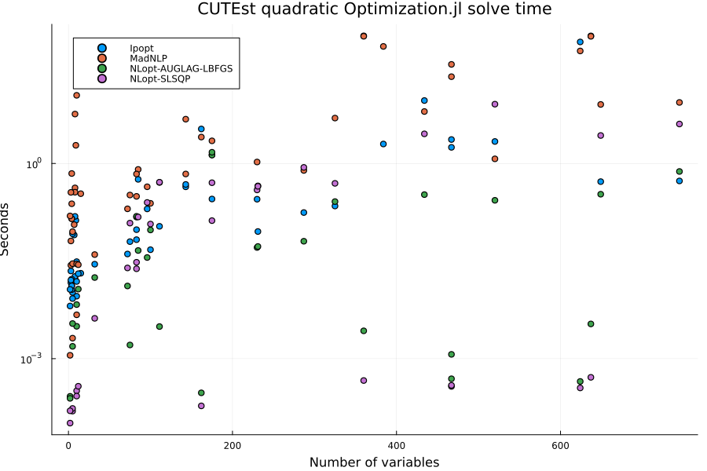
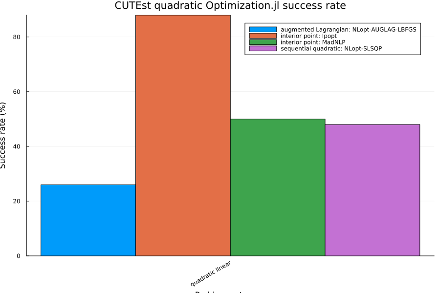
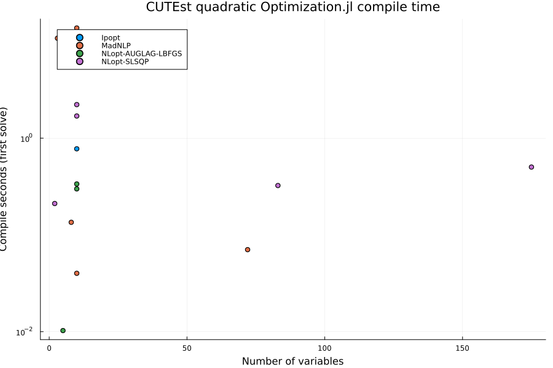
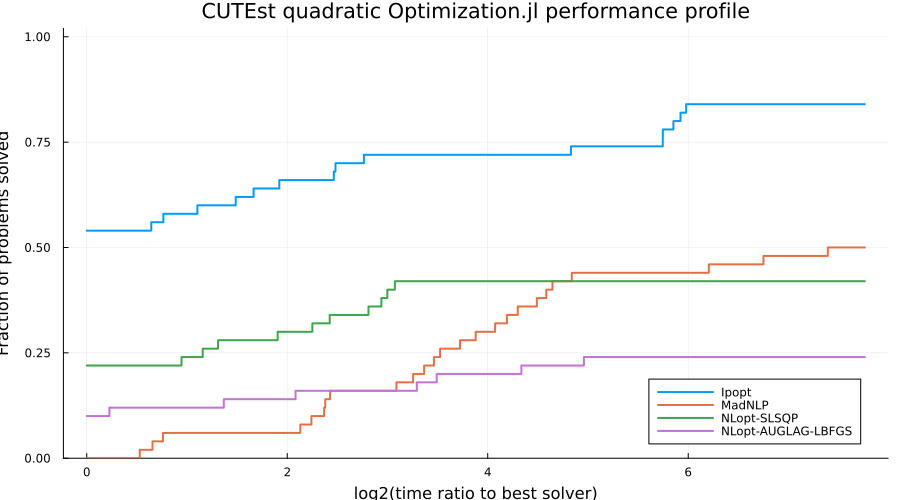
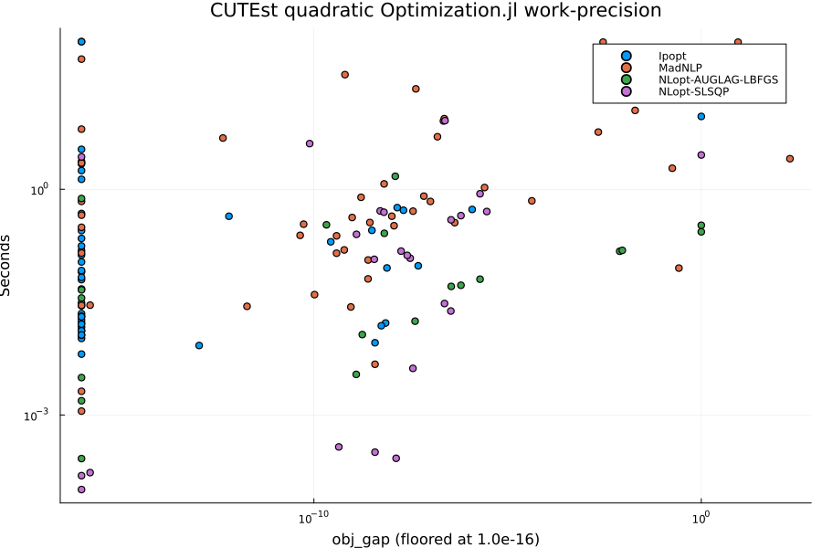

# CUTEst Quadratic Optimization.jl Benchmarks

This benchmark runs quadratic programs from the
[CUTEst](https://github.com/JuliaSmoothOptimizers/CUTEst.jl) test set through the
Optimization.jl interface using `OptimizationNLPModels`. The candidate pool is
`CUTEst.select_sif_problems(objtype = "quadratic", contype = "linear")`, i.e. problems
whose MASTSIF classification has a quadratic objective and linear constraints. No filter is
applied on variable bounds or on the equality/inequality mix of the constraints.

All four CUTEst pages in this folder share the harness in `cutest_benchmark_utils.jl`,
which defines the selection constants, the solver constructors, the run loop, and the
summary and plotting helpers. The prose below describes the harness as it stands;
refinements to the solver sets, solution-quality metrics, performance profiles, problem
selection, and timing methodology are tracked in
[SciMLBenchmarks#1857](https://github.com/SciML/SciMLBenchmarks.jl/issues/1857).

## Setup

```julia
ENV["GKSwstype"] = "100"

using CUTEst
using DataFrames
using Plots
using StatsPlots
using StatsBase: countmap
using Statistics
using Printf

include(joinpath(isdefined(Main, :WEAVE_ARGS) ? WEAVE_ARGS[:folder] : @__DIR__,
    "cutest_benchmark_utils.jl"))
```

```
plot_work_precision (generic function with 1 method)
```


## Problem selection

`select_safe_problems` sorts candidate names, filters the measured skip map and size limits,
then selects up to `MAX_PROBLEMS_PER_CATEGORY` across the 1–10, 11–100, and 101–`MAX_NVAR`
variable buckets. It samples each name-sorted bucket evenly, redistributing quotas when a
bucket has fewer candidates. Size strata come from CUTEst's public selection filters. The selected and eligible counts are printed per bucket.

```julia
println("MAX_PROBLEMS_PER_CATEGORY = ", MAX_PROBLEMS_PER_CATEGORY)
println("MAX_NVAR = ", MAX_NVAR)
println("MAX_NCON = ", MAX_NCON)
println("SOLVE_MAXITERS = ", SOLVE_MAXITERS)
println("SOLVE_TIMEOUT_SECONDS = ", SOLVE_TIMEOUT_SECONDS)
println("KNOWN_BAD_PROBLEMS = ", join(sort(collect(keys(KNOWN_BAD_PROBLEMS))), ", "))

quadratic_linear_problems = select_safe_problems(
    collect(CUTEst.select_sif_problems(objtype = "quadratic", contype = "linear",
        max_var = MAX_NVAR, max_con = MAX_NCON))
)

println("Selected quadratic problems with linear constraints: ",
    length(quadratic_linear_problems))
println(join(quadratic_linear_problems, ", "))
```

```
MAX_PROBLEMS_PER_CATEGORY = 50
MAX_NVAR = 1000
MAX_NCON = 1000
SOLVE_MAXITERS = 1000
SOLVE_TIMEOUT_SECONDS = 90.0
KNOWN_BAD_PROBLEMS = 
Selected 50 of 58 eligible problems (selected/eligible per bucket): 1-10 va
rs: 20/26, 11-100 vars: 10/10, 101-1000 vars: 20/22
Selected quadratic problems with linear constraints: 50
AVGASA, AVGASB, DEGENQP, DUALC1, DUALC2, DUALC8, GENHS28, HATFLDH, HS268, H
S35, HS35I, HS35MOD, HS44NEW, HS51, HS52, HS76, HS76I, PORTSNQP, TAME, ZECE
VIC2, CVXQP1, DUAL1, DUAL2, DUAL4, GOULDQP1, HS118, LOTSCHD, NASH, QPCBLEND
, QPNBLEND, CLEUVEN7, DUAL3, GMNCASE1, GMNCASE4, HIE1372D, PRIMAL1, PRIMAL2
, PRIMAL3, PRIMALC1, PRIMALC2, PRIMALC5, PRIMALC8, QPCBOEI1, QPCBOEI2, QPCS
TAIR, QPNBOEI2, QPNSTAIR, STATIC3, TABLE7, TARGUS
```


## Solvers

`CONSTRAINED_SOLVERS` currently contains only `Ipopt`, run through `OptimizationMOI`.
It is the only optimizer wired into the harness that accepts general equality and
inequality constraints via Optimization.jl; the Optim.jl algorithms on the unconstrained
page do not. Ipopt is configured with `max_iter = SOLVE_MAXITERS`,
`max_wall_time = SOLVE_TIMEOUT_SECONDS`, `tol = 1.0e-6`, `print_level = 0`, and
`hessian_approximation = "limited-memory"`. The limited-memory setting is used because
`OptimizationNLPModels` supplies the objective gradient and Hessian and the constraint
values and Jacobian from the CUTEst model, but not the constraint Hessians needed for an
exact Hessian of the Lagrangian. The same
iteration and time limits are also passed to `solve` as `maxiters` and `maxtime`. Ipopt
treats these problems as general nonlinear programs; no QP-specific solver is used yet.
Adding further constrained backends and an exact-Hessian Ipopt variant is item 1 of #1857.

## Run

Each (problem, solver) pair is solved once by `run_single_solve`. A row records the return
code as reported by Optimization.jl and a `status` of `OK` when `solve` returned,
`FAILED` when it threw, or `LOAD_FAILED` when the CUTEst problem could not be
constructed. The reported time is `sol.stats.time` when the solver provides a finite,
non-negative value, and otherwise the wall-clock time measured around problem construction
and `solve` together. `run_benchmarks` errors if a category yields no `OK` rows, so a
broken environment fails the build instead of producing an empty page.

```julia
quadratic_results = run_benchmarks(
    "quadratic linear",
    quadratic_linear_problems,
    CONSTRAINED_SOLVERS,
)

display(quadratic_results)
```

```
Warming up solvers (JIT), results are not benchmarked:
  Ipopt              HS35                    
***************************************************************************
***
This program contains Ipopt, a library for large-scale nonlinear optimizati
on.
 Ipopt is released as open source code under the Eclipse Public License (EP
L).
         For more information visit https://github.com/coin-or/Ipopt
***************************************************************************
***

 OK Success first 19.967s compile 19.947s clean 0.011s (total 22.883s)
  MadNLP             HS35                     OK Success first 18.912s comp
ile 18.842s clean 0.064s (total 19.348s)
  NLopt-SLSQP        HS35                    CUTEst solve skipped for HS35 
with NLopt-SLSQP: constraint bounds are not of the cons(x) <= 0 / cons(x) =
= 0 form that OptimizationNLopt passes to NLopt
 SKIPPED SKIPPED first 0.000s compile 0.000s clean 0.000s (total 0.272s)
  NLopt-AUGLAG-LBFGS HS35                    CUTEst solve skipped for HS35 
with NLopt-AUGLAG-LBFGS: constraint bounds are not of the cons(x) <= 0 / co
ns(x) == 0 form that OptimizationNLopt passes to NLopt
 SKIPPED SKIPPED first 0.000s compile 0.000s clean 0.000s (total 0.272s)

Running quadratic linear benchmarks
Problems: 50
Solvers: Ipopt, MadNLP, NLopt-SLSQP, NLopt-AUGLAG-LBFGS
Per-solve time cap: 90.0 s
  Ipopt              AVGASA                   OK Success 0.017s (first 0.01
9s, compile 0.000s, decode 0.276s)
  MadNLP             AVGASA                   OK Success 0.422s (first 0.46
7s, compile 0.000s, decode 0.272s)
  NLopt-SLSQP        AVGASA                  CUTEst solve skipped for AVGAS
A with NLopt-SLSQP: constraint bounds are not of the cons(x) <= 0 / cons(x)
 == 0 form that OptimizationNLopt passes to NLopt
 SKIPPED SKIPPED 0.000s (first 0.000s, compile 0.000s, decode 0.271s)
  NLopt-AUGLAG-LBFGS AVGASA                  CUTEst solve skipped for AVGAS
A with NLopt-AUGLAG-LBFGS: constraint bounds are not of the cons(x) <= 0 / 
cons(x) == 0 form that OptimizationNLopt passes to NLopt
 SKIPPED SKIPPED 0.000s (first 0.000s, compile 0.000s, decode 0.263s)
  Ipopt              AVGASB                   OK Success 0.018s (first 0.02
0s, compile 0.000s, decode 0.271s)
  MadNLP             AVGASB                   OK Success 0.361s (first 0.34
5s, compile 0.000s, decode 0.265s)
  NLopt-SLSQP        AVGASB                  CUTEst solve skipped for AVGAS
B with NLopt-SLSQP: constraint bounds are not of the cons(x) <= 0 / cons(x)
 == 0 form that OptimizationNLopt passes to NLopt
 SKIPPED SKIPPED 0.000s (first 0.000s, compile 0.000s, decode 0.277s)
  NLopt-AUGLAG-LBFGS AVGASB                  CUTEst solve skipped for AVGAS
B with NLopt-AUGLAG-LBFGS: constraint bounds are not of the cons(x) <= 0 / 
cons(x) == 0 form that OptimizationNLopt passes to NLopt
 SKIPPED SKIPPED 0.000s (first 0.000s, compile 0.000s, decode 0.282s)
  Ipopt              DEGENQP                  OK Success 0.031s (first 0.04
4s, compile 0.000s, decode 0.277s)
  MadNLP             DEGENQP                  OK MaxIters 11.156s (first 11
.226s, compile 0.040s, decode 0.270s)
  NLopt-SLSQP        DEGENQP                 CUTEst solve skipped for DEGEN
QP with NLopt-SLSQP: constraint bounds are not of the cons(x) <= 0 / cons(x
) == 0 form that OptimizationNLopt passes to NLopt
 SKIPPED SKIPPED 0.000s (first 0.000s, compile 0.000s, decode 0.272s)
  NLopt-AUGLAG-LBFGS DEGENQP                 CUTEst solve skipped for DEGEN
QP with NLopt-AUGLAG-LBFGS: constraint bounds are not of the cons(x) <= 0 /
 cons(x) == 0 form that OptimizationNLopt passes to NLopt
 SKIPPED SKIPPED 0.000s (first 0.000s, compile 0.000s, decode 0.267s)
  Ipopt              DUALC1                   OK Success 0.134s (first 0.16
1s, compile 0.000s, decode 0.288s)
  MadNLP             DUALC1                   OK MaxIters 1.904s (first 1.9
21s, compile 0.000s, decode 0.285s)
  NLopt-SLSQP        DUALC1                  CUTEst solve skipped for DUALC
1 with NLopt-SLSQP: constraint bounds are not of the cons(x) <= 0 / cons(x)
 == 0 form that OptimizationNLopt passes to NLopt
 SKIPPED SKIPPED 0.000s (first 0.000s, compile 0.000s, decode 0.293s)
  NLopt-AUGLAG-LBFGS DUALC1                  CUTEst solve skipped for DUALC
1 with NLopt-AUGLAG-LBFGS: constraint bounds are not of the cons(x) <= 0 / 
cons(x) == 0 form that OptimizationNLopt passes to NLopt
 SKIPPED SKIPPED 0.000s (first 0.000s, compile 0.000s, decode 0.280s)
  Ipopt              DUALC2                   OK Success 0.080s (first 0.10
6s, compile 0.000s, decode 0.280s)
  MadNLP             DUALC2                   OK Success 0.115s (first 0.16
3s, compile 0.000s, decode 0.279s)
  NLopt-SLSQP        DUALC2                  CUTEst solve skipped for DUALC
2 with NLopt-SLSQP: constraint bounds are not of the cons(x) <= 0 / cons(x)
 == 0 form that OptimizationNLopt passes to NLopt
 SKIPPED SKIPPED 0.000s (first 0.000s, compile 0.000s, decode 0.285s)
  NLopt-AUGLAG-LBFGS DUALC2                  CUTEst solve skipped for DUALC
2 with NLopt-AUGLAG-LBFGS: constraint bounds are not of the cons(x) <= 0 / 
cons(x) == 0 form that OptimizationNLopt passes to NLopt
 SKIPPED SKIPPED 0.000s (first 0.000s, compile 0.000s, decode 0.292s)
  Ipopt              DUALC8                   OK Success 0.154s (first 0.17
9s, compile 0.000s, decode 0.298s)
  MadNLP             DUALC8                   OK MaxIters 5.749s (first 5.9
02s, compile 0.135s, decode 0.294s)
  NLopt-SLSQP        DUALC8                  CUTEst solve skipped for DUALC
8 with NLopt-SLSQP: constraint bounds are not of the cons(x) <= 0 / cons(x)
 == 0 form that OptimizationNLopt passes to NLopt
 SKIPPED SKIPPED 0.000s (first 0.000s, compile 0.000s, decode 0.303s)
  NLopt-AUGLAG-LBFGS DUALC8                  CUTEst solve skipped for DUALC
8 with NLopt-AUGLAG-LBFGS: constraint bounds are not of the cons(x) <= 0 / 
cons(x) == 0 form that OptimizationNLopt passes to NLopt
 SKIPPED SKIPPED 0.000s (first 0.000s, compile 0.000s, decode 0.295s)
  Ipopt              GENHS28                  OK Success 0.009s (first 0.78
9s, compile 0.776s, decode 0.269s)
  MadNLP             GENHS28                  OK Success 0.005s (first 13.7
54s, compile 13.748s, decode 0.269s)
  NLopt-SLSQP        GENHS28                  OK Success 0.000s (first 2.24
8s, compile 2.221s, decode 0.268s)
  NLopt-AUGLAG-LBFGS GENHS28                  OK Success 0.003s (first 0.34
0s, compile 0.336s, decode 0.270s)
  Ipopt              HATFLDH                  OK Success 0.017s (first 0.02
2s, compile 0.000s, decode 0.259s)
  MadNLP             HATFLDH                  OK Success 0.142s (first 0.17
1s, compile 0.000s, decode 0.280s)
  NLopt-SLSQP        HATFLDH                 CUTEst solve skipped for HATFL
DH with NLopt-SLSQP: constraint bounds are not of the cons(x) <= 0 / cons(x
) == 0 form that OptimizationNLopt passes to NLopt
 SKIPPED SKIPPED 0.000s (first 0.000s, compile 0.000s, decode 0.267s)
  NLopt-AUGLAG-LBFGS HATFLDH                 CUTEst solve skipped for HATFL
DH with NLopt-AUGLAG-LBFGS: constraint bounds are not of the cons(x) <= 0 /
 cons(x) == 0 form that OptimizationNLopt passes to NLopt
 SKIPPED SKIPPED 0.000s (first 0.000s, compile 0.000s, decode 0.268s)
  Ipopt              HS268                    OK Success 0.083s (first 0.11
3s, compile 0.000s, decode 0.271s)
  MadNLP             HS268                    OK MaxIters 0.090s (first 0.1
15s, compile 0.000s, decode 0.272s)
  NLopt-SLSQP        HS268                   CUTEst solve skipped for HS268
 with NLopt-SLSQP: constraint bounds are not of the cons(x) <= 0 / cons(x) 
== 0 form that OptimizationNLopt passes to NLopt
 SKIPPED SKIPPED 0.000s (first 0.000s, compile 0.000s, decode 0.270s)
  NLopt-AUGLAG-LBFGS HS268                   CUTEst solve skipped for HS268
 with NLopt-AUGLAG-LBFGS: constraint bounds are not of the cons(x) <= 0 / c
ons(x) == 0 form that OptimizationNLopt passes to NLopt
 SKIPPED SKIPPED 0.000s (first 0.000s, compile 0.000s, decode 0.265s)
  Ipopt              HS35                     OK Success 0.015s (first 0.01
6s, compile 0.000s, decode 0.271s)
  MadNLP             HS35                     OK Success 0.064s (first 0.09
0s, compile 0.000s, decode 0.273s)
  NLopt-SLSQP        HS35                    CUTEst solve skipped for HS35 
with NLopt-SLSQP: constraint bounds are not of the cons(x) <= 0 / cons(x) =
= 0 form that OptimizationNLopt passes to NLopt
 SKIPPED SKIPPED 0.000s (first 0.000s, compile 0.000s, decode 0.272s)
  NLopt-AUGLAG-LBFGS HS35                    CUTEst solve skipped for HS35 
with NLopt-AUGLAG-LBFGS: constraint bounds are not of the cons(x) <= 0 / co
ns(x) == 0 form that OptimizationNLopt passes to NLopt
 SKIPPED SKIPPED 0.000s (first 0.000s, compile 0.000s, decode 0.267s)
  Ipopt              HS35I                    OK Success 0.016s (first 0.01
7s, compile 0.000s, decode 0.264s)
  MadNLP             HS35I                    OK Success 0.027s (first 0.03
0s, compile 0.000s, decode 0.269s)
  NLopt-SLSQP        HS35I                   CUTEst solve skipped for HS35I
 with NLopt-SLSQP: constraint bounds are not of the cons(x) <= 0 / cons(x) 
== 0 form that OptimizationNLopt passes to NLopt
 SKIPPED SKIPPED 0.000s (first 0.000s, compile 0.000s, decode 0.274s)
  NLopt-AUGLAG-LBFGS HS35I                   CUTEst solve skipped for HS35I
 with NLopt-AUGLAG-LBFGS: constraint bounds are not of the cons(x) <= 0 / c
ons(x) == 0 form that OptimizationNLopt passes to NLopt
 SKIPPED SKIPPED 0.000s (first 0.000s, compile 0.000s, decode 0.274s)
  Ipopt              HS35MOD                  OK Success 0.022s (first 0.02
3s, compile 0.000s, decode 0.269s)
  MadNLP             HS35MOD                  OK MaxIters 0.360s (first 11.
076s, compile 10.777s, decode 0.280s)
  NLopt-SLSQP        HS35MOD                 CUTEst solve skipped for HS35M
OD with NLopt-SLSQP: constraint bounds are not of the cons(x) <= 0 / cons(x
) == 0 form that OptimizationNLopt passes to NLopt
 SKIPPED SKIPPED 0.000s (first 0.000s, compile 0.000s, decode 0.274s)
  NLopt-AUGLAG-LBFGS HS35MOD                 CUTEst solve skipped for HS35M
OD with NLopt-AUGLAG-LBFGS: constraint bounds are not of the cons(x) <= 0 /
 cons(x) == 0 form that OptimizationNLopt passes to NLopt
 SKIPPED SKIPPED 0.000s (first 0.000s, compile 0.000s, decode 0.275s)
  Ipopt              HS44NEW                  OK Success 0.013s (first 0.01
5s, compile 0.000s, decode 0.269s)
  MadNLP             HS44NEW                  OK MaxIters 0.701s (first 0.6
47s, compile 0.000s, decode 0.259s)
  NLopt-SLSQP        HS44NEW                 CUTEst solve skipped for HS44N
EW with NLopt-SLSQP: constraint bounds are not of the cons(x) <= 0 / cons(x
) == 0 form that OptimizationNLopt passes to NLopt
 SKIPPED SKIPPED 0.000s (first 0.000s, compile 0.000s, decode 0.270s)
  NLopt-AUGLAG-LBFGS HS44NEW                 CUTEst solve skipped for HS44N
EW with NLopt-AUGLAG-LBFGS: constraint bounds are not of the cons(x) <= 0 /
 cons(x) == 0 form that OptimizationNLopt passes to NLopt
 SKIPPED SKIPPED 0.000s (first 0.000s, compile 0.000s, decode 0.258s)
  Ipopt              HS51                     OK Success 0.008s (first 0.01
0s, compile 0.000s, decode 0.271s)
  MadNLP             HS51                     OK Success 0.002s (first 0.00
3s, compile 0.000s, decode 0.269s)
  NLopt-SLSQP        HS51                     OK Success 0.000s (first 0.00
0s, compile 0.000s, decode 0.274s)
  NLopt-AUGLAG-LBFGS HS51                     OK Failure 0.002s (first 0.01
2s, compile 0.010s, decode 0.283s)
  Ipopt              HS52                     OK Success 0.010s (first 0.01
2s, compile 0.000s, decode 0.278s)
  MadNLP             HS52                     OK Success 0.029s (first 0.03
2s, compile 0.000s, decode 0.280s)
  NLopt-SLSQP        HS52                     OK Success 0.000s (first 0.00
0s, compile 0.000s, decode 0.276s)
  NLopt-AUGLAG-LBFGS HS52                     OK Success 0.003s (first 0.00
3s, compile 0.000s, decode 0.268s)
  Ipopt              HS76                     OK Success 0.012s (first 0.01
3s, compile 0.000s, decode 0.263s)
  MadNLP             HS76                     OK Infeasible 0.141s (first 0
.167s, compile 0.000s, decode 0.274s)
  NLopt-SLSQP        HS76                    CUTEst solve skipped for HS76 
with NLopt-SLSQP: constraint bounds are not of the cons(x) <= 0 / cons(x) =
= 0 form that OptimizationNLopt passes to NLopt
 SKIPPED SKIPPED 0.000s (first 0.000s, compile 0.000s, decode 0.275s)
  NLopt-AUGLAG-LBFGS HS76                    CUTEst solve skipped for HS76 
with NLopt-AUGLAG-LBFGS: constraint bounds are not of the cons(x) <= 0 / co
ns(x) == 0 form that OptimizationNLopt passes to NLopt
 SKIPPED SKIPPED 0.000s (first 0.000s, compile 0.000s, decode 0.274s)
  Ipopt              HS76I                    OK Success 0.013s (first 0.01
5s, compile 0.000s, decode 0.266s)
  MadNLP             HS76I                    OK Success 0.240s (first 0.27
6s, compile 0.000s, decode 0.266s)
  NLopt-SLSQP        HS76I                   CUTEst solve skipped for HS76I
 with NLopt-SLSQP: constraint bounds are not of the cons(x) <= 0 / cons(x) 
== 0 form that OptimizationNLopt passes to NLopt
 SKIPPED SKIPPED 0.000s (first 0.000s, compile 0.000s, decode 0.271s)
  NLopt-AUGLAG-LBFGS HS76I                   CUTEst solve skipped for HS76I
 with NLopt-AUGLAG-LBFGS: constraint bounds are not of the cons(x) <= 0 / c
ons(x) == 0 form that OptimizationNLopt passes to NLopt
 SKIPPED SKIPPED 0.000s (first 0.000s, compile 0.000s, decode 0.263s)
  Ipopt              PORTSNQP                 OK Success 0.015s (first 0.01
8s, compile 0.000s, decode 0.264s)
  MadNLP             PORTSNQP                 OK Success 0.029s (first 0.03
0s, compile 0.000s, decode 0.253s)
  NLopt-SLSQP        PORTSNQP                 OK Success 0.000s (first 1.71
3s, compile 1.694s, decode 0.241s)
  NLopt-AUGLAG-LBFGS PORTSNQP                 OK MaxIters 0.007s (first 0.3
06s, compile 0.299s, decode 0.257s)
  Ipopt              TAME                     OK Success 0.006s (first 0.00
8s, compile 0.000s, decode 0.258s)
  MadNLP             TAME                     OK Success 0.001s (first 0.00
2s, compile 0.000s, decode 0.257s)
  NLopt-SLSQP        TAME                     OK Success 0.000s (first 0.00
0s, compile 0.000s, decode 0.254s)
  NLopt-AUGLAG-LBFGS TAME                     OK Success 0.000s (first 0.00
1s, compile 0.000s, decode 0.262s)
  Ipopt              ZECEVIC2                 OK Success 0.012s (first 0.01
2s, compile 0.000s, decode 0.261s)
  MadNLP             ZECEVIC2                 OK MaxIters 0.156s (first 0.1
32s, compile 0.000s, decode 0.272s)
  NLopt-SLSQP        ZECEVIC2                 OK Failure 0.000s (first 0.21
2s, compile 0.211s, decode 0.267s)
  NLopt-AUGLAG-LBFGS ZECEVIC2                 OK Failure 0.000s (first 0.00
0s, compile 0.000s, decode 0.259s)
  Ipopt              CVXQP1                   OK Success 0.047s (first 0.07
1s, compile 0.000s, decode 0.264s)
  MadNLP             CVXQP1                   OK Success 0.244s (first 0.26
6s, compile 0.000s, decode 0.261s)
  NLopt-SLSQP        CVXQP1                   OK Success 0.117s (first 0.10
0s, compile 0.000s, decode 0.266s)
  NLopt-AUGLAG-LBFGS CVXQP1                   OK MaxIters 0.095s (first 0.1
38s, compile 0.000s, decode 0.265s)
  Ipopt              DUAL1                    OK Success 0.570s (first 0.61
1s, compile 0.000s, decode 0.331s)
  MadNLP             DUAL1                    OK Success 0.810s (first 0.86
7s, compile 0.000s, decode 0.331s)
  NLopt-SLSQP        DUAL1                    OK Success 0.151s (first 0.17
1s, compile 0.000s, decode 0.329s)
  NLopt-AUGLAG-LBFGS DUAL1                    OK Failure 0.046s (first 0.06
6s, compile 0.000s, decode 0.327s)
  Ipopt              DUAL2                    OK Success 0.200s (first 0.22
6s, compile 0.000s, decode 0.339s)
  MadNLP             DUAL2                    OK Infeasible 0.438s (first 0
.422s, compile 0.000s, decode 0.334s)
  NLopt-SLSQP        DUAL2                    OK Success 0.252s (first 0.27
1s, compile 0.000s, decode 0.342s)
  NLopt-AUGLAG-LBFGS DUAL2                    OK Success 0.036s (first 0.03
7s, compile 0.000s, decode 0.345s)
  Ipopt              DUAL4                    OK Success 0.063s (first 0.07
4s, compile 0.000s, decode 0.308s)
  MadNLP             DUAL4                    OK Success 0.327s (first 0.32
5s, compile 0.000s, decode 0.320s)
  NLopt-SLSQP        DUAL4                    OK Success 0.121s (first 0.14
4s, compile 0.000s, decode 0.321s)
  NLopt-AUGLAG-LBFGS DUAL4                    OK Failure 0.002s (first 0.00
2s, compile 0.000s, decode 0.317s)
  Ipopt              GOULDQP1                 OK Success 0.028s (first 0.03
8s, compile 0.000s, decode 0.265s)
  MadNLP             GOULDQP1                 OK Success 0.040s (first 0.05
9s, compile 0.000s, decode 0.268s)
  NLopt-SLSQP        GOULDQP1                 OK Success 0.004s (first 0.00
5s, compile 0.000s, decode 0.268s)
  NLopt-AUGLAG-LBFGS GOULDQP1                 OK Success 0.018s (first 0.01
9s, compile 0.000s, decode 0.262s)
  Ipopt              HS118                    OK Success 0.021s (first 0.02
2s, compile 0.000s, decode 0.268s)
  MadNLP             HS118                    OK Infeasible 0.343s (first 0
.335s, compile 0.000s, decode 0.263s)
  NLopt-SLSQP        HS118                   CUTEst solve skipped for HS118
 with NLopt-SLSQP: constraint bounds are not of the cons(x) <= 0 / cons(x) 
== 0 form that OptimizationNLopt passes to NLopt
 SKIPPED SKIPPED 0.000s (first 0.000s, compile 0.000s, decode 0.267s)
  NLopt-AUGLAG-LBFGS HS118                   CUTEst solve skipped for HS118
 with NLopt-AUGLAG-LBFGS: constraint bounds are not of the cons(x) <= 0 / c
ons(x) == 0 form that OptimizationNLopt passes to NLopt
 SKIPPED SKIPPED 0.000s (first 0.000s, compile 0.000s, decode 0.267s)
  Ipopt              LOTSCHD                  OK Success 0.020s (first 0.02
3s, compile 0.000s, decode 0.263s)
  MadNLP             LOTSCHD                  OK Success 0.028s (first 0.03
0s, compile 0.000s, decode 0.259s)
  NLopt-SLSQP        LOTSCHD                  OK Success 0.000s (first 0.00
1s, compile 0.000s, decode 0.258s)
  NLopt-AUGLAG-LBFGS LOTSCHD                  OK Success 0.012s (first 0.01
3s, compile 0.000s, decode 0.253s)
  Ipopt              NASH                     OK Infeasible 0.041s (first 0
.061s, compile 0.000s, decode 0.271s)
  MadNLP             NASH                     OK MaxIters 0.201s (first 0.3
56s, compile 0.070s, decode 0.266s)
  NLopt-SLSQP        NASH                     OK Success 0.025s (first 0.02
5s, compile 0.000s, decode 0.266s)
  NLopt-AUGLAG-LBFGS NASH                     OK Failure 0.013s (first 0.08
3s, compile 0.000s, decode 0.270s)
  Ipopt              QPCBLEND                 OK Success 0.067s (first 0.09
4s, compile 0.000s, decode 0.274s)
  MadNLP             QPCBLEND                 OK Success 0.689s (first 0.57
6s, compile 0.000s, decode 0.275s)
  NLopt-SLSQP        QPCBLEND                 OK Success 0.024s (first 0.36
2s, compile 0.324s, decode 0.277s)
  NLopt-AUGLAG-LBFGS QPCBLEND                 OK MaxIters 0.150s (first 0.3
24s, compile 0.000s, decode 0.279s)
  Ipopt              QPNBLEND                 OK Success 0.096s (first 0.11
2s, compile 0.000s, decode 0.271s)
  MadNLP             QPNBLEND                 OK Success 0.312s (first 0.36
5s, compile 0.000s, decode 0.276s)
  NLopt-SLSQP        QPNBLEND                 OK Success 0.030s (first 0.04
0s, compile 0.000s, decode 0.277s)
  NLopt-AUGLAG-LBFGS QPNBLEND                 OK MaxIters 0.154s (first 0.1
87s, compile 0.000s, decode 0.272s)
  Ipopt              CLEUVEN7                 [rerun skipped: first run end
ed with MaxTime] OK MaxTime 91.558s (first 91.558s, compile 0.000s, decode 
0.500s)
  MadNLP             CLEUVEN7                 [rerun skipped: first run end
ed with MaxTime] OK MaxTime 90.219s (first 90.219s, compile 0.000s, decode 
0.473s)
  NLopt-SLSQP        CLEUVEN7                 OK Failure 0.000s (first 0.00
2s, compile 0.000s, decode 0.477s)
  NLopt-AUGLAG-LBFGS CLEUVEN7                 OK Failure 0.003s (first 0.00
3s, compile 0.000s, decode 0.490s)
  Ipopt              DUAL3                    OK Success 0.108s (first 0.13
1s, compile 0.000s, decode 0.358s)
  MadNLP             DUAL3                    OK Success 0.511s (first 0.49
7s, compile 0.000s, decode 0.362s)
  NLopt-SLSQP        DUAL3                    OK Success 0.515s (first 0.53
1s, compile 0.000s, decode 0.362s)
  NLopt-AUGLAG-LBFGS DUAL3                    OK Failure 0.003s (first 0.00
4s, compile 0.000s, decode 0.363s)
  Ipopt              GMNCASE1                 OK Success 1.357s (first 1.37
8s, compile 0.000s, decode 0.492s)
  MadNLP             GMNCASE1                 OK MaxIters 39.678s (first 39
.400s, compile 0.000s, decode 0.485s)
  NLopt-SLSQP        GMNCASE1                 OK Success 0.506s (first 1.09
1s, compile 0.503s, decode 0.487s)
  NLopt-AUGLAG-LBFGS GMNCASE1                 OK MaxIters 1.345s (first 1.5
01s, compile 0.000s, decode 0.491s)
  Ipopt              GMNCASE4                 OK Success 0.284s (first 0.20
6s, compile 0.000s, decode 0.505s)
  MadNLP             GMNCASE4                 OK Success 2.228s (first 2.01
1s, compile 0.000s, decode 0.510s)
  NLopt-SLSQP        GMNCASE4                 OK Success 0.132s (first 0.13
3s, compile 0.000s, decode 0.538s)
  NLopt-AUGLAG-LBFGS GMNCASE4                 OK Success 1.488s (first 1.56
1s, compile 0.000s, decode 0.505s)
  Ipopt              HIE1372D                 [rerun skipped: first run end
ed with MaxTime] OK MaxTime 91.383s (first 91.383s, compile 0.000s, decode 
0.292s)
  MadNLP             HIE1372D                 [rerun skipped: first run end
ed with MaxTime] OK MaxTime 90.037s (first 90.037s, compile 0.000s, decode 
0.290s)
  NLopt-SLSQP        HIE1372D                 OK Failure 0.001s (first 0.00
3s, compile 0.000s, decode 0.292s)
  NLopt-AUGLAG-LBFGS HIE1372D                 OK Failure 0.003s (first 0.00
4s, compile 0.000s, decode 0.275s)
  Ipopt              PRIMAL1                  OK Success 0.222s (first 0.18
7s, compile 0.000s, decode 0.296s)
  MadNLP             PRIMAL1                  OK Success 4.986s (first 5.29
5s, compile 0.000s, decode 0.295s)
  NLopt-SLSQP        PRIMAL1                  OK Success 0.495s (first 0.51
9s, compile 0.000s, decode 0.298s)
  NLopt-AUGLAG-LBFGS PRIMAL1                  OK Success 0.260s (first 0.30
5s, compile 0.000s, decode 0.289s)
  Ipopt              PRIMAL2                  OK Success 0.526s (first 0.45
5s, compile 0.000s, decode 0.313s)
  MadNLP             PRIMAL2                  OK Success 8.078s (first 8.33
5s, compile 0.000s, decode 0.301s)
  NLopt-SLSQP        PRIMAL2                  OK Success 2.692s (first 2.71
7s, compile 0.000s, decode 0.298s)
  NLopt-AUGLAG-LBFGS PRIMAL2                  OK Success 0.337s (first 0.36
2s, compile 0.000s, decode 0.310s)
  Ipopt              PRIMAL3                  OK Success 0.539s (first 0.60
8s, compile 0.000s, decode 0.356s)
  MadNLP             PRIMAL3                  OK Success 8.672s (first 9.15
8s, compile 0.000s, decode 0.345s)
  NLopt-SLSQP        PRIMAL3                  OK Success 4.042s (first 4.04
2s, compile 0.000s, decode 0.344s)
  NLopt-AUGLAG-LBFGS PRIMAL3                  OK Success 0.753s (first 0.82
4s, compile 0.000s, decode 0.373s)
  Ipopt              PRIMALC1                 OK Success 0.282s (first 0.32
1s, compile 0.000s, decode 0.280s)
  MadNLP             PRIMALC1                 OK MaxIters 1.054s (first 1.0
72s, compile 0.000s, decode 0.278s)
  NLopt-SLSQP        PRIMALC1                 OK Success 0.392s (first 0.41
7s, compile 0.000s, decode 0.278s)
  NLopt-AUGLAG-LBFGS PRIMALC1                 OK Success 0.051s (first 0.04
8s, compile 0.000s, decode 0.280s)
  Ipopt              PRIMALC2                 OK Success 0.090s (first 0.11
8s, compile 0.000s, decode 0.271s)
  MadNLP             PRIMALC2                 OK MaxIters 0.452s (first 0.4
84s, compile 0.000s, decode 0.269s)
  NLopt-SLSQP        PRIMALC2                 OK Success 0.446s (first 0.47
4s, compile 0.000s, decode 0.278s)
  NLopt-AUGLAG-LBFGS PRIMALC2                 OK Success 0.053s (first 0.07
9s, compile 0.000s, decode 0.281s)
  Ipopt              PRIMALC5                 OK Success 0.176s (first 0.18
8s, compile 0.000s, decode 0.274s)
  MadNLP             PRIMALC5                 OK MaxIters 0.782s (first 1.0
29s, compile 0.000s, decode 0.275s)
  NLopt-SLSQP        PRIMALC5                 OK Success 0.871s (first 0.89
5s, compile 0.000s, decode 0.276s)
  NLopt-AUGLAG-LBFGS PRIMALC5                 OK Success 0.064s (first 0.06
7s, compile 0.000s, decode 0.275s)
  Ipopt              PRIMALC8                 OK Success 2.179s (first 2.18
2s, compile 0.000s, decode 0.293s)
  MadNLP             PRIMALC8                 OK Infeasible 1.178s (first 1
.148s, compile 0.000s, decode 0.289s)
  NLopt-SLSQP        PRIMALC8                 OK Success 8.157s (first 8.16
6s, compile 0.000s, decode 0.288s)
  NLopt-AUGLAG-LBFGS PRIMALC8                 OK MaxIters 0.272s (first 0.3
17s, compile 0.000s, decode 0.286s)
  Ipopt              QPCBOEI1                 OK Success 1.992s (first 2.13
2s, compile 0.000s, decode 0.299s)
  MadNLP             QPCBOEI1                 OK Infeasible 62.965s (first 
63.409s, compile 0.000s, decode 0.291s)
  NLopt-SLSQP        QPCBOEI1                CUTEst solve skipped for QPCBO
EI1 with NLopt-SLSQP: constraint bounds are not of the cons(x) <= 0 / cons(
x) == 0 form that OptimizationNLopt passes to NLopt
 SKIPPED SKIPPED 0.000s (first 0.000s, compile 0.000s, decode 0.301s)
  NLopt-AUGLAG-LBFGS QPCBOEI1                CUTEst solve skipped for QPCBO
EI1 with NLopt-AUGLAG-LBFGS: constraint bounds are not of the cons(x) <= 0 
/ cons(x) == 0 form that OptimizationNLopt passes to NLopt
 SKIPPED SKIPPED 0.000s (first 0.000s, compile 0.000s, decode 0.295s)
  Ipopt              QPCBOEI2                 OK Success 0.438s (first 0.45
1s, compile 0.000s, decode 0.278s)
  MadNLP             QPCBOEI2                 OK Success 0.689s (first 0.95
8s, compile 0.000s, decode 0.272s)
  NLopt-SLSQP        QPCBOEI2                CUTEst solve skipped for QPCBO
EI2 with NLopt-SLSQP: constraint bounds are not of the cons(x) <= 0 / cons(
x) == 0 form that OptimizationNLopt passes to NLopt
 SKIPPED SKIPPED 0.000s (first 0.000s, compile 0.000s, decode 0.279s)
  NLopt-AUGLAG-LBFGS QPCBOEI2                CUTEst solve skipped for QPCBO
EI2 with NLopt-AUGLAG-LBFGS: constraint bounds are not of the cons(x) <= 0 
/ cons(x) == 0 form that OptimizationNLopt passes to NLopt
 SKIPPED SKIPPED 0.000s (first 0.000s, compile 0.000s, decode 0.279s)
  Ipopt              QPCSTAIR                 OK Success 1.770s (first 1.73
8s, compile 0.000s, decode 0.301s)
  MadNLP             QPCSTAIR                 OK Infeasible 21.581s (first 
21.705s, compile 0.000s, decode 0.298s)
  NLopt-SLSQP        QPCSTAIR                 OK Failure 0.000s (first 0.00
1s, compile 0.000s, decode 0.302s)
  NLopt-AUGLAG-LBFGS QPCSTAIR                 OK Failure 0.001s (first 0.00
1s, compile 0.000s, decode 0.292s)
  Ipopt              QPNBOEI2                 OK Success 0.476s (first 0.49
7s, compile 0.000s, decode 0.283s)
  MadNLP             QPNBOEI2                 OK MaxIters 4.796s (first 5.0
04s, compile 0.000s, decode 0.281s)
  NLopt-SLSQP        QPNBOEI2                CUTEst solve skipped for QPNBO
EI2 with NLopt-SLSQP: constraint bounds are not of the cons(x) <= 0 / cons(
x) == 0 form that OptimizationNLopt passes to NLopt
 SKIPPED SKIPPED 0.000s (first 0.000s, compile 0.000s, decode 0.285s)
  NLopt-AUGLAG-LBFGS QPNBOEI2                CUTEst solve skipped for QPNBO
EI2 with NLopt-AUGLAG-LBFGS: constraint bounds are not of the cons(x) <= 0 
/ cons(x) == 0 form that OptimizationNLopt passes to NLopt
 SKIPPED SKIPPED 0.000s (first 0.000s, compile 0.000s, decode 0.274s)
  Ipopt              QPNSTAIR                 OK Success 2.334s (first 2.37
5s, compile 0.000s, decode 0.306s)
  MadNLP             QPNSTAIR                 OK Infeasible 33.345s (first 
34.056s, compile 0.000s, decode 0.300s)
  NLopt-SLSQP        QPNSTAIR                 OK Failure 0.000s (first 0.00
1s, compile 0.000s, decode 0.297s)
  NLopt-AUGLAG-LBFGS QPNSTAIR                 OK Failure 0.000s (first 0.00
1s, compile 0.000s, decode 0.299s)
  Ipopt              STATIC3                  OK Failure 9.279s (first 9.29
2s, compile 0.000s, decode 0.295s)
  MadNLP             STATIC3                  OK MaxIters 6.290s (first 6.5
36s, compile 0.000s, decode 0.296s)
  NLopt-SLSQP        STATIC3                  OK Failure 2.853s (first 2.87
7s, compile 0.000s, decode 0.305s)
  NLopt-AUGLAG-LBFGS STATIC3                  OK MaxIters 0.332s (first 0.3
74s, compile 0.000s, decode 0.295s)
  Ipopt              TABLE7                   OK MaxIters 73.793s (first 73
.939s, compile 0.000s, decode 0.293s)
  MadNLP             TABLE7                   OK MaxIters 53.619s (first 54
.394s, compile 0.000s, decode 0.289s)
  NLopt-SLSQP        TABLE7                   OK Failure 0.000s (first 0.00
1s, compile 0.000s, decode 0.290s)
  NLopt-AUGLAG-LBFGS TABLE7                   OK Failure 0.000s (first 0.00
1s, compile 0.000s, decode 0.288s)
  Ipopt              TARGUS                   OK MaxIters 3.393s (first 3.4
66s, compile 0.000s, decode 0.273s)
  MadNLP             TARGUS                   OK MaxIters 2.546s (first 2.8
30s, compile 0.000s, decode 0.273s)
  NLopt-SLSQP        TARGUS                   OK Failure 0.000s (first 0.00
0s, compile 0.000s, decode 0.270s)
  NLopt-AUGLAG-LBFGS TARGUS                   OK Failure 0.000s (first 0.00
0s, compile 0.000s, decode 0.267s)
  quadratic linear: 164/164 attempted rows completed (100.0%); 36 skipped; 
status: OK=164, SKIPPED=36
200×19 DataFrame
 Row │ category          problem  solver              solver_class         
 n_ ⋯
     │ String            String   String              String               
 In ⋯
─────┼─────────────────────────────────────────────────────────────────────
─────
   1 │ quadratic linear  AVGASA   Ipopt               interior point       
    ⋯
   2 │ quadratic linear  AVGASA   MadNLP              interior point
   3 │ quadratic linear  AVGASA   NLopt-SLSQP         sequential quadratic
   4 │ quadratic linear  AVGASA   NLopt-AUGLAG-LBFGS  augmented Lagrangian
   5 │ quadratic linear  AVGASB   Ipopt               interior point       
    ⋯
   6 │ quadratic linear  AVGASB   MadNLP              interior point
   7 │ quadratic linear  AVGASB   NLopt-SLSQP         sequential quadratic
   8 │ quadratic linear  AVGASB   NLopt-AUGLAG-LBFGS  augmented Lagrangian
  ⋮  │        ⋮             ⋮             ⋮                    ⋮           
    ⋱
 194 │ quadratic linear  TABLE7   MadNLP              interior point       
    ⋯
 195 │ quadratic linear  TABLE7   NLopt-SLSQP         sequential quadratic
 196 │ quadratic linear  TABLE7   NLopt-AUGLAG-LBFGS  augmented Lagrangian
 197 │ quadratic linear  TARGUS   Ipopt               interior point
 198 │ quadratic linear  TARGUS   MadNLP              interior point       
    ⋯
 199 │ quadratic linear  TARGUS   NLopt-SLSQP         sequential quadratic
 200 │ quadratic linear  TARGUS   NLopt-AUGLAG-LBFGS  augmented Lagrangian
                                                 15 columns and 185 rows om
itted
```


## Summary

`summarize_results` groups rows by category and solver. `completion_rate` is the share of
runs with `status == "OK"`, i.e. the solver returned at all. `success_rate` is the share
of runs whose return code is in `SUCCESS_RETCODES` (`Success`, `Terminated`,
`FirstOrderOptimal`). Runs that stopped at `MaxIters` or `MaxTime` count as completed but
not successful. `median_secs` is the median of the per-run time described above over all
rows for that category and solver, including unsuccessful ones. No solution-quality
metric (objective value, KKT residual, constraint violation) is recorded yet; see #1857.

```julia
quadratic_summary = summarize_results(quadratic_results)

plot_solve_times(quadratic_results, "CUTEst quadratic Optimization.jl solve time")
plot_success_rates(quadratic_summary, "CUTEst quadratic Optimization.jl success rate")
plot_compile_times(quadratic_results, "CUTEst quadratic Optimization.jl compile time")
plot_performance_profile(quadratic_results,
    "CUTEst quadratic Optimization.jl performance profile")
plot_work_precision(quadratic_results, "CUTEst quadratic Optimization.jl work-precision")
```

```
Return code distribution:
  Success: 106
  SKIPPED: 36
  MaxIters: 25
  Failure: 21
  Infeasible: 8
  MaxTime: 4

Summary (local convergence-based solvers; success = return code in FirstOrd
erOptimal/Success/Terminated):
4×14 DataFrame
 Row │ category          solver_class          solver              complete
d_r ⋯
     │ String            String                String              Int64   
    ⋯
─────┼─────────────────────────────────────────────────────────────────────
─────
   1 │ quadratic linear  augmented Lagrangian  NLopt-AUGLAG-LBFGS          
    ⋯
   2 │ quadratic linear  interior point        Ipopt
   3 │ quadratic linear  interior point        MadNLP
   4 │ quadratic linear  sequential quadratic  NLopt-SLSQP
                                                              11 columns om
itted
```









## Appendix

These benchmarks are a part of the SciMLBenchmarks.jl repository, found at: [https://github.com/SciML/SciMLBenchmarks.jl](https://github.com/SciML/SciMLBenchmarks.jl). For more information on high-performance scientific machine learning, check out the SciML Open Source Software Organization [https://sciml.ai](https://sciml.ai).

To locally run this benchmark, do the following commands:
```
using SciMLBenchmarks
SciMLBenchmarks.weave_file("benchmarks/OptimizationCUTEst","CUTEst_quadratic.jmd")
```

Computer Information:

```
Julia Version 1.12.7
Commit 6d172b025e4 (2026-08-15 08:05 UTC)
Build Info:
  Official https://julialang.org release
Platform Info:
  OS: Linux (x86_64-linux-gnu)
  CPU: 128 × AMD EPYC 7502 32-Core Processor
  WORD_SIZE: 64
  LLVM: libLLVM-18.1.7 (ORCJIT, znver2)
  GC: Built with stock GC
Threads: 128 default, 1 interactive, 128 GC (on 128 virtual cores)
Environment:
  JULIA_NUM_THREADS = auto

```

Package Information:

```
Status `/julia/github-runners/amdci1-1/_work/SciMLBenchmarks.jl/SciMLBenchmarks.jl/benchmarks/OptimizationCUTEst/Project.toml`
⌃ [1b53aba6] CUTEst v1.3.7
  [a93c6f00] DataFrames v1.8.2
  [b6b21f68] Ipopt v1.16.0
  [2621e9c9] MadNLP v0.10.1
⌃ [b8f27783] MathOptInterface v1.53.0
  [a4795742] NLPModels v0.21.12
  [7f7a1694] Optimization v5.9.1
⌃ [fd9f6733] OptimizationMOI v1.4.1
⌃ [5d9c809f] OptimizationMadNLP v2.3.1
⌃ [064b21be] OptimizationNLPModels v1.6.0
⌃ [4e6fcdb7] OptimizationNLopt v0.3.18
⌃ [36348300] OptimizationOptimJL v0.4.21
⌃ [42dfb2eb] OptimizationOptimisers v0.3.24
  [91a5bcdd] Plots v1.41.7
  [31c91b34] SciMLBenchmarks v0.2.1 [loaded: `/julia/github-runners/amdci1-1/_work/SciMLBenchmarks.jl/SciMLBenchmarks.jl/src/SciMLBenchmarks.jl` (v0.2.1) expected `/home/crackauc/.julia/packages/SciMLBenchmarks/ceJyd/src/SciMLBenchmarks.jl` (v0.2.1)]
  [10745b16] Statistics v1.11.5
  [2913bbd2] StatsBase v0.34.13
  [f3b207a7] StatsPlots v0.15.8
  [56ddb016] Logging v1.11.0
  [de0858da] Printf v1.11.0
Info Packages marked with ⌃ have new versions available and may be upgradable.
```

And the full manifest:

```
Status `/julia/github-runners/amdci1-1/_work/SciMLBenchmarks.jl/SciMLBenchmarks.jl/benchmarks/OptimizationCUTEst/Manifest.toml`
  [47edcb42] ADTypes v1.24.0
  [14f7f29c] AMD v0.5.4
  [621f4979] AbstractFFTs v1.5.0
  [6e696c72] AbstractPlutoDingetjes v1.4.1
  [1520ce14] AbstractTrees v0.4.5
  [7d9f7c33] Accessors v0.1.45
⌃ [79e6a3ab] Adapt v4.7.0
  [66dad0bd] AliasTables v1.1.3
  [ec485272] ArnoldiMethod v0.4.0
  [7d9fca2a] Arpack v0.5.4
⌃ [4fba245c] ArrayInterface v7.30.1
⌃ [4c555306] ArrayLayouts v1.12.2
  [13072b0f] AxisAlgorithms v1.1.0
⌃ [aae01518] BandedMatrices v1.12.0
  [e2ed5e7c] Bijections v0.2.2
  [b2a6c25c] BinaryHeaps v1.1.0
  [caf10ac8] BipartiteGraphs v0.1.14
⌃ [8e7c35d0] BlockArrays v1.10.0
⌃ [70df07ce] BracketingNonlinearSolve v1.12.7
⌅ [fa961155] CEnum v0.5.0
⌃ [1b53aba6] CUTEst v1.3.7
⌃ [d360d2e6] ChainRulesCore v1.26.1
  [aaaa29a8] Clustering v0.15.8
  [523fee87] CodecBzip2 v0.8.5
  [944b1d66] CodecZlib v0.7.9
  [35d6a980] ColorSchemes v3.31.0
⌃ [3da002f7] ColorTypes v0.12.1
  [c3611d14] ColorVectorSpace v0.11.0
⌃ [5ae59095] Colors v0.13.1
⌅ [861a8166] Combinatorics v1.0.2
  [38540f10] CommonSolve v0.2.14
  [bbf7d656] CommonSubexpressions v0.3.1
  [f70d9fcc] CommonWorldInvalidations v1.2.2
  [34da2185] Compat v4.18.1
  [b152e2b5] CompositeTypes v0.1.4
  [a33af91c] CompositionsBase v0.1.2
  [2569d6c7] ConcreteStructs v0.2.8
  [88cd18e8] ConsoleProgressMonitor v0.1.2
  [187b0558] ConstructionBase v1.6.0
  [d38c429a] Contour v0.6.3
  [a8cc5b0e] Crayons v4.2.0
  [9a962f9c] DataAPI v1.16.0
  [a93c6f00] DataFrames v1.8.2
  [864edb3b] DataStructures v0.19.6
  [e2d170a0] DataValueInterfaces v1.0.0
  [8bb1440f] DelimitedFiles v1.9.1
⌃ [2b5f629d] DiffEqBase v7.21.1
⌃ [459566f4] DiffEqCallbacks v4.19.4
  [163ba53b] DiffResults v1.1.0
  [b552c78f] DiffRules v1.16.0
  [a0c0ee7d] DifferentiationInterface v0.7.21
  [b4f34e82] Distances v0.10.12
⌃ [31c24e10] Distributions v0.25.131
⌅ [ffbed154] DocStringExtensions v0.9.5
⌃ [5b8099bc] DomainSets v0.8.1
  [7c1d4256] DynamicPolynomials v0.6.8
  [4e289a0a] EnumX v1.0.7
⌃ [f151be2c] EnzymeCore v0.8.21
  [e2ba6199] ExprTools v0.1.11
  [55351af7] ExproniconLite v0.10.14
⌃ [c87230d0] FFMPEG v0.4.5
  [b86e33f2] FFTA v0.3.1
⌃ [7034ab61] FastBroadcast v1.4.0
  [9aa1b823] FastClosures v0.3.2
⌃ [a4df4552] FastPower v1.5.0
⌃ [1a297f60] FillArrays v1.17.0
⌃ [64ca27bc] FindFirstFunctions v3.2.1
  [6a86dc24] FiniteDiff v2.33.0
⌅ [53c48c17] FixedPointNumbers v0.8.6
  [1fa38f19] Format v1.3.7
  [f6369f11] ForwardDiff v1.4.6
  [a85aefff] FunctionMaps v0.1.2
  [069b7b12] FunctionWrappers v1.1.3
  [77dc65aa] FunctionWrappersWrappers v1.13.0
⌃ [d9f16b24] Functors v0.5.3
⌃ [46192b85] GPUArraysCore v0.2.0
  [28b8d3ca] GR v0.73.27
  [a0844989] Gamma v1.2.0
  [86223c79] Graphs v1.15.0
⌅ [eafb193a] Highlights v0.5.3
  [34004b35] HypergeometricFunctions v0.3.30
  [3263718b] ImplicitDiscreteSolve v2.3.0
  [d25df0c9] Inflate v0.1.5
⌅ [842dd82b] InlineStrings v1.4.6
  [18e54dd8] IntegerMathUtils v0.1.4
  [a98d9a8b] Interpolations v0.16.3
⌃ [8197267c] IntervalSets v0.7.14
⌃ [3587e190] InverseFunctions v0.1.17
  [41ab1584] InvertedIndices v1.3.1
  [b6b21f68] Ipopt v1.16.0
  [92d709cd] IrrationalConstants v0.2.6
  [82899510] IteratorInterfaceExtensions v1.0.0
  [1019f520] JLFzf v0.1.11
  [692b3bcd] JLLWrappers v1.8.0
⌅ [682c06a0] JSON v0.21.4
  [ae98c720] Jieko v0.2.1
⌅ [ccbc3e58] JumpProcesses v9.32.3
  [5ab0869b] KernelDensity v0.6.12
⌃ [ba0b0d4f] Krylov v0.10.10
  [40e66cde] LDLFactorizations v0.10.2
  [2faa5264] LHLFactorization v2.2.2
  [b964fa9f] LaTeXStrings v1.4.1
  [23fbe1c1] Latexify v0.16.12
  [1d6d02ad] LeftChildRightSiblingTrees v0.3.0
⌃ [87fe0de2] LineSearch v0.1.18
⌃ [d3d80556] LineSearches v7.8.1
⌃ [5c8ed15e] LinearOperators v2.14.2
⌃ [7ed4a6bd] LinearSolve v5.17.3
⌃ [2ab3a3ac] LogExpFunctions v1.0.1
  [e6f89c97] LoggingExtras v1.2.0
  [1914dd2f] MacroTools v0.5.16
  [2621e9c9] MadNLP v0.10.1
⌃ [b8f27783] MathOptInterface v1.53.0
  [bb5d69b7] MaybeInplace v0.1.8
  [442fdcdd] Measures v0.3.3
  [e1d29d7a] Missings v1.2.0
⌃ [7771a370] ModelingToolkitBase v1.70.0
⌅ [2e0e35c7] Moshi v0.3.9
  [46d2c3a1] MuladdMacro v0.2.7
⌃ [102ac46a] MultivariatePolynomials v0.5.19
  [6f286f6a] MultivariateStats v0.10.5
⌃ [ffc61752] Mustache v1.0.21 [loaded: v1.1.0]
⌃ [d8a4904e] MutableArithmetics v1.8.0
  [a4795742] NLPModels v0.21.12
  [d41bc354] NLSolversBase v8.0.1
  [76087f3c] NLopt v1.2.1
⌃ [77ba4419] NaNMath v1.1.4
  [b8a86587] NearestNeighbors v0.4.29
⌃ [be0214bd] NonlinearSolveBase v2.48.0
⌃ [5959db7a] NonlinearSolveFirstOrder v2.6.1
  [510215fc] Observables v0.5.5
  [6fe1bfb0] OffsetArrays v1.17.0
⌃ [429524aa] Optim v2.3.1
⌃ [3bd65402] Optimisers v0.4.9
  [7f7a1694] Optimization v5.9.1
⌃ [bca83a33] OptimizationBase v5.6.1
⌃ [fd9f6733] OptimizationMOI v1.4.1
⌃ [5d9c809f] OptimizationMadNLP v2.3.1
⌃ [064b21be] OptimizationNLPModels v1.6.0
⌃ [4e6fcdb7] OptimizationNLopt v0.3.18
⌃ [36348300] OptimizationOptimJL v0.4.21
⌃ [42dfb2eb] OptimizationOptimisers v0.3.24
⌃ [bac558e1] OrderedCollections v2.0.1 [loaded: v2.0.3]
⌃ [bbf590c4] OrdinaryDiffEqCore v4.17.2
  [90014a1f] PDMats v0.11.41
⌅ [69de0a69] Parsers v2.8.8
  [ccf2f8ad] PlotThemes v3.3.0
⌃ [995b91a9] PlotUtils v1.4.4
  [91a5bcdd] Plots v1.41.7
⌃ [e409e4f3] PoissonRandom v0.4.13
  [2dfb63ee] PooledArrays v1.4.3
  [85a6dd25] PositiveFactorizations v0.2.4
  [d236fae5] PreallocationTools v1.7.1
  [aea7be01] PrecompileTools v1.3.4
⌃ [21216c6a] Preferences v1.6.0 [loaded: v1.6.1]
⌃ [08abe8d2] PrettyTables v3.4.8
  [27ebfcd6] Primes v0.5.7
  [33c8b6b6] ProgressLogging v0.1.6
⌃ [92933f4c] ProgressMeter v1.11.0
  [43287f4e] PtrArrays v1.4.0
⌃ [0c0d3e7f] PureKLU v1.5.0
  [1fd47b50] QuadGK v2.11.3
⌅ [be4d8f0f] Quadmath v0.5.13
  [c84ed2f1] Ratios v0.4.5
  [988b38a3] ReadOnlyArrays v0.2.0
  [795d4caa] ReadOnlyDicts v1.0.1
⌃ [3cdcf5f2] RecipesBase v1.3.4
  [01d81517] RecipesPipeline v0.6.12
⌃ [731186ca] RecursiveArrayTools v4.5.1
  [189a3867] Reexport v1.2.2
  [05181044] RelocatableFolders v1.0.1
  [ae029012] Requires v1.3.1
  [9fe22ead] RespecializeParams v1.3.0
  [79098fc4] Rmath v0.9.0
⌃ [f2b01f46] Roots v3.0.8
⌃ [7e49a35a] RuntimeGeneratedFunctions v0.5.26
⌃ [9dfe8606] SCCNonlinearSolve v1.15.3
⌃ [0bca4576] SciMLBase v3.54.0
  [31c91b34] SciMLBenchmarks v0.2.1 [loaded: `/julia/github-runners/amdci1-1/_work/SciMLBenchmarks.jl/SciMLBenchmarks.jl/src/SciMLBenchmarks.jl` (v0.2.1) expected `/home/crackauc/.julia/packages/SciMLBenchmarks/ceJyd/src/SciMLBenchmarks.jl` (v0.2.1)]
⌃ [19f34311] SciMLJacobianOperators v0.1.19
  [a6db7da4] SciMLLogging v2.1.0
⌃ [c0aeaf25] SciMLOperators v1.30.0
  [431bcebd] SciMLPublic v1.3.0
⌃ [53ae85a6] SciMLStructures v1.10.5
  [6c6a2e73] Scratch v1.3.0
  [91c51154] SentinelArrays v1.4.10
  [efcf1570] Setfield v1.1.2
  [992d4aef] Showoff v1.1.1
⌃ [727e6d20] SimpleNonlinearSolve v2.14.5
  [699a6c99] SimpleTraits v0.9.6
  [ff4d7338] SolverCore v0.3.10
  [a2af1166] SortingAlgorithms v1.2.3
  [a57abbd0] SparseColumnPivotedQR v2.1.8
⌃ [9f842d2f] SparseConnectivityTracer v1.2.3
⌃ [0a514795] SparseMatrixColorings v0.4.28
  [276daf66] SpecialFunctions v2.9.0
⌃ [860ef19b] StableRNGs v1.0.4
  [0c0c59c1] StarAlgebras v0.3.0
⌃ [90137ffa] StaticArrays v1.9.20
  [1e83bf80] StaticArraysCore v1.4.4
  [10745b16] Statistics v1.11.5
  [82ae8749] StatsAPI v1.8.0
  [2913bbd2] StatsBase v0.34.13
  [4c63d2b9] StatsFuns v2.2.1
  [f3b207a7] StatsPlots v0.15.8
  [69024149] StringEncodings v0.3.7
⌅ [892a3eda] StringManipulation v0.5.0
  [2efcf032] SymbolicIndexingInterface v0.3.55
⌃ [19f23fe9] SymbolicLimits v1.2.1
⌃ [d1185830] SymbolicUtils v4.46.6
⌃ [0c5d862f] Symbolics v7.39.2
  [ab02a1b2] TableOperations v1.2.0
  [3783bdb8] TableTraits v1.0.1
  [bd369af6] Tables v1.14.0
  [ed4db957] TaskLocalValues v0.1.3
  [62fd8b95] TensorCore v0.1.1
⌃ [8ea1fca8] TermInterface v2.0.0
  [5d786b92] TerminalLoggers v0.1.8
⌅ [a759f4b9] TimerOutputs v0.5.29
  [3bb67fe8] TranscodingStreams v0.11.3
  [781d530d] TruncatedStacktraces v1.4.0
  [3a884ed6] UnPack v1.0.2
  [1cfade01] UnicodeFun v0.4.1
  [41fe7b60] Unzip v0.2.0
  [d30d5f5c] WeakCacheSets v0.1.0
  [44d3d7a6] Weave v0.10.12
  [cc8bc4a8] Widgets v0.6.8
  [efce3f68] WoodburyMatrices v1.1.0
⌃ [ddb6d928] YAML v0.4.16 [loaded: v0.4.17]
  [ae81ac8f] ASL_jll v0.1.5+0
⌅ [68821587] Arpack_jll v3.5.2+0
  [6e34b625] Bzip2_jll v1.0.9+0
  [bb5f6f25] CUTEst_jll v2.7.0+0
⌃ [83423d85] Cairo_jll v1.18.7+0
  [ee1fde0b] Dbus_jll v1.16.2+0
  [2702e6a9] EpollShim_jll v0.0.20230411+1
⌃ [2e619515] Expat_jll v2.8.4+0
⌅ [b22a6f82] FFMPEG_jll v8.1.2+0
  [a3f928ae] Fontconfig_jll v2.17.1+0
⌃ [d7e528f0] FreeType2_jll v2.14.3+1
⌃ [559328eb] FriBidi_jll v1.0.17+0
  [0656b61e] GLFW_jll v3.5.1+0
  [d2c73de3] GR_jll v0.73.27+0
⌅ [b0724c58] GettextRuntime_jll v0.22.4+0
  [61579ee1] Ghostscript_jll v9.55.1+0
⌃ [7746bdde] Glib_jll v2.88.3+0
  [3b182d85] Graphite2_jll v1.3.16+0
⌃ [2e76f6c2] HarfBuzz_jll v100.14004.0+0
⌃ [e33a78d0] Hwloc_jll v2.14.0+0
  [1d5cc7b8] IntelOpenMP_jll v2025.2.0+0
⌅ [9cc047cb] Ipopt_jll v300.1400.1902+0
  [aacddb02] JpegTurbo_jll v3.2.0+1
  [c1c5ebd0] LAME_jll v3.100.3+0
  [88015f11] LERC_jll v4.2.0+0
  [1d63c593] LLVMOpenMP_jll v23.1.1+0
⌅ [e9f186c6] Libffi_jll v3.4.7+0
  [7e76a0d4] Libglvnd_jll v1.7.1+1
  [94ce4f54] Libiconv_jll v1.18.0+0
⌃ [4b2f31a3] Libmount_jll v2.42.0+0
  [89763e89] Libtiff_jll v4.7.3+0
⌃ [38a345b3] Libuuid_jll v2.42.0+0
  [d00139f3] METIS_jll v5.1.4+0
  [856f044c] MKL_jll v2025.2.0+0
  [d7ed1dd3] MUMPS_seq_jll v500.900.100+0
  [079eb43e] NLopt_jll v2.11.0+0
  [e7412a2a] Ogg_jll v1.3.6+0
  [656ef2d0] OpenBLAS32_jll v0.3.34+0
  [efe28fd5] OpenSpecFun_jll v0.5.6+0
  [91d4177d] Opus_jll v1.6.1+0
  [36c8627f] Pango_jll v1.58.2+0
  [30392449] Pixman_jll v0.46.4+0
  [c0090381] Qt6Base_jll v6.10.2+2
  [629bc702] Qt6Declarative_jll v6.10.2+2
  [ce943373] Qt6ShaderTools_jll v6.10.2+1
  [6de9746b] Qt6Svg_jll v6.10.2+0
  [e99dba38] Qt6Wayland_jll v6.10.2+1
  [f50d1b31] Rmath_jll v0.5.2+0
  [54dcf436] SIFDecode_jll v3.1.1+0
  [319450e9] SPRAL_jll v2025.9.18+1
  [a44049a8] Vulkan_Loader_jll v1.3.243+0
  [a2964d1f] Wayland_jll v1.24.0+0
⌅ [02c8fc9c] XML2_jll v2.13.9+0
  [ffd25f8a] XZ_jll v5.8.4+0
  [f67eecfb] Xorg_libICE_jll v1.1.2+0
  [c834827a] Xorg_libSM_jll v1.2.6+0
⌃ [4f6342f7] Xorg_libX11_jll v1.8.13+0
  [0c0b7dd1] Xorg_libXau_jll v1.0.13+0
  [935fb764] Xorg_libXcursor_jll v1.2.4+0
  [a3789734] Xorg_libXdmcp_jll v1.1.6+0
  [1082639a] Xorg_libXext_jll v1.3.8+0
  [d091e8ba] Xorg_libXfixes_jll v6.0.2+0
⌃ [a51aa0fd] Xorg_libXi_jll v1.8.4+0
  [d1454406] Xorg_libXinerama_jll v1.1.7+0
  [ec84b674] Xorg_libXrandr_jll v1.5.6+0
⌃ [ea2f1a96] Xorg_libXrender_jll v0.9.12+0
  [a65dc6b1] Xorg_libpciaccess_jll v0.19.0+0
  [c7cfdc94] Xorg_libxcb_jll v1.17.1+0
  [cc61e674] Xorg_libxkbfile_jll v1.2.0+0
  [e920d4aa] Xorg_xcb_util_cursor_jll v0.1.6+0
  [12413925] Xorg_xcb_util_image_jll v0.4.1+0
  [2def613f] Xorg_xcb_util_jll v0.4.1+0
  [975044d2] Xorg_xcb_util_keysyms_jll v0.4.1+0
  [0d47668e] Xorg_xcb_util_renderutil_jll v0.3.10+0
  [c22f9ab0] Xorg_xcb_util_wm_jll v0.4.2+0
⌃ [35661453] Xorg_xkbcomp_jll v1.4.7+0
⌃ [33bec58e] Xorg_xkeyboard_config_jll v2.47.0+2
  [c5fb5394] Xorg_xtrans_jll v1.6.0+0
  [3161d3a3] Zstd_jll v1.5.7+1
  [35ca27e7] eudev_jll v3.2.14+0
⌅ [214eeab7] fzf_jll v0.61.1+0
⌃ [a4ae2306] libaom_jll v3.14.1+0
  [0ac62f75] libass_jll v0.17.5+0
  [1183f4f0] libdecor_jll v0.2.2+0
  [8e53e030] libdrm_jll v2.4.134+0
  [2db6ffa8] libevdev_jll v1.13.4+0
⌅ [f638f0a6] libfdk_aac_jll v2.0.4+0
  [36db933b] libinput_jll v1.28.1+0
⌃ [b53b4c65] libpng_jll v1.6.58+0
⌃ [9a156e7d] libva_jll v2.23.0+0
  [f27f6e37] libvorbis_jll v1.3.8+0
  [009596ad] mtdev_jll v1.1.7+0
⌃ [1317d2d5] oneTBB_jll v2022.3.0+0
⌅ [1270edf5] x264_jll v10164.0.1+0
⌅ [dfaa095f] x265_jll v4.1.0+0
  [d8fb68d0] xkbcommon_jll v1.13.0+0
  [0dad84c5] ArgTools v1.1.2
  [56f22d72] Artifacts v1.11.0
  [2a0f44e3] Base64 v1.11.0
  [ade2ca70] Dates v1.11.0
  [8ba89e20] Distributed v1.11.0
  [f43a241f] Downloads v1.7.0
  [7b1f6079] FileWatching v1.11.0
  [9fa8497b] Future v1.11.0
  [b77e0a4c] InteractiveUtils v1.11.0
  [ac6e5ff7] JuliaSyntaxHighlighting v1.12.0
  [4af54fe1] LazyArtifacts v1.11.0
  [b27032c2] LibCURL v0.6.4
  [76f85450] LibGit2 v1.11.0
  [8f399da3] Libdl v1.11.0
  [37e2e46d] LinearAlgebra v1.12.0
  [56ddb016] Logging v1.11.0
  [d6f4376e] Markdown v1.11.0
  [a63ad114] Mmap v1.11.0
  [ca575930] NetworkOptions v1.3.0
  [44cfe95a] Pkg v1.12.1
  [de0858da] Printf v1.11.0
  [3fa0cd96] REPL v1.11.0
  [9a3f8284] Random v1.11.0
  [ea8e919c] SHA v0.7.0
  [9e88b42a] Serialization v1.11.0
  [1a1011a3] SharedArrays v1.11.0
  [6462fe0b] Sockets v1.11.0
  [2f01184e] SparseArrays v1.12.0
  [f489334b] StyledStrings v1.11.0
  [4607b0f0] SuiteSparse
  [fa267f1f] TOML v1.0.3
  [a4e569a6] Tar v1.10.0
  [8dfed614] Test v1.11.0
  [cf7118a7] UUIDs v1.11.0
  [4ec0a83e] Unicode v1.11.0
  [e66e0078] CompilerSupportLibraries_jll v1.3.0+1
  [deac9b47] LibCURL_jll v8.15.0+0
  [e37daf67] LibGit2_jll v1.9.0+0
  [29816b5a] LibSSH2_jll v1.11.3+1
  [14a3606d] MozillaCACerts_jll v2025.11.4
  [4536629a] OpenBLAS_jll v0.3.29+0
  [05823500] OpenLibm_jll v0.8.7+0
  [458c3c95] OpenSSL_jll v3.5.4+0
  [efcefdf7] PCRE2_jll v10.44.0+1
  [bea87d4a] SuiteSparse_jll v7.8.3+2
  [83775a58] Zlib_jll v1.3.1+2
  [8e850b90] libblastrampoline_jll v5.15.0+0
  [8e850ede] nghttp2_jll v1.64.0+1
  [3f19e933] p7zip_jll v17.7.0+0
Info Packages marked with ⌃ and ⌅ have new versions available. Those with ⌃ may be upgradable, but those with ⌅ are restricted by compatibility constraints from upgrading. To see why use `status --outdated -m`
```

