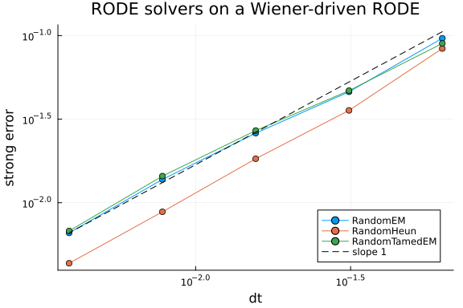
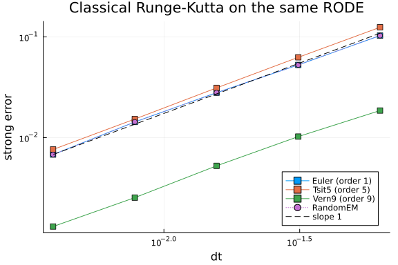
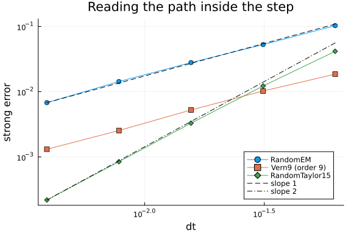
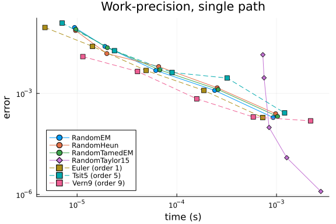

A random ordinary differential equation (RODE) is an ODE whose right-hand side is driven by a
stochastic process sampled pathwise,

$$\frac{du}{dt} = f(u, t, W(t)),$$

with $W$ a Wiener path supplied to the solver. Because each realisation of $W$ is a fixed
function of time, a RODE is a genuine ODE for that realisation, and it is tempting to hand it
to a high-order ODE integrator and expect the usual rate.

That expectation is wrong, and it is wrong in a way that is cheap to measure. A Wiener path is
nowhere differentiable, so the right-hand side is only Hölder-$1/2$ continuous in $t$ and the
Taylor expansion a classical Runge-Kutta method relies on does not exist. Grüne and Kloeden
showed the resulting order loss ([BIT 41, 2001](https://doi.org/10.1023/A:1021995918864)).
Kloeden and Rosa later proved that the Euler scheme still converges with strong order $1$ for
semimartingale noise ([arXiv:2306.15418](https://arxiv.org/abs/2306.15418), ESAIM: M2AN 59,
2025), where the Hölder exponent alone would suggest $1/2$.

This page measures both halves of that statement: the rate the dedicated RODE solvers reach,
and the rate a nominally 5th and 9th order ODE method reaches on the same problem. It then
measures a method that does get past order 1, by using the path between the step endpoints.

```julia
using StochasticDiffEq, DiffEqNoiseProcess, OrdinaryDiffEqLowOrderRK, OrdinaryDiffEqTsit5,
      OrdinaryDiffEqVerner, BenchmarkTools, Plots, Random, Statistics, Printf
gr()

const SEED = 20260921
const TEND = 1.0
const FINE = 2^18
const FDT = TEND / FINE
const GRID = collect(range(0.0, TEND; length = FINE + 1))
const STEPS = [16, 32, 64, 128, 256]
const WP_STEPS = [16, 64, 256, 1024, 4096]
const PATHS = 256
```

```
256
```


## Test problem

The problem is scalar and linear in $u$, which is what makes an accurate reference available:

$$\frac{du}{dt} = -u \cos(5 W(t)), \qquad u(0) = 1,$$

whose solution is $u(t) = \exp\left(-\int_0^t \cos(5W(s))\,ds\right)$. The path is stored on
a fine grid, and every solver below sees it as the piecewise linear function through those
points: the RODE solvers through `NoiseGrid`, the ODE solvers through the interpolant `make_W`.
On each grid interval the integral of $\cos(5W)$ then has a closed form, so the reference is
exact for that path up to rounding and no measured error below is limited by it.

```julia
wiener_path(rng) = (W = zeros(FINE + 1); W[2:end] .= cumsum(sqrt(FDT) .* randn(rng, FINE)); W)

function exact_solution(path)
    u = ones(length(path)); acc = 0.0
    @inbounds for k in 1:(length(path) - 1)
        a = 5 * path[k]; b = 5 * path[k + 1]
        acc += abs(b - a) < 1.0e-8 ? FDT * cos((a + b) / 2) : FDT * (sin(b) - sin(a)) / (b - a)
        u[k + 1] = exp(-acc)
    end
    return u
end

function fitted_slope(ns, errs)
    x = log2.(1 ./ ns); y = log2.(errs); n = length(x)
    return (n * sum(x .* y) - sum(x) * sum(y)) / (n * sum(x .^ 2) - sum(x)^2)
end

rode_f(u, p, t, W) = -u * cos(5W)

# W(t) by linear interpolation of the stored path, the way a practitioner hands a
# sampled path to an ODE solver
function make_W(path)
    return function (t)
        s = t / FDT
        i = clamp(floor(Int, s), 0, FINE - 1)
        theta = s - i
        return (1 - theta) * path[i + 1] + theta * path[i + 2]
    end
end
```

```
make_W (generic function with 1 method)
```


## Strong convergence of the RODE solvers

`RandomEM`, `RandomHeun` and `RandomTamedEM` read $W$ at the step endpoints only. They are
measured against the exact pathwise solution, the error being the maximum over the saved steps,
reported as a root-mean-square over independent paths.

```julia
function strong_errors(solve_one)
    rng = MersenneTwister(SEED)
    E = zeros(PATHS, length(STEPS))
    for m in 1:PATHS
        path = wiener_path(rng)
        exact = exact_solution(path)
        for (j, n) in enumerate(STEPS)
            u = solve_one(path, n)
            stride = FINE ÷ n
            E[m, j] = maximum(abs(u[k + 1] - exact[k * stride + 1]) for k in 0:n)
        end
    end
    return [sqrt(mean(E[:, j] .^ 2)) for j in eachindex(STEPS)]
end

rode_solver(alg) = (path, n) -> solve(
    RODEProblem{false}(rode_f, 1.0, (0.0, TEND), noise = NoiseGrid(GRID, path)),
    alg, dt = TEND / n, adaptive = false, save_everystep = true).u

rode_algs = ["RandomEM" => RandomEM(), "RandomHeun" => RandomHeun(),
             "RandomTamedEM" => RandomTamedEM()]
rode_results = Dict(name => strong_errors(rode_solver(alg)) for (name, alg) in rode_algs)

for (name, _) in rode_algs
    errs = rode_results[name]
    @printf("%-16s slope %.3f   error at dt=1/256 %.3g\n", name,
            fitted_slope(STEPS, errs), errs[end])
end
```

```
RandomEM         slope 0.973   error at dt=1/256 0.0068
RandomHeun       slope 0.973   error at dt=1/256 0.00478
RandomTamedEM    slope 0.954   error at dt=1/256 0.00711
```


All three sit at order 1. `RandomHeun` costs a second right-hand side evaluation per step and
does not convert it into a rate, for the same reason the classical methods below do not: the
second stage is an expansion the path does not support.

```julia
dts = TEND ./ STEPS
plt = plot(xscale = :log10, yscale = :log10, xlabel = "dt", ylabel = "strong error",
           title = "RODE solvers on a Wiener-driven RODE", legend = :bottomright)
for (name, _) in rode_algs
    plot!(plt, dts, rode_results[name], marker = :circle, label = name)
end
plot!(plt, dts, dts .* (rode_results["RandomEM"][end] / dts[end]),
      linestyle = :dash, color = :black, label = "slope 1")
plt
```




## The same problem given to classical ODE solvers

Now the identical path is handed to `Euler`, `Tsit5` and `Vern9` as an ODE whose right-hand
side happens to call `W(t)`. The solver steps are far coarser than the grid the path is stored
on, so the path is fully resolved beneath every step; nothing here is a sampling artefact.

```julia
ode_solver(alg) = function (path, n)
    Wf = make_W(path)
    odef(u, p, t) = -u * cos(5 * Wf(t))
    return solve(ODEProblem(odef, 1.0, (0.0, TEND)), alg,
                 dt = TEND / n, adaptive = false, save_everystep = true).u
end

ode_algs = ["Euler (order 1)" => Euler(), "Tsit5 (order 5)" => Tsit5(),
            "Vern9 (order 9)" => Vern9()]
ode_results = Dict(name => strong_errors(ode_solver(alg)) for (name, alg) in ode_algs)

for (name, _) in ode_algs
    errs = ode_results[name]
    @printf("%-16s slope %.3f   error at dt=1/256 %.3g\n", name,
            fitted_slope(STEPS, errs), errs[end])
end

@printf("\nmax |Euler - RandomEM| over the step counts: %.3g\n",
        maximum(abs, ode_results["Euler (order 1)"] .- rode_results["RandomEM"]))
```

```
Euler (order 1)  slope 0.973   error at dt=1/256 0.0068
Tsit5 (order 5)  slope 1.009   error at dt=1/256 0.00764
Vern9 (order 9)  slope 0.966   error at dt=1/256 0.00131

max |Euler - RandomEM| over the step counts: 6.94e-18
```


Nominal orders 1, 5 and 9 all measure close to 1. `Vern9` buys a smaller constant and no rate;
`Tsit5` spends six stages per step to land beside `Euler`. `Euler` on the interpolated path
agrees with `RandomEM` to rounding error, printed above, which is the expected identity: at
order 1 the two formulations coincide.

```julia
plt = plot(xscale = :log10, yscale = :log10, xlabel = "dt", ylabel = "strong error",
           title = "Classical Runge-Kutta on the same RODE", legend = :bottomright)
for (name, _) in ode_algs
    plot!(plt, dts, ode_results[name], marker = :square, label = name)
end
plot!(plt, dts, rode_results["RandomEM"], marker = :circle, linestyle = :dot,
      label = "RandomEM")
plot!(plt, dts, dts .* (ode_results["Euler (order 1)"][end] / dts[end]),
      linestyle = :dash, color = :black, label = "slope 1")
plt
```




## Using the path between the step endpoints

Every method so far reads $W$ at points and treats the path between them as if it were smooth.
Getting past order 1 requires the step to use what the path does between its endpoints, through
integrals such as $\int_t^{t+h}(W_s - W_t)\,ds$, which are not functions of the increment
alone. `RandomTaylor15` does this. It is a derivative-free form of the order 1.5 RODE-Taylor
scheme (Han and Kloeden, *Random Ordinary Differential Equations and Their Numerical Solution*,
Springer 2017, Chapter 12) that computes those integrals from the grid points of the stored
path inside each step, so it needs the path on a grid finer than the solver steps, as it is
here.

```julia
taylor_algs = ["RandomTaylor15" => RandomTaylor15()]
taylor_results = Dict(name => strong_errors(rode_solver(alg)) for (name, alg) in taylor_algs)

for (name, _) in taylor_algs
    errs = taylor_results[name]
    @printf("%-16s slope %.3f   error at dt=1/256 %.3g\n", name,
            fitted_slope(STEPS, errs), errs[end])
end
@printf("\nRandomEM error / RandomTaylor15 error at dt=1/256: %.0f\n",
        rode_results["RandomEM"][end] / taylor_results["RandomTaylor15"][end])
```

```
RandomTaylor15   slope 1.900   error at dt=1/256 0.000219

RandomEM error / RandomTaylor15 error at dt=1/256: 31
```


```julia
plt = plot(xscale = :log10, yscale = :log10, xlabel = "dt", ylabel = "strong error",
           title = "Reading the path inside the step", legend = :bottomright)
plot!(plt, dts, rode_results["RandomEM"], marker = :circle, label = "RandomEM")
plot!(plt, dts, ode_results["Vern9 (order 9)"], marker = :square, label = "Vern9 (order 9)")
plot!(plt, dts, taylor_results["RandomTaylor15"], marker = :diamond, label = "RandomTaylor15")
plot!(plt, dts, dts .* (rode_results["RandomEM"][end] / dts[end]),
      linestyle = :dash, color = :black, label = "slope 1")
plot!(plt, dts, dts .^ 2 .* (taylor_results["RandomTaylor15"][end] / dts[end]^2),
      linestyle = :dashdot, color = :black, label = "slope 2")
plt
```




`RandomTaylor15` measures close to order 2, with four right-hand side evaluations per step. That is half
an order above the pathwise order 1.5 of the scheme, the same gain that takes the Euler scheme
from pathwise order $1/2$ to strong order 1. `Vern9` starts ahead on its smaller constant and is
overtaken within the range shown, since its error only falls at order 1.

## Work-precision

Rate is not the whole story: a method with the same rate and a smaller constant can still be
the right choice, and a higher rate has to pay for what it costs per step. This measures error
against wall-clock time for one path. Each problem is built once, outside the timer, and the
time is the minimum over BenchmarkTools samples. The RODE solvers read the path from a
`NoiseGrid` of $2^{18}$ points; with DiffEqNoiseProcess 5.36.4, which this page pins, a solve
shares that grid rather than copying it, so the times of the three order-1 RODE solvers reflect
stepping and not the length of the stored path.

`RandomTaylor15` is different by construction. Its step integrals use every stored point of the
path, so each solve reads all $2^{18}$ points once whatever the step size, and that sets a floor
under its time. The step counts here therefore run to 4096, further than in the convergence
studies, so that the order-1 methods spend comparable time.

```julia
rode_problem(alg) = path -> (
    RODEProblem{false}(rode_f, 1.0, (0.0, TEND), noise = NoiseGrid(GRID, path)), alg)
ode_problem(alg) = function (path)
    Wf = make_W(path)
    odef(u, p, t) = -u * cos(5 * Wf(t))
    return ODEProblem(odef, 1.0, (0.0, TEND)), alg
end

function timed_errors(build)
    rng = MersenneTwister(SEED)
    path = wiener_path(rng)
    exact = exact_solution(path)
    errs = zeros(length(WP_STEPS)); times = zeros(length(WP_STEPS))
    for (j, n) in enumerate(WP_STEPS)
        prob, alg = build(path)
        dt = TEND / n
        u = solve(prob, alg, dt = dt, adaptive = false, save_everystep = true).u
        times[j] = @belapsed solve($prob, $alg, dt = $dt, adaptive = false,
                                   save_everystep = true) seconds = 1
        stride = FINE ÷ n
        errs[j] = maximum(abs(u[k + 1] - exact[k * stride + 1]) for k in 0:n)
    end
    return errs, times
end

wp = Dict{String, Tuple{Vector{Float64}, Vector{Float64}}}()
for (name, alg) in vcat(rode_algs, taylor_algs)
    wp[name] = timed_errors(rode_problem(alg))
end
for (name, alg) in ode_algs
    wp[name] = timed_errors(ode_problem(alg))
end

for (j, n) in enumerate(WP_STEPS)
    @printf("\ndt = 1/%d\n%-16s %-10s %-10s\n", n, "method", "time (s)", "error")
    for (name, _) in vcat(rode_algs, taylor_algs, ode_algs)
        @printf("%-16s %-10.3g %-10.3g\n", name, wp[name][2][j], wp[name][1][j])
    end
end

plt = plot(xscale = :log10, yscale = :log10, xlabel = "time (s)", ylabel = "error",
           title = "Work-precision, single path", legend = :bottomleft)
for (name, _) in rode_algs
    plot!(plt, wp[name][2], wp[name][1], marker = :circle, label = name)
end
for (name, _) in taylor_algs
    plot!(plt, wp[name][2], wp[name][1], marker = :diamond, label = name)
end
for (name, _) in ode_algs
    plot!(plt, wp[name][2], wp[name][1], marker = :square, linestyle = :dash, label = name)
end
plt
```

```
dt = 1/16
method           time (s)   error     
RandomEM         9.43e-06   0.091     
RandomHeun       9.65e-06   0.0736    
RandomTamedEM    9.72e-06   0.0802    
RandomTaylor15   0.000729   0.0141    
Euler (order 1)  4.76e-06   0.091     
Tsit5 (order 5)  7.07e-06   0.123     
Vern9 (order 9)  1.14e-05   0.0124    

dt = 1/64
method           time (s)   error     
RandomEM         1.9e-05    0.025     
RandomHeun       1.99e-05   0.0152    
RandomTamedEM    2.01e-05   0.0229    
RandomTaylor15   0.00075    0.00291   
Euler (order 1)  1.43e-05   0.025     
Tsit5 (order 5)  2.37e-05   0.0186    
Vern9 (order 9)  4.04e-05   0.0045    

dt = 1/256
method           time (s)   error     
RandomEM         6.16e-05   0.0048    
RandomHeun       6.58e-05   0.00627   
RandomTamedEM    6.75e-05   0.00499   
RandomTaylor15   0.000842   9.74e-05  
Euler (order 1)  4.91e-05   0.0048    
Tsit5 (order 5)  8.96e-05   0.0042    
Vern9 (order 9)  0.000159   0.000693  

dt = 1/1024
method           time (s)   error     
RandomEM         0.00024    0.00123   
RandomHeun       0.000254   0.00147   
RandomTamedEM    0.00026    0.0013    
RandomTaylor15   0.00127    1.23e-05  
Euler (order 1)  0.000187   0.00123   
Tsit5 (order 5)  0.000319   0.00287   
Vern9 (order 9)  0.000585   0.0002    

dt = 1/4096
method           time (s)   error     
RandomEM         0.000925   0.000192  
RandomHeun       0.00098    0.000249  
RandomTamedEM    0.00102    0.000207  
RandomTaylor15   0.00278    1.22e-06  
Euler (order 1)  0.000727   0.000192  
Tsit5 (order 5)  0.00121    0.000264  
Vern9 (order 9)  0.0022     0.000153
```





Below its floor `RandomTaylor15` is not an option, and for coarse answers the order-1 methods
are cheaper. By `dt = 1/4096` they cost about as much as `RandomTaylor15` does at `dt = 1/1024`,
and its error there is below all of theirs; from that point on each halving of the step divides
its error by four and theirs by two.

## What this means for choosing a solver

Throwing classical order at a RODE does not raise the rate. The three classical tableaus
measured here, of nominal order 1, 5 and 9, all land at order 1 alongside `RandomEM`,
`RandomHeun` and `RandomTamedEM`, and the differences between those six are constants:
evaluating $W$ at more points inside the step did not raise the rate for any of them.

Getting past order 1 takes a step that uses the path *between* its endpoints, and that needs
the path on a grid finer than the solver steps, which is the case in most applications where
the noise is measured data or generated once at high resolution. `RandomTaylor15` gets close to
order 2 that way. Its price is a time floor proportional to the length of the stored path, so
it is the method to use when the error wanted is below what the order-1 methods reach in that
time, as the tables above show, and `RandomEM` or `Vern9` remain cheaper for coarse answers.


## Appendix

These benchmarks are a part of the SciMLBenchmarks.jl repository, found at: [https://github.com/SciML/SciMLBenchmarks.jl](https://github.com/SciML/SciMLBenchmarks.jl). For more information on high-performance scientific machine learning, check out the SciML Open Source Software Organization [https://sciml.ai](https://sciml.ai).

To locally run this benchmark, do the following commands:
```
using SciMLBenchmarks
SciMLBenchmarks.weave_file("benchmarks/RODE","rode_convergence.jmd")
```

Computer Information:

```
Julia Version 1.12.7
Commit 6d172b025e4 (2026-08-15 08:05 UTC)
Build Info:
  Official https://julialang.org release
Platform Info:
  OS: Linux (x86_64-linux-gnu)
  CPU: 128 × AMD EPYC 7502 32-Core Processor
  WORD_SIZE: 64
  LLVM: libLLVM-18.1.7 (ORCJIT, znver2)
  GC: Built with stock GC
Threads: 128 default, 1 interactive, 128 GC (on 128 virtual cores)
Environment:
  JULIA_NUM_THREADS = auto

```

Package Information:

```
Status `/julia/github-runners/amdci1-1/_work/SciMLBenchmarks.jl/SciMLBenchmarks.jl/benchmarks/RODE/Project.toml`
  [6e4b80f9] BenchmarkTools v1.8.0
  [77a26b50] DiffEqNoiseProcess v5.36.4
  [1344f307] OrdinaryDiffEqLowOrderRK v2.2.6
  [b1df2697] OrdinaryDiffEqTsit5 v2.1.5
  [79d7bb75] OrdinaryDiffEqVerner v2.4.2
  [91a5bcdd] Plots v1.41.7
  [31c91b34] SciMLBenchmarks v0.2.1 [loaded: `/julia/github-runners/amdci1-1/_work/SciMLBenchmarks.jl/SciMLBenchmarks.jl/src/SciMLBenchmarks.jl` (v0.2.1) expected `/home/crackauc/.julia/packages/SciMLBenchmarks/ceJyd/src/SciMLBenchmarks.jl` (v0.2.1)]
  [10745b16] Statistics v1.11.5
  [789caeaf] StochasticDiffEq v7.2.0
  [49714585] StochasticDiffEqRODE v2.2.0
  [de0858da] Printf v1.11.0
  [9a3f8284] Random v1.11.0
```

And the full manifest:

```
Status `/julia/github-runners/amdci1-1/_work/SciMLBenchmarks.jl/SciMLBenchmarks.jl/benchmarks/RODE/Manifest.toml`
  [47edcb42] ADTypes v1.24.0
  [14f7f29c] AMD v0.5.4
  [7d9f7c33] Accessors v0.1.45
⌃ [79e6a3ab] Adapt v4.7.1
  [66dad0bd] AliasTables v1.1.3
  [ec485272] ArnoldiMethod v0.4.0
  [4fba245c] ArrayInterface v7.30.2
  [6e4b80f9] BenchmarkTools v1.8.0
  [b2a6c25c] BinaryHeaps v1.1.0
  [70df07ce] BracketingNonlinearSolve v1.12.8
  [35d6a980] ColorSchemes v3.31.0
  [3da002f7] ColorTypes v0.12.3
  [c3611d14] ColorVectorSpace v0.11.0
  [5ae59095] Colors v0.13.2
  [38540f10] CommonSolve v0.2.14
  [bbf7d656] CommonSubexpressions v0.3.1
  [34da2185] Compat v4.18.1
  [a33af91c] CompositionsBase v0.1.2
  [2569d6c7] ConcreteStructs v0.2.8
  [187b0558] ConstructionBase v1.6.0
  [d38c429a] Contour v0.6.3
  [a8cc5b0e] Crayons v4.2.0
  [9a962f9c] DataAPI v1.16.0
  [a93c6f00] DataFrames v1.8.2
  [864edb3b] DataStructures v0.19.6
  [e2d170a0] DataValueInterfaces v1.0.0
  [8bb1440f] DelimitedFiles v1.9.1
  [2b5f629d] DiffEqBase v7.21.3
  [459566f4] DiffEqCallbacks v4.19.4
  [77a26b50] DiffEqNoiseProcess v5.36.4
  [163ba53b] DiffResults v1.1.0
  [b552c78f] DiffRules v1.16.0
  [a0c0ee7d] DifferentiationInterface v0.7.21
  [31c24e10] Distributions v0.25.131
  [ffbed154] DocStringExtensions v0.9.5
  [4e289a0a] EnumX v1.0.7
⌃ [f151be2c] EnzymeCore v0.8.21
  [e2ba6199] ExprTools v0.1.11
  [c87230d0] FFMPEG v0.4.6
  [7034ab61] FastBroadcast v1.4.0
  [9aa1b823] FastClosures v0.3.2
  [a4df4552] FastPower v1.5.0
⌃ [1a297f60] FillArrays v1.17.1
  [64ca27bc] FindFirstFunctions v3.4.0
  [6a86dc24] FiniteDiff v2.33.0
⌅ [53c48c17] FixedPointNumbers v0.8.6
  [1fa38f19] Format v1.3.7
  [f6369f11] ForwardDiff v1.4.6
  [069b7b12] FunctionWrappers v1.1.3
  [77dc65aa] FunctionWrappersWrappers v1.13.0
  [46192b85] GPUArraysCore v0.2.1
  [28b8d3ca] GR v0.73.27
  [a0844989] Gamma v1.2.0
  [86223c79] Graphs v1.15.0
⌅ [eafb193a] Highlights v0.5.3
  [34004b35] HypergeometricFunctions v0.3.30
  [d25df0c9] Inflate v0.1.5
⌅ [842dd82b] InlineStrings v1.4.6
  [3587e190] InverseFunctions v0.1.17
  [41ab1584] InvertedIndices v1.3.1
  [92d709cd] IrrationalConstants v0.2.6
  [82899510] IteratorInterfaceExtensions v1.0.0
  [1019f520] JLFzf v0.1.11
  [692b3bcd] JLLWrappers v1.8.0
⌅ [682c06a0] JSON v0.21.4
  [ccbc3e58] JumpProcesses v9.33.1
⌃ [ba0b0d4f] Krylov v0.10.10
  [2faa5264] LHLFactorization v2.2.2
  [b964fa9f] LaTeXStrings v1.4.1
  [23fbe1c1] Latexify v0.16.12
  [87fe0de2] LineSearch v0.1.19
  [7ed4a6bd] LinearSolve v5.18.2
  [2ab3a3ac] LogExpFunctions v1.0.2
  [e6f89c97] LoggingExtras v1.2.0
  [1914dd2f] MacroTools v0.5.16
  [bb5d69b7] MaybeInplace v0.1.8
  [442fdcdd] Measures v0.3.3
  [e1d29d7a] Missings v1.2.0
  [46d2c3a1] MuladdMacro v0.2.7
  [ffc61752] Mustache v1.1.0
  [77ba4419] NaNMath v1.1.4
  [8913a72c] NonlinearSolve v4.32.0
  [be0214bd] NonlinearSolveBase v2.54.1
  [5959db7a] NonlinearSolveFirstOrder v2.10.0
  [9a2c21bd] NonlinearSolveQuasiNewton v1.15.3
  [26075421] NonlinearSolveSpectralMethods v1.8.3
⌃ [bac558e1] OrderedCollections v2.0.1 [loaded: v2.0.2]
  [bbf590c4] OrdinaryDiffEqCore v4.18.1
  [4302a76b] OrdinaryDiffEqDifferentiation v3.12.4
  [1344f307] OrdinaryDiffEqLowOrderRK v2.2.6
  [127b3ac7] OrdinaryDiffEqNonlinearSolve v2.9.9
  [b1df2697] OrdinaryDiffEqTsit5 v2.1.5
  [79d7bb75] OrdinaryDiffEqVerner v2.4.2
  [90014a1f] PDMats v0.11.41
⌅ [69de0a69] Parsers v2.8.8
  [ccf2f8ad] PlotThemes v3.3.0
⌃ [995b91a9] PlotUtils v1.5.0
  [91a5bcdd] Plots v1.41.7
  [e409e4f3] PoissonRandom v0.4.13
  [2dfb63ee] PooledArrays v1.4.3
  [d236fae5] PreallocationTools v1.7.1
  [aea7be01] PrecompileTools v1.3.4
  [21216c6a] Preferences v1.6.0
  [08abe8d2] PrettyTables v3.5.0
  [43287f4e] PtrArrays v1.4.0
  [0c0d3e7f] PureKLU v1.6.0
  [1fd47b50] QuadGK v2.11.3
  [3cdcf5f2] RecipesBase v1.4.0
  [01d81517] RecipesPipeline v0.6.12
  [731186ca] RecursiveArrayTools v4.5.3
  [189a3867] Reexport v1.2.2
  [05181044] RelocatableFolders v1.0.1
  [ae029012] Requires v1.3.1
  [ae5879a3] ResettableStacks v1.4.0
  [9fe22ead] RespecializeParams v1.3.0
  [79098fc4] Rmath v0.9.0
⌃ [f2b01f46] Roots v3.0.9
  [7e49a35a] RuntimeGeneratedFunctions v0.5.27
  [0bca4576] SciMLBase v3.57.0
  [31c91b34] SciMLBenchmarks v0.2.1 [loaded: `/julia/github-runners/amdci1-1/_work/SciMLBenchmarks.jl/SciMLBenchmarks.jl/src/SciMLBenchmarks.jl` (v0.2.1) expected `/home/crackauc/.julia/packages/SciMLBenchmarks/ceJyd/src/SciMLBenchmarks.jl` (v0.2.1)]
  [19f34311] SciMLJacobianOperators v0.1.19
  [a6db7da4] SciMLLogging v2.1.0
  [c0aeaf25] SciMLOperators v1.30.2
  [431bcebd] SciMLPublic v1.3.0
  [53ae85a6] SciMLStructures v1.10.5
  [6c6a2e73] Scratch v1.3.0
  [91c51154] SentinelArrays v1.4.10
  [efcf1570] Setfield v1.1.2
  [992d4aef] Showoff v1.1.1
  [727e6d20] SimpleNonlinearSolve v2.14.6
  [699a6c99] SimpleTraits v0.9.6
  [ed01d8cd] Sobol v1.5.0
  [a2af1166] SortingAlgorithms v1.2.3
  [a57abbd0] SparseColumnPivotedQR v2.1.8
  [0a514795] SparseMatrixColorings v0.4.28
  [276daf66] SpecialFunctions v2.9.0
⌃ [90137ffa] StaticArrays v1.9.22
  [1e83bf80] StaticArraysCore v1.4.4
  [10745b16] Statistics v1.11.5
  [82ae8749] StatsAPI v1.8.0
  [2913bbd2] StatsBase v0.34.13
  [4c63d2b9] StatsFuns v2.2.1
  [789caeaf] StochasticDiffEq v7.2.0
  [19c5a474] StochasticDiffEqCore v2.2.3
  [0520c28c] StochasticDiffEqHighOrder v2.2.0
  [ebf54054] StochasticDiffEqIIF v2.1.0
  [5080b986] StochasticDiffEqImplicit v2.2.1
  [aefaaa88] StochasticDiffEqLeaping v2.1.0
  [90dbc90e] StochasticDiffEqLevyArea v2.1.1
  [d15fe365] StochasticDiffEqLowOrder v2.0.5
  [8c95a807] StochasticDiffEqMilstein v2.1.1
  [db241ea8] StochasticDiffEqROCK v2.1.1
  [49714585] StochasticDiffEqRODE v2.2.0
  [af2a2fcd] StochasticDiffEqWeak v2.2.1
  [69024149] StringEncodings v0.3.7
  [892a3eda] StringManipulation v0.6.1
  [2efcf032] SymbolicIndexingInterface v0.3.55
  [3783bdb8] TableTraits v1.0.1
  [bd369af6] Tables v1.14.0
  [62fd8b95] TensorCore v0.1.1
  [a759f4b9] TimerOutputs v1.2.2
  [781d530d] TruncatedStacktraces v1.4.0
  [1cfade01] UnicodeFun v0.4.1
  [41fe7b60] Unzip v0.2.0
  [44d3d7a6] Weave v0.10.12
  [ddb6d928] YAML v0.4.17
  [6e34b625] Bzip2_jll v1.0.9+0
  [83423d85] Cairo_jll v1.18.8+0
  [ee1fde0b] Dbus_jll v1.16.2+0
  [2702e6a9] EpollShim_jll v0.0.20230411+1
  [2e619515] Expat_jll v2.8.4+0
  [b22a6f82] FFMPEG_jll v9.0.2+0
  [a3f928ae] Fontconfig_jll v2.17.1+0
  [d7e528f0] FreeType2_jll v2.14.3+1
  [559328eb] FriBidi_jll v1.0.17+0
  [0656b61e] GLFW_jll v3.5.1+0
  [d2c73de3] GR_jll v0.73.27+0
⌅ [b0724c58] GettextRuntime_jll v0.22.4+0
  [61579ee1] Ghostscript_jll v9.55.1+0
  [7746bdde] Glib_jll v2.88.3+0
  [3b182d85] Graphite2_jll v1.3.16+0
  [2e76f6c2] HarfBuzz_jll v100.14004.0+0
  [1d5cc7b8] IntelOpenMP_jll v2025.2.0+0
  [aacddb02] JpegTurbo_jll v3.2.0+1
  [c1c5ebd0] LAME_jll v3.100.3+0
  [88015f11] LERC_jll v4.2.0+0
  [1d63c593] LLVMOpenMP_jll v23.1.1+0
⌅ [e9f186c6] Libffi_jll v3.4.7+0
  [7e76a0d4] Libglvnd_jll v1.7.1+1
  [94ce4f54] Libiconv_jll v1.18.0+0
  [4b2f31a3] Libmount_jll v2.42.0+0
  [89763e89] Libtiff_jll v4.7.3+0
  [38a345b3] Libuuid_jll v2.42.0+0
  [856f044c] MKL_jll v2025.2.0+0
  [e7412a2a] Ogg_jll v1.3.6+0
  [efe28fd5] OpenSpecFun_jll v0.5.6+0
  [91d4177d] Opus_jll v1.6.1+0
  [36c8627f] Pango_jll v1.58.2+0
  [30392449] Pixman_jll v0.46.4+0
  [c0090381] Qt6Base_jll v6.10.2+2
  [629bc702] Qt6Declarative_jll v6.10.2+2
  [ce943373] Qt6ShaderTools_jll v6.10.2+1
  [6de9746b] Qt6Svg_jll v6.10.2+0
  [e99dba38] Qt6Wayland_jll v6.10.2+1
  [f50d1b31] Rmath_jll v0.5.2+0
  [a44049a8] Vulkan_Loader_jll v1.3.243+0
  [a2964d1f] Wayland_jll v1.24.0+0
  [ffd25f8a] XZ_jll v5.8.4+0
  [f67eecfb] Xorg_libICE_jll v1.1.2+0
  [c834827a] Xorg_libSM_jll v1.2.6+0
  [4f6342f7] Xorg_libX11_jll v1.8.13+0
  [0c0b7dd1] Xorg_libXau_jll v1.0.13+0
  [935fb764] Xorg_libXcursor_jll v1.2.4+0
  [a3789734] Xorg_libXdmcp_jll v1.1.6+0
  [1082639a] Xorg_libXext_jll v1.3.8+0
  [d091e8ba] Xorg_libXfixes_jll v6.0.2+0
  [a51aa0fd] Xorg_libXi_jll v1.8.4+0
  [d1454406] Xorg_libXinerama_jll v1.1.7+0
  [ec84b674] Xorg_libXrandr_jll v1.5.6+0
  [ea2f1a96] Xorg_libXrender_jll v0.9.12+0
  [a65dc6b1] Xorg_libpciaccess_jll v0.19.0+0
  [c7cfdc94] Xorg_libxcb_jll v1.17.1+0
  [cc61e674] Xorg_libxkbfile_jll v1.2.0+0
  [e920d4aa] Xorg_xcb_util_cursor_jll v0.1.6+0
  [12413925] Xorg_xcb_util_image_jll v0.4.1+0
  [2def613f] Xorg_xcb_util_jll v0.4.1+0
  [975044d2] Xorg_xcb_util_keysyms_jll v0.4.1+0
  [0d47668e] Xorg_xcb_util_renderutil_jll v0.3.10+0
  [c22f9ab0] Xorg_xcb_util_wm_jll v0.4.2+0
  [35661453] Xorg_xkbcomp_jll v1.4.7+0
  [33bec58e] Xorg_xkeyboard_config_jll v2.47.0+2
  [c5fb5394] Xorg_xtrans_jll v1.6.0+0
  [3161d3a3] Zstd_jll v1.5.7+1
  [35ca27e7] eudev_jll v3.2.14+0
⌅ [214eeab7] fzf_jll v0.61.1+0
  [a4ae2306] libaom_jll v3.15.1+0
  [0ac62f75] libass_jll v0.17.5+0
  [1183f4f0] libdecor_jll v0.2.2+0
  [8e53e030] libdrm_jll v2.4.134+0
  [2db6ffa8] libevdev_jll v1.13.4+0
  [f638f0a6] libfdk_aac_jll v2.0.4+0
  [36db933b] libinput_jll v1.28.1+0
⌃ [b53b4c65] libpng_jll v1.6.59+0
  [9a156e7d] libva_jll v2.23.0+0
  [f27f6e37] libvorbis_jll v1.3.8+0
  [009596ad] mtdev_jll v1.1.7+0
⌃ [1317d2d5] oneTBB_jll v2022.3.0+0
⌅ [1270edf5] x264_jll v10164.0.1+0
  [dfaa095f] x265_jll v4.1.0+0
  [d8fb68d0] xkbcommon_jll v1.13.0+0
  [0dad84c5] ArgTools v1.1.2
  [56f22d72] Artifacts v1.11.0
  [2a0f44e3] Base64 v1.11.0
  [ade2ca70] Dates v1.11.0
  [8ba89e20] Distributed v1.11.0
  [f43a241f] Downloads v1.7.0
  [7b1f6079] FileWatching v1.11.0
  [9fa8497b] Future v1.11.0
  [b77e0a4c] InteractiveUtils v1.11.0
  [ac6e5ff7] JuliaSyntaxHighlighting v1.12.0
  [4af54fe1] LazyArtifacts v1.11.0
  [b27032c2] LibCURL v0.6.4
  [76f85450] LibGit2 v1.11.0
  [8f399da3] Libdl v1.11.0
  [37e2e46d] LinearAlgebra v1.12.0
  [56ddb016] Logging v1.11.0
  [d6f4376e] Markdown v1.11.0
  [a63ad114] Mmap v1.11.0
  [ca575930] NetworkOptions v1.3.0
  [44cfe95a] Pkg v1.12.1
  [de0858da] Printf v1.11.0
  [9abbd945] Profile v1.11.0
  [3fa0cd96] REPL v1.11.0
  [9a3f8284] Random v1.11.0
  [ea8e919c] SHA v0.7.0
  [9e88b42a] Serialization v1.11.0
  [6462fe0b] Sockets v1.11.0
  [2f01184e] SparseArrays v1.12.0
  [f489334b] StyledStrings v1.11.0
  [4607b0f0] SuiteSparse
  [fa267f1f] TOML v1.0.3
  [a4e569a6] Tar v1.10.0
  [8dfed614] Test v1.11.0
  [cf7118a7] UUIDs v1.11.0
  [4ec0a83e] Unicode v1.11.0
  [e66e0078] CompilerSupportLibraries_jll v1.3.1+2
  [deac9b47] LibCURL_jll v8.15.0+0
  [e37daf67] LibGit2_jll v1.9.0+0
  [29816b5a] LibSSH2_jll v1.11.3+1
  [14a3606d] MozillaCACerts_jll v2025.11.4
  [4536629a] OpenBLAS_jll v0.3.29+0
  [05823500] OpenLibm_jll v0.8.7+0
  [458c3c95] OpenSSL_jll v3.5.6+0
  [efcefdf7] PCRE2_jll v10.44.0+1
  [bea87d4a] SuiteSparse_jll v7.8.3+2
  [83775a58] Zlib_jll v1.3.1+2
  [8e850b90] libblastrampoline_jll v5.15.0+0
  [8e850ede] nghttp2_jll v1.64.0+1
  [3f19e933] p7zip_jll v17.7.0+0
Info Packages marked with ⌃ and ⌅ have new versions available. Those with ⌃ may be upgradable, but those with ⌅ are restricted by compatibility constraints from upgrading. To see why use `status --outdated -m`
```

